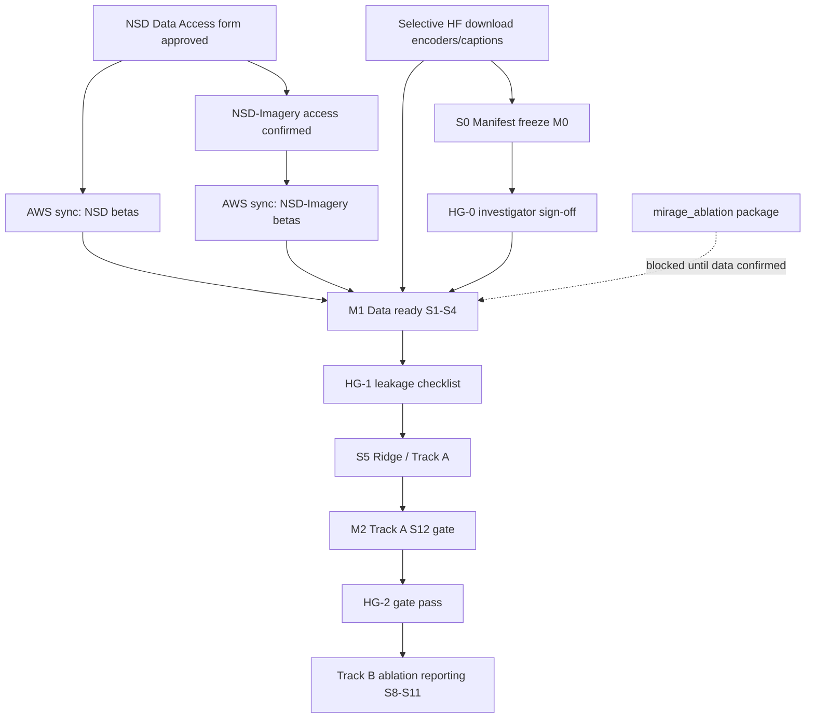

# Data and Compute Prerequisites

**Study:** Perception-to-Imagery Latent-Target Ablation (Option 3 — Dual-Track Hybrid)  
**Date:** 2026-09-10  
**Status:** CSF bootstrap complete (2026-10-05); NSD DUA confirmed (2026-10-21); scratch sync + S0 not started  
**Execution plan:** `docs/workflow_stages/execution_plans/2026-09-10-perception-imagery-latent-ablation-execution-plan.md`

This document clarifies what must be downloaded, from where, and what compute is required **before** GPU training or large Hugging Face syncs. It addresses the common confusion between the MIRAGE README's ~300 GB Hugging Face bundle and the actual NSD/NSD-Imagery neuroimaging requirements for this study.

---

## Two data sources and their roles

This study depends on **two independent data sources**. Neither replaces the other.

### Source A — Official NSD + NSD-Imagery (primary neuroimaging)

| Item | Detail |
| ---- | ------ |
| **What** | GLMsingle v3 beta maps, BIDS/NIfTI structure, session manifests, stimulus metadata |
| **Where** | AWS S3 bucket `natural-scenes-dataset` (region `us-east-2`) |
| **Access** | **Two separate applications** — see [How to get the data](https://cvnlab.slite.page/p/dC~rBTjqjb/How-to-get-the-data) |
| **Role in pipeline** | S1–S2 ingestion; S4 split construction; S5–S7 ridge fit and OOD latent inference |
| **Subjects required** | All 8 subjects for ingest; test subjects $\{1,2,5,7\}$; tuning subjects $\{3,4,6,8\}$ |

**NSD core (perception training):**

- GLMsingle v3 betas at 1.8 mm in `nsdgeneral` mask (beta version 2: `betas_fithrf`)
- Session/run manifests for subjects 1–8
- Stimulus metadata (COCO image IDs, `shared1000` lists)

**NSD-Imagery (OOD test):**

- Dedicated imagery-session betas for all 8 subjects
- 18 imagery stimuli + 12 vision stimuli (vision runs supplementary only)
- Separate data-access acknowledgement via [naturalscenesdataset.org](https://naturalscenesdataset.org/)

**What you do NOT need from NSD:**

- 1 mm functional preparations (`func1mm`)
- MNI-space versions
- Beta version 1 (`betas_assumehrf`) or version 3 (`betas_fithrf_GLMdenoise_RR`)
- Raw NIfTI beta archives when `.npy` or HDF5 preparations exist
- Full raw timeseries (unless debugging eyetracking)

The NSD manual (received after form approval) is authoritative for exact file paths. The AWS CLI example below follows the [official NSD access page](https://cvnlab.slite.page/p/dC~rBTjqjb/How-to-get-the-data).

### Where is NSD-Imagery? (same bucket — not a separate download site)

NSD-Imagery is **not** a second S3 bucket or a hidden form. It lives inside the same `natural-scenes-dataset` bucket as core NSD:

| Content | S3 prefix |
| ------- | --------- |
| **Imagery-session GLMsingle betas** (all 8 subjects) | `nsddata_betas/ppdata/subj{01..08}/func1pt8mm/nsdimagerybetas_fithrf/` |
| Stimulus metadata, design matrices, cue lists | `nsddata/experiments/nsdimagery/` |
| Raw target images (simple/complex sets) | `nsddata/experiments/nsdimagery/rawtargetimages/` |

Per subject, imagery betas are **~1.3–1.6 GB** (8 files; key file: `betas_nsdimagery.hdf5`). All 8 subjects ≈ **12 GB total** — this fits on a laptop.

The [NSD-Imagery paper](https://arxiv.org/html/2506.06898v1) states access instructions are at [naturalscenesdataset.org](https://naturalscenesdataset.org/) — meaning the **same NSD Data Access Agreement** covers both; the Data Manual documents the `nsdimagery` paths above.

### AWS CLI setup (this machine)

AWS CLI v2 is installed at `~/.local/bin/aws`. If `aws` is not found in a new terminal, add to `~/.zshrc`:

```bash
export PATH="$HOME/.local/bin:$PATH"
```

Then open a new terminal tab (or run `source ~/.zshrc`). No AWS account is required — use `--no-sign-request` for public bucket reads.

Verify:

```bash
aws --version
aws s3 ls s3://natural-scenes-dataset/ --no-sign-request
```

Agents and scripts in this project should prepend `$HOME/.local/bin` to `PATH` when invoking `aws`.

### Disk space reality check (this machine)

**Available space (2026-09-12): ~68 GB free.**

| Dataset slice | Approx. size (8 subjects) | Fits 68 GB? |
| ------------- | ------------------------- | ----------- |
| NSD-Imagery betas (`nsdimagerybetas_fithrf/`) | ~12 GB | **Yes** |
| NSD experiment manifests + ROI masks (`nsddata/experiments/nsd`, `nsddata/ppdata/*/func1pt8mm/roi/`) | $<$1 GB | **Yes** |
| NSD-Imagery metadata (`nsddata/experiments/nsdimagery/`) | $<$50 MB | **Yes** |
| MIRAGE HF weights (selective) | ~20–30 GB | **Tight** |
| **NSD core perception betas** (`betas_fithrf/`, all sessions, all 8 subjects) | **~400–520 GB** | **No** |

**Implication:** this laptop cannot hold the full NSD perception training set alongside model weights. Options:

1. **External drive** (recommended for local work) — sync perception betas there; symlink or set `data/raw/nsd/` to the drive.
2. **University HPC / cloud** — keep betas on cluster storage; run S1–S6 there.
3. **Per-subject rolling download** — sync one subject at a time (~45–65 GB each), preprocess to masked `.npy`, delete raw session files before next subject (requires careful pipeline discipline).

**Minimum to unblock M0 (manifests only):** sync `nsddata/experiments/nsd`, `nsddata/experiments/nsdimagery`, and ROI masks — under 1 GB. No perception betas required yet.

### Source B — MIRAGE Hugging Face artifacts (frozen weights and precomputes)

| Item | Detail |
| ---- | ------ |
| **Repos** | [`pscotti/mindeyev2`](https://huggingface.co/datasets/pscotti/mindeyev2); [`reesekneeland/MIRAGE`](https://huggingface.co/datasets/reesekneeland/MIRAGE) |
| **Upstream reference** | [MedARC-AI/MIRAGE README](https://github.com/MedARC-AI/MIRAGE) |
| **Role in pipeline** | S3 target preparation (frozen encoder outputs); S9 diffusion (Stable Cascade, VDVAE); HC-08 fixed LLaVA captions |
| **Critical distinction** | The README warns that cloning both repos wholesale downloads **>300 GB**. This study requires **selective** artifacts only. |

**Required (selective download):**

| Artifact class | Purpose | Approx. scale |
| -------------- | ------- | ------------- |
| Stable Cascade checkpoints | S9 image synthesis (HC-02) | ~10–15 GB |
| VDVAE weights | Low-level latent path | ~1 GB (`imagenet64` EMA checkpoint) |
| CLIP checkpoints | ViT-L/14, ViT-bigG/14 frozen encoders | ~5–10 GB |
| LLaVA v1.5-13B captions (MIRAGE artifacts) | S3 ridge targets; HC-08 | Repo-dependent; caption files only |
| Precomputed training-image targets (if available) | Avoid re-encoding millions of NSD images | Subset of `mindeyev2`; not full `train_logs` |
| Retrieval module weights | S7–S9 retrieval path | Checkpoint files only |

**Explicitly NOT required for MVP:**

| Excluded artifact | Reason |
| ----------------- | ------ |
| Full `train_logs/` from Hugging Face | MindEye2 training artefacts; not used (HC-01 ridge only) |
| All brain-activity preparations | Only GLMsingle v3 betas from **official NSD S3** are authoritative |
| Duplicate COCO image corpora | Use NSD stimulus images or targeted COCO subsets for overlap audit |
| MLP / diffusion-prior backbone checkpoints | Out of scope (HC-01) |
| Full `git clone` of both HF datasets | README default; use `snapshot_download` with `allow_patterns` |

**Selective download pattern (example):**

```python
from huggingface_hub import snapshot_download, hf_hub_download

# Example: captions and checkpoint shards only — edit allow_patterns per milestone checklist
snapshot_download(
    repo_id="reesekneeland/MIRAGE",
    repo_type="dataset",
    allow_patterns=["*caption*", "*stable*", "*clip*", "*.json"],
    local_dir="data/frozen_weights/mirage_hf",
    local_dir_use_symlinks=False,
)
```

Inspect repo file trees on Hugging Face before syncing; pin exact filenames in `manifests/model_weights_manifest.json` at S0.4.

---

## Minimal download checklist by milestone

### M0 — Manifest frozen (S0)

**Goal:** Populate and freeze test manifest, overlap audit, distractor catalogues, and model-weights manifest. **No model fitting.**

| Source | Required now? | Artifacts |
| ------ | ------------- | --------- |
| NSD | **Partial** — session manifests, COCO ID lists, `shared1000` metadata | Stimulus overlap audit inputs (S0.2) |
| NSD-Imagery | **Yes** — stimulus documentation (18 definitions) | `manifests/nsd_imagery_test_manifest_v1.json` |
| MIRAGE HF | **Partial** — CLIP ViT-L/14 for semantic-neighbour audit ($\geq 0.85$ threshold) | Encoder weights only; no diffusion |
| MIRAGE HF | **Partial** — LLaVA caption files for conceptual lemma holdout | Caption JSON/parquet per HC-08 |

**Estimated download (M0):** $<$5 GB if manifests and audit encoders only.

**Overlap audit vs MIRAGE (HG-0):** Setting A uses the same training mask as [MIRAGE `load_nsd`](https://github.com/MedARC-AI/MIRAGE/blob/main/src/utils.py) (`shared1000=False` rows in `nsd_stim_info_merged.csv`). Non-zero `exact_seen` on some subjects can match that mask; confirm with `python scripts/compare_mirage_training_split.py --write-audit` (`mirage_split_verification.all_subjects_agree`). Strict holdout for ablations is **Setting B**, not a change to the S12 reproduction split.

**Blocks:** HG-0 (manifest freeze) → unblocks S1 and Track A environment setup.

### M1 — Data ready (S1–S4)

**Goal:** Ingested betas, preprocessed masked vectors, frozen training targets, train/tune split indices for Setting A.

| Source | Required now? | Artifacts |
| ------ | ------------- | --------- |
| NSD S3 | **Yes** — GLMsingle v3 betas, subjects 1–8, sessions 1–40 | `data/raw/nsd/`, `data/processed/betas/` |
| NSD-Imagery S3 | **Yes** — imagery + vision session betas | `data/raw/nsd_imagery/` |
| MIRAGE HF | **Yes** — full frozen encoder stack for S3 | VDVAE, CLIP (both ViTs), Stable Cascade stage weights |
| MIRAGE HF | **Yes** — LLaVA captions for all perception-training images | `data/processed/targets/` inputs |
| mindeyev2 HF | **Optional** — precomputed embedding caches | Skip if regenerating from official NSD images |

**Estimated download (M1):** ~50–120 GB (dominated by NSD betas for 8 subjects + encoder weights; **not** the full 300 GB HF bundle).

**Perception betas on CSF (Tier 3):** Submit `scripts/csf/sync_m1_perception_subj.sbatch` **once per subject** (`SUBJ=01`…`08`) on the **`serial`** partition (default in the jobscript). This is S3 I/O only; **`multicore` queue wait can be multi-day** when the cluster is busy. See `docs/CSF/csf-environment.md` § M1 perception beta sync.

**Blocks:** HG-1 (leakage checklist) → unblocks S5 ridge training and Track A.

### M2 — Track A gate pass (TA.1–TA.5)

**Goal:** S12 reproduction gate — `combined`, Setting A, subjects $\{1,2,5,7\}$.

| Source | Additional beyond M1? | Artifacts |
| ------ | --------------------- | --------- |
| NSD / NSD-Imagery | No new neuroimaging if M1 complete | — |
| MIRAGE HF | Stable Cascade + retrieval module if not fetched at M1 | S9 inference path for Track A notebooks |
| MIRAGE GitHub | Notebook source + `src/setup.sh` env | `track_a/` vendored notebooks |

**Compute (not storage):** Ridge training on CPU with high RAM; GPU for Track A imagery inference and reconstruction eval.

**Blocks:** HG-2 (S12 gate) → unblocks Track B S8–S11 **reporting** (S5–S7 may proceed in parallel per execution plan, but ablation narrative remains blocked).

---

## Compute requirements

Reference: Kneeland et al., MIRAGE (PLoS Comput Biol 2026) — ridge training on hardware with **512 GB RAM**; inference on **NVIDIA A100 40 GB VRAM**.

| Stage | Hardware | RAM / VRAM | Duration guidance | Notes |
| ----- | -------- | ---------- | ----------------- | ----- |
| S0 manifest population | CPU | $<$16 GB | Hours | CLIP encoding for overlap audit |
| S1–S2 ingest + preprocess | CPU | 32–64 GB | 1–2 days (8 subjects) | I/O bound; parallelise per subject |
| S3 target preparation | GPU preferred | 24–40 GB VRAM | 1–3 days | Frozen encoder forward passes; cache to disk |
| S5 ridge fit (per subject × condition) | CPU (preferred for parity) | **Up to 512 GB** recommended | Hours–days per head | Paper spec; batching may reduce peak RAM |
| S6 $\lambda$ tuning | CPU + GPU | As S5 + S7 proxy | 1–2 days per condition | Grid $\{10^3,\ldots,10^7\}$ per active head |
| S7 OOD latent decode | GPU | 24–40 GB | Hours | 216 cells ($4 \times 18 \times 3$ conditions) |
| S8 decoder metrics | CPU | $<$32 GB | Hours | No diffusion (HC-10) |
| **S9 diffusion** | **GPU** | **$\geq$40 GB VRAM (A100 class)** | **Dominant cost** | **6480 runs** — see below |
| S10 reconstruction metrics | CPU/GPU | 16–24 GB | Hours | CLIP, SSIM, PixCorr |
| S11 statistics | CPU | $<$16 GB | Hours | 10 000 permutations |
| Track A notebooks | GPU + high-RAM CPU | 512 GB RAM + A100 40 GB | Multi-day | Same as MIRAGE paper |

### S9 scale: 6480 diffusion runs

$$
N_{\text{S9}} = 4 \times 18 \times 3 \times 3 \times 10 = 6480
$$

| Factor | Value |
| ------ | ----- |
| Test subjects | 4 |
| Imagery stimuli | 18 |
| Ablation conditions | 3 (`image_only`, `text_only`, `combined`) |
| Random seeds | 3 ($\{42, 123, 456\}$) |
| Reconstructions per seed | 10 |

**Planning estimate:** At ~2–5 min per diffusion sample (hardware dependent), S9 alone is **9–27 GPU-days** sequential, reducible via parallel jobs across (condition $\times$ subject $\times$ seed). Track A gate requires only the `combined` condition ($4 \times 18 \times 3 \times 10 = 2160$ runs).

### Practical compute options

| Option | Pros | Cons |
| ------ | ---- | ---- |
| Local workstation (high-RAM CPU + A100) | Full control; reproducibility | Upfront hardware cost |
| University HPC | Batch scheduling; large RAM nodes | Queue wait; env pinning |
| AWS EC2 (`p4d` / `p5` + `r6id` memory instances) | On-demand; NSD S3 colocation | Cost monitoring required |

Pipeline preference PF-02: CPU ridge is acceptable if numerically identical to the MIRAGE reference (verify via `parity/coefficient_diff.py`, tolerance $\leq 10^{-6}$).

---

## Dependency graph: what blocks what



| Gate | Prerequisite | Unblocks |
| ---- | ------------ | -------- |
| Data access (NSD) | Signed NSD Data Access Agreement | NSD S3 sync; S1 perception ingest |
| Data access (NSD-Imagery) | Separate acknowledgement per NSD-Imagery release | Imagery beta ingest; OOD test trials |
| M0 / HG-0 | Manifests hashed and committed | S1, Track A env verification |
| M1 / HG-1 | Leakage checklist 12/12 | S5, Track A ridge training |
| M2 / HG-2 | `gate_report.json` exit 0 | Track B S8–S11 reporting |
| Package implementation | Data paths verified on disk | `mirage_ablation/` CLIs (deferred this kickoff) |

**Current focus (2026-10-21):** Data access and CSF tooling are ready (`docs/CSF/csf-environment.md`). **Next:** sync M0-sized metadata to scratch, implement S0 scripts, populate manifests (HG-0), then M1 betas and selective HF weights. No full ~300 GB HF bundle. GPU training remains after M0/M1.

---

## Staged investigator action list

### Phase 0 — Access (do first; no downloads)

- [ ] **0.1** Complete [NSD Data Access Agreement](https://naturalscenesdataset.org/) (Terms and Conditions + form)
- [ ] **0.2** Receive NSD Data Manual; confirm GLMsingle v3 beta paths for subjects 1–8
- [ ] **0.3** Confirm NSD Data Manual documents `nsdimagery` paths (same agreement as core NSD — no separate imagery form)
- [ ] **0.3b** Add `export PATH="$HOME/.local/bin:$PATH"` to `~/.zshrc` if `aws` not found in new terminals
- [ ] **0.3c** Decide storage strategy for ~400+ GB perception betas (external drive vs HPC vs rolling per-subject)
- [ ] **0.4** Record approval dates and data version in `runs/registry.yaml`
- [ ] **0.5** Clone [MedARC-AI/MIRAGE](https://github.com/MedARC-AI/MIRAGE) for Track A notebook reference only (no HF bulk download)

### Phase 1 — Minimal NSD sync (after 0.1–0.3 approved)

Replace `/path/to/local/` with project paths (e.g. `data/raw/nsd/`). Always run with `--dryrun` first.

**Tier 1 — M0 manifests only (~1 GB; safe on laptop):**

```bash
export PATH="$HOME/.local/bin:$PATH"
PROJECT="/Users/absjames/Documents/UoM/Year 3/3rd Yr Project/3rd-yr-project"

aws s3 sync --dryrun --no-sign-request \
  s3://natural-scenes-dataset/nsddata/experiments/nsd \
  "$PROJECT/data/raw/nsd/experiments/nsd"

aws s3 sync --dryrun --no-sign-request \
  s3://natural-scenes-dataset/nsddata/experiments/nsdimagery \
  "$PROJECT/data/raw/nsd_imagery/experiments/nsdimagery"

# ROI masks (nsdgeneral) — all 8 subjects, tiny
for s in 01 02 03 04 05 06 07 08; do
  aws s3 sync --dryrun --no-sign-request \
    s3://natural-scenes-dataset/nsddata/ppdata/subj${s}/func1pt8mm/roi/ \
    "$PROJECT/data/raw/nsd/ppdata/subj${s}/func1pt8mm/roi/"
done
```

**Tier 2 — NSD-Imagery betas (~12 GB; fits laptop):**

```bash
for s in 01 02 03 04 05 06 07 08; do
  aws s3 sync --dryrun --no-sign-request \
    s3://natural-scenes-dataset/nsddata_betas/ppdata/subj${s}/func1pt8mm/nsdimagerybetas_fithrf/ \
    "$PROJECT/data/raw/nsd_imagery/betas/subj${s}/func1pt8mm/nsdimagerybetas_fithrf/"
done
```

**Tier 3 — NSD core perception betas (~400–520 GB; requires external drive or HPC):**

```bash
# Point NSD_DATA to external volume, NOT laptop root
NSD_DATA="/Volumes/YourExternalDrive/nsd"

aws s3 sync --dryrun --no-sign-request \
  s3://natural-scenes-dataset/nsddata_betas/ppdata/ \
  "$NSD_DATA/nsddata_betas/ppdata/" \
  --exclude "*func1mm*" \
  --exclude "*MNI*" \
  --exclude "*betas_assumehrf*" \
  --exclude "*betas_fithrf_GLMdenoise_RR*" \
  --exclude "*nsdimagery*" \
  --exclude "*nsdsynthetic*" \
  --exclude "*resting*"
```

Prefer `betas_nsdimagery.hdf5` (HDF5) over `.nii.gz` for imagery; for core NSD, confirm beta version (`betas_fithrf` vs `betas_fithrf_GLMdenoise_RR`) against MIRAGE Track A notebooks before bulk sync.

- [ ] **1.1** Execute dry-run commands; verify subject count and beta version
- [ ] **1.2** Remove `--dryrun`; sync to `data/raw/nsd/` and `data/raw/nsd_imagery/`
- [ ] **1.3** Log sync commands, timestamps, and byte counts in `runs/execution_log.md`

### Phase 2 — Selective Hugging Face sync (after Phase 1 paths confirmed)

- [ ] **2.1** Browse [`reesekneeland/MIRAGE`](https://huggingface.co/datasets/reesekneeland/MIRAGE/tree/main) and [`pscotti/mindeyev2`](https://huggingface.co/datasets/pscotti/mindeyev2) file trees
- [ ] **2.2** Download **only** files matching M0/M1 checklist (captions, Stable Cascade, VDVAE, CLIP, retrieval)
- [ ] **2.3** Download VDVAE from OpenAI public blob if not in HF repo:
  `wget https://openaipublic.blob.core.windows.net/very-deep-vaes-assets/vdvae-assets-2/imagenet64-iter-1600000-model-ema.th`
- [ ] **2.4** Record SHA-256 per checkpoint in `manifests/model_weights_manifest.json` (S0.4)
- [ ] **2.5** **Do not** clone full repos or sync `train_logs/`

### Phase 3 — Environment and manifest freeze (M0)

- [ ] **3.1** Run S0 manifest population (blocked until `mirage_ablation` package scaffold exists — next execution phase)
- [ ] **3.2** Investigator sign-off on manifest contents (HG-0) in `runs/execution_log.md`
- [ ] **3.3** Commit frozen manifests + `manifests/*.sha256`

### Phase 4 — Compute provisioning (before S5 / Track A training)

- [ ] **4.1** Reserve high-RAM node (target 512 GB) for ridge training
- [ ] **4.2** Reserve GPU node (A100 40 GB or equivalent) for Track A inference
- [ ] **4.3** Estimate S9 GPU budget: 6480 diffusion jobs for full Track B ablation
- [ ] **4.4** Pin environments: `configs/environments/track_a.lock`, `track_b.lock`

---

## Related documents

| Document | Path |
| -------- | ---- |
| Execution plan | `docs/workflow_stages/execution_plans/2026-09-10-perception-imagery-latent-ablation-execution-plan.md` |
| Execution log | `docs/workflow_stages/execution_plans/2026-09-10-perception-imagery-latent-ablation-execution-log.md` |
| Pipeline definition | `docs/workflow_stages/pipeline_definitions/2026-09-06-perception-imagery-latent-ablation-pipeline-definition.md` |
| Model design (Option 3) | `docs/workflow_stages/model_designs/2026-09-06-perception-imagery-latent-ablation-option-3.md` |
| Run registry | `runs/registry.yaml` |
