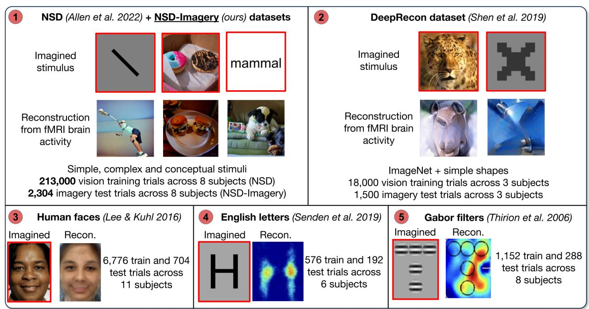
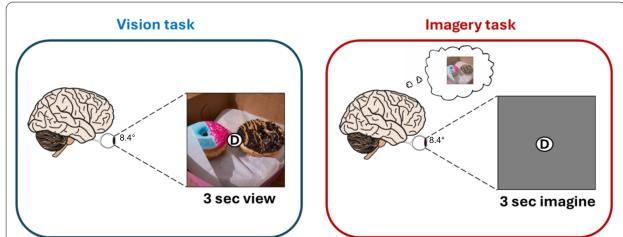
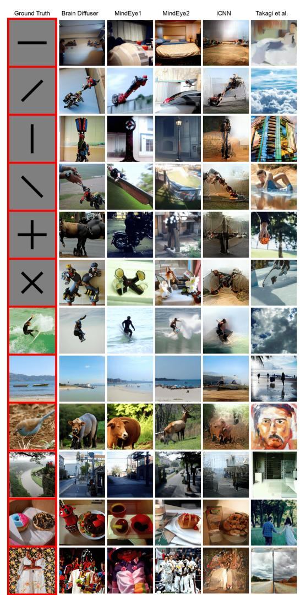
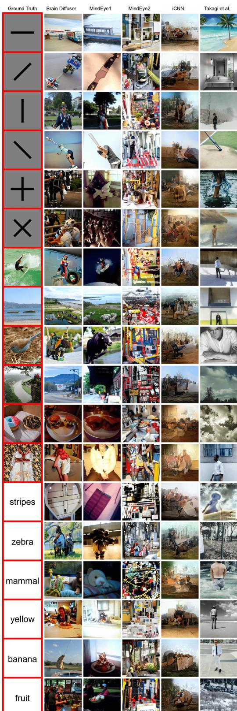
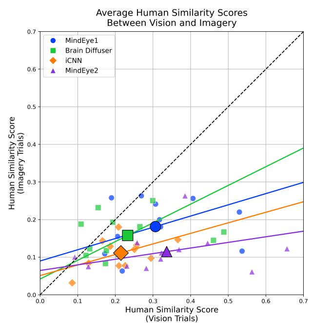
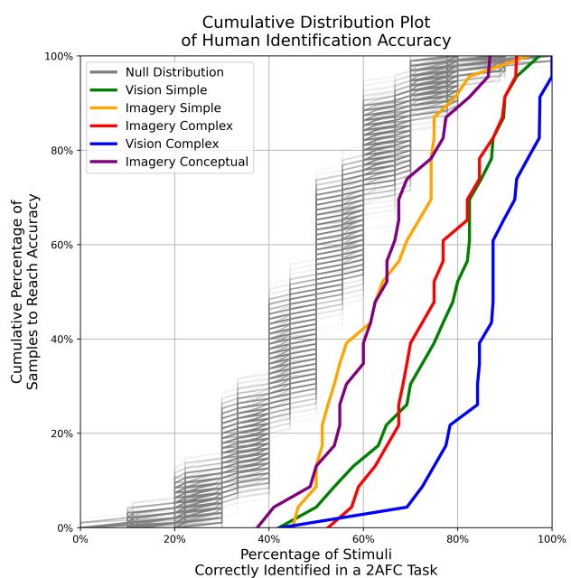

{0}------------------------------------------------

# NSD-Imagery: A benchmark dataset for extending fMRI vision decoding methods to mental imagery

Reese Kneeland1 2 Paul S. Scotti3 4 Ghislain St-Yves1 Jesse Breedlove1

Kendrick Kay1 Thomas Naselaris1

1University of Minnesota

2Alljoined

3 Princeton Neuroscience Institute

4 Formerly Stability AI/Medical AI Research Center (MedARC)

Correspondence to: nase0005@umn.edu

Figure 1. Overview of our dataset (NSD-Imagery) against previous imagery reconstruction datasets. 1: NSD [\[2\]](#page-8-0) and NSD-Imagery (ours), reconstructions of mental images are produced by Brain Diffuser [\[39\]](#page-9-0). 2: DeepRecon [\[54\]](#page-9-1), reconstructions of mental images produced by Koide-Majima et al. [\[28\]](#page-8-1). 3: Human faces (Lee and Kuhl [\[31\]](#page-9-2)). 4: English letters (Senden et al. [\[52\]](#page-9-3)), reconstructions produced by Goebel et al. [\[20\]](#page-8-2). 5: Gabor filters (Thirion et al. [\[65\]](#page-10-0)).

# Abstract

*We release NSD-Imagery, a benchmark dataset of human fMRI activity paired with mental images, to complement the existing Natural Scenes Dataset (NSD), a large-scale dataset of fMRI activity paired with seen images that enabled unprecedented improvements in fMRI-to-image reconstruction efforts. Recent models trained on NSD have been evaluated only on seen image reconstruction. Using NSD-Imagery, it is possible to assess how well these models perform on*

*mental image reconstruction. This is a challenging generalization requirement because mental images are encoded in human brain activity with relatively lower signal-to-noise and spatial resolution; however, generalization from seen to mental imagery is critical for real-world applications in medical domains and brain-computer interfaces, where the desired information is always internally generated. We provide benchmarks for a suite of recent NSD-trained opensource visual decoding models (MindEye1, MindEye2, Brain Diffuser, iCNN, Takagi et al.) on NSD-Imagery, and show*

{1}------------------------------------------------

*that the performance of decoding methods on mental images is largely decoupled from performance on vision reconstruction. We further demonstrate that architectural choices significantly impact cross-decoding performance: models employing simple linear decoding architectures and multimodal feature decoding generalize better to mental imagery, while complex architectures tend to overfit visual training data. Our findings indicate that mental imagery datasets are critical for the development of practical applications, and establish NSD-Imagery as a useful resource for better aligning visual decoding methods with this goal.*

### 1. Introduction

The ability to decode mental states from brain activity is a longstanding goal of neuroscience. Mental images–visual representations not driven by retinal input–are an especially appealing target for decoding since an externalized mental image could, in principle, depict information stored in brain activity patterns that is difficult or impossible to read out by other means (e.g., by speaking). Access to this information could help researchers better understand cognitive processes; it could also be useful in a clinical setting [\[42\]](#page-9-4), where millions of patients are left unable to communicate through conventional means as a result of traumatic brain injuries, and many common afflictions manifest as a profound dysregulation of unwanted or confusing mental imagery [\[22\]](#page-8-3).

Most previous attempts to classify, retrieve, or reconstruct mental images have used a cross-decoding approach in which an encoding or decoding model is trained on brain activity evoked by seen images and then tested on brain activity recorded during mental imagery [\[28,](#page-8-1) [54,](#page-9-1) [65\]](#page-10-0). This approach is strongly justified by basic neuroscience that has demonstrated the extensive overlap in the representation of seen and mental images [\[20,](#page-8-2) [29,](#page-9-5) [37,](#page-9-6) [45,](#page-9-7) [59\]](#page-10-1). Excitement about the prospects offered by cross-decoding approaches has increased significantly of late, due to the rapid and dramatic improvement in vision decoding methods (e.g., [\[49,](#page-9-8) [50\]](#page-9-9)).

It has been unclear if recently developed methods for decoding seen images might generalize to mental imagery, which is encoded in brain activity with much lower signalto-noise ratios than vision [\[47\]](#page-9-10) and at a lower spatial resolution in the early visual areas that represent much of the structural detail of seen images [\[3\]](#page-8-4). In particular, it is not known whether modern vision decoding methods can yield reconstructions that naive human observers would accurately identify as corresponding to the target images, a benchmark recently achieved by reconstructions of seen images [\[50\]](#page-9-9) and a minimum requirement for practical applications.

It has also been an open question whether the complexity of the imagined target stimuli might limit the quality of reconstructions of mental images. Although previous works (see Figure [1\)](#page-0-0) have demonstrated reconstructions of simple imagined stimuli such as blobs [\[65\]](#page-10-0), letters [\[20,](#page-8-2) [52\]](#page-9-3), and

single natural objects [\[28,](#page-8-1) [31,](#page-9-2) [54\]](#page-9-1), there is no precedent for reconstructing complex natural scenes with multiple objects. To address these gaps, we make three main contributions:

- 1. We release the benchmark dataset NSD-Imagery. This dataset is an extension to the Natural Scenes Dataset (NSD) [\[2\]](#page-8-0), which is a large-scale dataset of fMRI activity paired with seen images that is the current standard used to train brain-to-image reconstruction models [\[49,](#page-9-8) [50\]](#page-9-9). NSD-Imagery provides held-out test trials where the same NSD participants performed a mental imagery task across varying stimulus complexity, thereby allowing researchers to test the generalization capabilities of vision decoding methods trained on the core NSD data.
- 2. We demonstrate that while the reconstruction performance of *individual stimuli* is correlated between vision and mental imagery, *methods* with improved performance on vision decoding do not necessarily produce improved performance for mental imagery decoding—at least for the handful of high-performing vision reconstruction methods tested here—a finding with critical importance to efforts developing methods that perform well on downstream tasks requiring mental images.
- 3. We conduct extensive analyses using human raters and demonstrate that, despite the nuance in the previous point, some recent vision decoding methods do generalize to mental images, a promising finding that demonstrates the utility of using contemporary vision decoding models to improve reconstructions of mental images.

# 2. Related work

The open releases of deep learning models, such as CLIP [\[44\]](#page-9-11) and Stable Diffusion [\[46\]](#page-9-12), as well as large-scale fMRI datasets like NSD [\[2\]](#page-8-0) where tens of thousands of images were shown to human subjects, sparked a surge of research papers showing high-quality reconstructions of seen images from human brain activity [\[5,](#page-8-5) [6,](#page-8-6) [13,](#page-8-7) [14,](#page-8-8) [16,](#page-8-9) [25–](#page-8-10)[27,](#page-8-11) [35,](#page-9-13) [39,](#page-9-0) [40,](#page-9-14) [49,](#page-9-8) [60,](#page-10-2) [62,](#page-10-3) [63,](#page-10-4) [66,](#page-10-5) [69\]](#page-10-6). In contrast to earlier efforts [\[21,](#page-8-12) [23,](#page-8-13) [34,](#page-9-15) [36,](#page-9-16) [38,](#page-9-17) [51,](#page-9-18) [53,](#page-9-19) [54,](#page-9-1) [57\]](#page-10-7), these methods map fMRI brain activity patterns to embeddings of pretrained deep learning models that are used to drive a diffusion model [\[7,](#page-8-14) [43,](#page-9-20) [50,](#page-9-9) [70\]](#page-10-8) to generate image reconstructions of the content present in visual cortex.

Generalizing these vision decoding methods to mental imagery is challenging because of the many documented differences between vision and mental imagery in the human brain[\[32,](#page-9-21) [41\]](#page-9-22). When compared to vision, brain activity patterns measured during mental imagery have much lower signal-to-noise ratios (SNR) [\[47\]](#page-9-10), vary along fewer signal dimensions [\[48\]](#page-9-23), and encode imagined stimuli with expanded receptive fields and lower spatial frequency preferences, especially in early visual cortex [\[3\]](#page-8-4). These findings indicate that the spatial resolution of mental imagery is reduced [\[12\]](#page-8-15), and that reconstructions of mental images are likely to be less

{2}------------------------------------------------

structurally consistent than reconstructions of seen images [\[9\]](#page-8-16). Previous works have also shown differences between vision and imagery in functional connectivity [\[15\]](#page-8-17) and in temporal dynamics [\[10\]](#page-8-18).

Despite these challenges, previous studies have reported success at decoding mental imagery from human brain activity. Many fMRI studies have reported accurate n-way classification of mental images [\[1,](#page-8-19) [8,](#page-8-20) [32\]](#page-9-21). Accurate retrieval of mental images of natural scenes using a visual encoding model was first reported in Naselaris et al. [\[37\]](#page-9-6). A preliminary attempt at retrieval for mental images in the NSD-Imagery dataset was reported in St-Yves et al. [\[58\]](#page-10-9). To our knowledge, the first study to reconstruct mental images encoded in human brain activity measured with fMRI was Thirion et al. [\[65\]](#page-10-0), in which the imagined target stimuli were simple configurations of blobs. Subsequent studies reported mental imagery reconstructions using simple stimuli such as blobs, letters, or singular natural objects [\[20,](#page-8-2) [28,](#page-8-1) [31,](#page-9-2) [52,](#page-9-3) [54\]](#page-9-1).

Our work is distinguished from past work in the following ways: (1) we release a dataset that allows for cross-decoding mental images using NSD, the largest currently available vision dataset; (2) we study the generalization from perception to mental imagery of state-of-the-art (SOTA) vision reconstruction methods trained on NSD; (3) we directly compare the relative limitations of reconstructing stimuli of different distributions and levels of complexity; (4) we conduct large-scale tests of reconstruction quality with human raters; and (5) we quantify the correlation between the quality of seen image reconstructions and mental image reconstructions across stimuli and different reconstruction methods.

# 3. NSD-Imagery Dataset

The NSD-Imagery dataset extends NSD by incorporating a small set of 7T functional magnetic resonance imaging (fMRI) responses collected from the same subjects during mental imagery tasks. This enables the evaluation of vision decoding models on internally generated visual representations that are more relevant to future downstream use cases of brain decoding models. For this extension, all 8 participants from the original NSD study underwent an additional scanning session, following the same high-resolution fMRI acquisition protocols as NSD.

Figure 2. Overview of the tasks utilized for the NSD-Imagery benchmark.

Each participant completed runs of three task types (vi-

sion, imagery, and attention) performed with three sets of target stimuli (simple, complex, and conceptual), resulting in 9 distinct run types, of which the imagery runs were completed twice for a total of 12 runs. Each run contained 8 repetitions of the 6 stimuli in each set, for a total of 576 trials per subject. The vision and imagery tasks (Figure [2\)](#page-2-0) are the primary tasks utilized for the NSD-Imagery benchmark. The target stimuli were carefully designed to encompass varying levels of complexity:

- (A) *Simple stimuli*: Six simple geometric shapes–four oriented bars (0°, 45°, 90°, 135°) and two crosses ("+" and "×")–all constructed from black bars on a gray background.
- (B) *Complex stimuli*: Five natural scenes selected from the NSD shared1000 and one artwork ("The Two Sisters" by Kehinde Wiley). The natural scene images were chosen based on a recognizability score derived from participants' performance in the original NSD sessions, ensuring a range of familiarity and visual content.
- (C) *Conceptual stimuli*: Six single-word concepts describing abstract visual features or objects (e.g., stripes, banana, mammal), rather than specific images. The *vision* trials for conceptual stimuli showed varying images of natural scenes corresponding to the target concept for each trial. Since the value of decoding a trial-averaged response to multiple visual stimuli is not clear, we recommend excluding the vision trials of conceptual stimuli from evaluations on the benchmark, and we present results here only on the imagery trials of conceptual stimuli.

Each stimulus was associated with a unique single-letter cue, and participants memorized all 18 cue-stimulus pairs prior to scanning. Pre-scan practice sessions were conducted to ensure familiarity with the cues and stimuli, involving both visual presentations and verbal recall to reinforce memory.

In the *vision runs*, participants were presented with images accompanied by the corresponding letter cue displayed at the central fixation point. Each trial lasted 4 seconds, consisting of 3 seconds of image and cue presentation, followed by a 1-second rest period with only the fixation cross displayed. Participants indicated via button press whether the presented image matched the letter cue. Images were displayed within a square frame occupying 8.4° × 8.4° of the subject's field of view, consistent with NSD stimuli presentations.

In the *imagery runs*, participants were shown only the cue letter at the fixation point within the same frame used in vision runs, and were instructed to imagine the corresponding stimuli. Each trial also lasted 4 seconds, with 3 seconds allocated to vividly imagine the cued target stimulus, projecting the mental image onto the space outlined by the frame. This was followed by a 1-second rest period. Participants rated the vividness of their mental image via button press, pressing

{3}------------------------------------------------

one of two buttons to indicate "vivid" or "not vivid."

In the *attention runs*, participants were given a letter cue and asked to detect whether the cued stimulus was present in a series of rapidly presented images. While these runs are released as part of the NSD-Imagery dataset, their value for assessing vision reconstruction methods is unclear, and we recommend excluding these from evaluations on the NSD-Imagery benchmark. More information on NSD-Imagery and details on data preprocessing are in Appendix ??

#### 3.1. Dataset Release

Instructions for accessing the NSD-Imagery dataset can be found at [www.naturalscenesdataset.org.](www.naturalscenesdataset.org)

# 4. Results

# 4.1. Evaluation Methods

In this study, we test a suite of 5 fMRI-to-Image models, including Brain Diffuser [\[39\]](#page-9-0), MindEye1 [\[49\]](#page-9-8), MindEye2 [\[50\]](#page-9-9), iCNN [\[54\]](#page-9-1), and the +Decoded Text method proposed by Takagi et al. [\[62,](#page-10-3) [63\]](#page-10-4). We utilize the authors' open-source implementations for all vision decoding methods shown in this paper to generate reconstructions on NSD-Imagery. All reconstruction methods tested in this paper were trained exclusively on NSD [\[2\]](#page-8-0), the largest currently available neuroimaging dataset for vision. Only subjects 1, 2, 5, and 7 completed the full NSD experiment, so reconstruction methods generally train only on them. Stimulus images were sampled from the Common Objects in Context (COCO) database [\[33\]](#page-9-24) (CC BY 4.0), which contains a diverse set of complex natural scenes.

### 4.2. Reconstructions of seen images

The 5 selected decoding methods were first applied to the 12 stimuli available in the vision trials of the NSD-Imagery benchmark. 10 reconstructions were sampled from the posterior distribution of each method. Best-case reconstructions from each method can be seen in Figure [3.](#page-3-0) Median and worstcase reconstructions can be seen in Appendix ??. Complete quantitative results from all methods on the vision trials can be seen in the middle of Table [1.](#page-5-0)

In Figure [3,](#page-3-0) we observe reconstructions that appear qualitatively similar to the reconstructions reported in the original method publications. The NSD-Imagery dataset presents an interesting test of model generalization to new stimuli, as the simple stimuli are well outside the distribution of complex naturalistic images the models were trained on. The decoding models enforce this prior on the outputs, which produces simple stimuli reconstructions that are structurally coherent with the ground truth orientation, but with seemingly nonsensical semantic contents and fine details. While these out-of-distribution stimuli soften some recent criticisms of brain decoding models trained on NSD [\[55\]](#page-9-25), they

Figure 3. Qualitative comparison of reconstruction methods on *simple* and *complex stimuli* seen during vision. Reconstructions selected for the figure are the best samples for each method and stimuli as assessed by quantitative performance across all metrics in Table [1.](#page-5-0)

also illustrate the limitations of the training prior on the reconstruction process, as it can be difficult to generalize to out-of-distribution images and stimuli types. We note that out-of-distribution generalization is a topic that can be explored in greater detail using NSD-Synthetic [\[18\]](#page-8-21), a recently released NSD extension that includes responses to carefully controlled synthetic images.

### 4.3. Reconstructions of mental images

The 5 decoding methods were next applied to the 18 stimuli available in the mental imagery trials of the NSD-Imagery benchmark. 10 reconstructions were sampled from the posterior distribution of each method. Best-case reconstructions from each method can be seen in Figure [4.](#page-4-0) Median and worstcase reconstructions can be seen in Appendix ??. Complete

{4}------------------------------------------------

quantitative results from all methods on the mental imagery trials can be seen at the top of Table [1.](#page-5-0)

At a glance, several methods appear to generalize well to mental imagery, successfully reconstructing images that qualitatively reflect similar categories and themes for the *complex stimuli*, such as food, water sports, animals, and outdoor scenes. For *simple stimuli*, the overall structure and orientation of the ground truth images are largely preserved in the mental image reconstructions. The *conceptual stimuli* also produce interesting reconstructions, in many cases demonstrating noticeable correspondence to the target concept, although it is difficult to quantify accuracy for these stimuli, as there are no ground truth images, and the precise content of the subject's mental images is not known. Overall the reconstructions demonstrate substantial fidelity with respect to the content present in the ground truth images, and mark a major leap forward in mental image reconstruction compared to the current baseline introduced in Koide-Majima et al. [\[28\]](#page-8-1) (Figure [1\)](#page-0-0).

#### 4.4. Feature metric evaluations of reconstruction quality

Several reconstruction methods demonstrate promisingly robust quantitative outcomes when applied to mental images, with MindEye1 and Brain Diffuser standing out as the top performers. All the methods do show a drop in quantitative benchmarks when reconstructing mental images (Table [1,](#page-5-0) top) compared to the NSD-Imagery vision trials (Table [1,](#page-5-0) middle) and the test set from NSD (Table [1,](#page-5-0) bottom), an expected result given previous research demonstrating that brain activity responses to mental images have lower SNR and fewer dimensions of signal variance than vision [\[47,](#page-9-10) [48\]](#page-9-23). Interestingly, brain correlation scores in early visual cortex experience a much steeper drop than brain correlation scores in higher visual cortex, aligning with findings of broader receptive fields during imagery for voxels within early visual regions [\[3\]](#page-8-4). This drop in spatial resolution is also reflected in the low-level metrics–which generally privilege accurate structure–as they experience a larger drop than higher-level metrics that are more tuned to semantic qualities such as object class. All of the methods evaluated also observe a slight drop in quantitative metrics on the vision trials of NSD-Imagery (Table [1,](#page-5-0) bottom) compared to the test set from NSD, likely a result of the shift in image distribution for the simple stimuli.

# 4.5. Human ratings of reconstruction quality

To be useful for applications, users, scientists, and clinicians will need to draw meaningful interpretations from the outputs of mental imagery decoding methods. Thus, human judgments of the quality of mental image reconstructions are important metrics of performance. Although the image feature metrics discussed in Section [4.4](#page-4-1) may be a reasonable

Figure 4. Qualitative comparison of reconstruction methods on all 18 imagined stimuli from NSD-Imagery. Samples are selected the same way as Figure [3.](#page-3-0)

{5}------------------------------------------------

| Method   |                 | PixCorr | Low-Level ↑ SSIM | ↑ Alex(2) | ↑ Alex(5)   | High-Level ↑ Incep NSD-Imagery | ↑ CLIP Mental | ↑ Eff Imagery Trials | Distance ↓ SwAV | ↓ Early Vis. | Brain Correlation ↑ Higher Vis. | ↑ Visual Cortex ↑ |
|----------|-----------------|---------|------------------|-----------|-------------|--------------------------------|---------------|----------------------|-----------------|--------------|---------------------------------|-------------------|
| MindEye1 | [49]            | 0.086   | 0.349            | 59.56%    | 61.00%      | 52.03%                         | 54.72%        | 0.948                | 0.564           | 0.180        | 0.135                           | 0.155             |
| Brain    | Diffuser [39]   | 0.064   | 0.401            | 52.14%    | 58.35%      | 52.73%                         | 54.07%        | 0.935                | 0.585           | 0.133        | 0.127                           | 0.141             |
| iCNN     | [54]            | 0.108   | 0.340            | 50.57%    | 55.25%      | 49.39%                         | 41.72%        | 0.994                | 0.560           | 0.113        | 0.062                           | 0.113             |
| MindEye2 | [50]            | 0.036   | 0.414            | 47.60%    | 55.38%      | 46.02%                         | 50.78%        | 0.966                | 0.591           | 0.069        | 0.055                           | 0.061             |
| Takagi   | et al. [62, 63] | -0.006  | 0.455            | 41.88%    | 40.19%      | 43.26%                         | 40.08%        | 0.976                | 0.606           | 0.000        | 0.004                           | 0.000             |
|          |                 |         |                  |           | NSD-Imagery |                                | Vision        | Trials               |                 |              |                                 |                   |
| MindEye1 | [49]            | 0.218   | 0.412            | 73.56%    | 80.81%      | 62.44%                         | 65.34%        | 0.881                | 0.510           | 0.374        | 0.253                           | 0.311             |
| Brain    | Diffuser [39]   | 0.107   | 0.455            | 60.34%    | 72.84%      | 60.95%                         | 58.31%        | 0.908                | 0.555           | 0.247        | 0.229                           | 0.255             |
| iCNN     | [54]            | 0.224   | 0.385            | 71.67%    | 81.35%      | 61.16%                         | 49.03%        | 0.926                | 0.524           | 0.442        | 0.246                           | 0.338             |
| MindEye2 | [50]            | 0.161   | 0.480            | 70.10%    | 77.52%      | 62.69%                         | 65.93%        | 0.886                | 0.512           | 0.356        | 0.234                           | 0.290             |
| Takagi   | et al. [62, 63] | -0.013  | 0.412            | 41.55%    | 39.26%      | 39.26%                         | 43.01%        | 0.969                | 0.610           | -0.006       | 0.016                           | 0.009             |
|          |                 |         |                  |           | NSD         | Shared1000                     | Test          | Set                  |                 |              |                                 |                   |
| MindEye1 | [49]            | 0.319   | 0.360            |           |             |                                |               | 0.648                | 0.377           | 0.350        | 0.377                           | 0.378             |
| Brain    | Diffuser [39]   | 0.273   | 0.365            |           |             |                                |               | 0.728                | 0.421           | 0.353        | 0.375                           | 0.381             |
| iCNN     | [54]            | 0.321   | 0.336            |           |             |                                |               | 0.797                | 0.528           | 0.410        | 0.371                           | 0.395             |
| MindEye2 | [50]            | 0.322   | 0.431            |           |             |                                |               | 0.619                | 0.344           | 0.360        | 0.368                           | 0.373             |
| Takagi   | et al. [62, 63] | 0.246   | 0.410            |           |             |                                |               | 0.811                | 0.504           | 0.167        | 0.288                           | 0.247             |

Table 1. Quantitative comparison between reconstruction methods for NSD-Imagery using the simple and complex stimuli (Conceptual stimuli have no ground truth images). NSD Shared1000 test set results are reported at the bottom for comparison, with the exception of the 2-way comparison (2WC) metrics as these are not directly comparable to metrics on NSD-Imagery. PixCorr is the pixel-level correlation score. SSIM is the structural similarity index metric [\[68\]](#page-10-10). AlexNet(2) and AlexNet(5) are the 2WCs of layers 2 and 5 of AlexNet [\[30\]](#page-9-26). CLIP is the 2WC of the output layer of the ViT-L/14 CLIP-Vision model [\[44\]](#page-9-11). Inception is the 2WC of the last pooling layer of InceptionV3 [\[61\]](#page-10-11). EffNet-B and SwAV are distance metrics gathered from EfficientNet-B13 [\[64\]](#page-10-12) and SwAV-ResNet50 [\[4\]](#page-8-22) models. For EffNet-B and SwAV distances, lower is better, while higher is better for all other metrics. Bold indicates best performance, and underline second-best performance. Additional notes on the metrics used, including explanations of 2-way comparisons and brain correlation scores, are in Appendix ??. A breakdown of model performance across the different types of stimuli is in Appendix ??.

proxy for human judgment, numerous research efforts have established that these metrics do not always closely align with human subjective assessments of content [\[56\]](#page-10-13) or quality [\[24,](#page-8-23) [50\]](#page-9-9), and a small dataset like NSD-Imagery can be particularly susceptible to such volatility. In light of this, we conducted several online behavioral experiments in which human raters (n=500) assessed the quality of the reconstructions. For detailed experiment protocols see Appendix ??.

An initial image-identification experiment asked human raters to perform a two-alternative forced-choice judgment about whether a reconstruction was more similar to the ground truth image than a randomly selected reconstruction of a different stimulus within the same stimulus type. Results from this experiment (Table [2\)](#page-5-1) underscore promising generalizability for several vision decoding methods, notably MindEye1 and Brain Diffuser which produce strong accuracy rates for mental image reconstructions. We also note that MindEye2, the current SOTA vision decoding method, generalizes extremely poorly, producing near-chance performance. We hypothesize that this decoupling of vision and imagery decoding performance is a result of architectural design, discussed further in Section [5.](#page-7-0)

For us, the method from Takagi et al. underperforms on both the vision and imagery trials of NSD-Imagery, producing chance-level reconstructions as evaluated by both the

image feature metrics in Table [1](#page-5-0) and human raters in Table [2.](#page-5-1) For this reason, we have excluded it from further analyses.

| Method   |                 | Human All Stimuli NSD-Imagery | Identification ↑ Simple Mental | Accuracy ↑ Complex Imagery Trials | ↑ Conceptual ↑ |
|----------|-----------------|-------------------------------|--------------------------------|-----------------------------------|----------------|
| MindEye1 | [49]            | 73.00%                        | 71.01%                         | 82.28%                            | 65.68%         |
| Brain    | Diffuser [39]   | 73.95%                        | 68.20%                         | 82.70%                            | 71.01%         |
| iCNN     | [54]            | 66.15%                        | 66.81%                         | 70.04%                            | 61.60%         |
| MindEye2 | [50]            | 56.96%                        | 50.21%                         | 64.83%                            | 55.74%         |
| Takagi   | et al. [62, 63] | 52.89%                        | 57.26%                         | 48.31%                            | 53.14%         |
|          |                 | NSD-Imagery                   | Vision                         | Trials                            |                |
| MindEye1 | [49]            | 84.29%                        | 79.32%                         | 89.32%                            | N/A            |
| Brain    | Diffuser [39]   | 80.13%                        | 71.79%                         | 88.46%                            | N/A            |
| iCNN     | [54]            | 74.52%                        | 75.85%                         | 73.19%                            | N/A            |
| MindEye2 | [50]            | 83.05%                        | 75.54%                         | 90.56%                            | N/A            |
| Takagi   | et al. [62, 63] | 49.58%                        | 48.95%                         | 50.20%                            | N/A            |

Table 2. Human identification accuracy scores for the mental imagery and vision trials of the NSD-Imagery benchmark. Scores are provided for each method and stimulus type. The best value is bolded, and the second best is underlined. The chance threshold is 50%. P-values for Takagi et al. [\[62,](#page-10-3) [63\]](#page-10-4) are 0.891 for vision and 0.133 for imagery. P-values for all other methods are <0.001.

#### 4.6. Comparison of reconstruction quality for different stimulus types

To understand how reconstruction quality varies across inference modes, we calculated the cumulative distribu-

{6}------------------------------------------------

tion of human ratings from our first experiment (Figure [5\)](#page-6-0) by pooling across methods and conditioning on modality (vision/imagery) and stimulus complexity (simple/complex/conceptual). As anticipated, complex visual stimuli (blue line) yielded the strongest performance, reflecting the primary training scenario of these methods. Interestingly, under this rating method, reconstructions of *imagined* complex stimuli (natural scenes) have very similar assessments to, and in some cases outperform, reconstructions of *seen* simple stimuli (bars and crosses). We infer that the drop in performance for simple and conceptual stimuli is caused by their deviation from the distribution of the stimuli used for training, as well as the priors of the pre-trained diffusion model, which also carries a bias towards naturalistic stimuli. This suggests that decoding performance may be influenced by the consistency of training and test distributions and the priors of the pre-trained models more than by the decoded stimuli's inherent complexity (or other decoding challenges).

Figure 5. Cumulative distribution plot of human two-way identification accuracy across stimulus/modality types (line colors), collapsed across methods (excluding Takagi et al.). Data is from Table [2.](#page-5-1) The X-axis indicates intervals of human identification accuracy, and the Y-axis indicates the cumulative percentage of samples to meet the accuracy threshold at each interval. Less area under the curve is better. Null distribution is plotted in gray.

#### 4.7. Correlation between seen and mental image reconstruction quality

To obtain a direct comparison of the quality of matched seen and mental image reconstructions, we performed a second similarity-score experiment that presented human raters with a ground truth image, a reconstruction of that image from a vision trial, and a reconstruction of that image from an imagery trial, asking human raters to rate on a continuous

Figure 6. Human similarity score results for the simple and complex stimuli. The X-axis represents the similarity scores for the vision reconstruction, while the Y-axis represents the similarity scores for the imagery reconstruction. The average response scores for the 12 samples are plotted individually for each method, denoted with colors and shapes. The average score of all 12 samples is plotted with a larger bold point of the same shape and color. A larger slope for the color-coded fitted lines represents better generalization performance between the imagery and vision trials. The dashed line at unity represents equal performance between vision and imagery reconstructions.

scale how similar each reconstruction was to the ground truth image. We note that continuous similarity ratings like these can be extremely sensitive to the context of the samples being presented, and so while this experiment is useful for comparing the relative similarity between vision and imagery reconstructions, it is less informative of differences between decoding methods or other stimulus conditions.

We observe that these similarity scores of matched seen and mental image reconstructions (Figure [6\)](#page-6-1) were correlated across stimuli (MindEye1: r = 0.16, Brain Diffuser: r = 0.19, iCNN: r = 0.22, MindEye2: r = 0.13; p <0.001 for all methods, n = 480 for each method), but we note that not all methods were equally correlated. In particular, MindEye2 again produces significantly weaker correlations than the older MindEye1, Brain Diffuser, and iCNN models. The correlation between the similarity scores of vision and imagery reconstructions demonstrates that *specific stimuli* that reconstruct well for vision tend to also reconstruct well for imagery, allowing us to infer that improvements to decoders of seen images will likely translate to improvements in decoding matched mental images, although the *degree* to which these improvements translate appears to be heavily depen

{7}------------------------------------------------

dent on the specific architecture of the decoding model, and varies significantly between methods.

# 5. Discussion

We demonstrate the utility of the NSD-Imagery dataset in showing that, despite the massive loss of SNR during imagery relative to vision, several vision decoding methods based on recent advances in generative modeling robustly generalize to mental imagery without the need for domainspecific model training, and produce SOTA reconstructions of mental images. Previous SOTA reconstructions used the DeepRecon dataset, which faced fundamental limitations due to training data size (see Figure [1\)](#page-0-0). We hope our dataset will be useful to researchers training fMRI-to-Image models on NSD, enabling them to evaluate the generalizability of the models to out-of-distribution stimuli and mental images.

The fact that variation in the vision reconstruction performance across the small set of high-performing models tested here does not explain the variation in mental image reconstruction performance across this same set of models demonstrates that the best vision decoding models are not necessarily the best mental imagery decoding models. Specifically, we observe that the high-dimensional ViT-bigG image embeddings used to drive the SDXL unCLIP generator in MindEye2 tend to break down when decoded from mental images, which have brain activity responses of much lower SNR. We also observe that the Brain Diffuser method appears to be the best of all the methods tested in generalizing to mental images, and hypothesize that this is likely due to its simple and robust ridge regression backbone, as well as the multi-modal image and text features employed in the architecture. Further analysis to find the optimal decoding architectures for generalizing vision decoding models to mental images would be rich ground for future work.

Our results show that in some cases, decoding performance on mental imagery for complex stimuli outperforms vision decoding performance for simpler stimuli that are out of distribution from the training images, indicating that target image complexity is not currently the primary limiting factor to mental image reconstruction quality. We infer from this result that alignment with the training distribution of the decoding model is currently a more relevant ceiling for the reconstruction of mental images than the raw complexity of the stimuli. Therefore, it seems likely that if vision reconstruction methods were trained on a broader distribution of stimuli, their performance for these stimuli would be greatly improved.

Our results indicate that training a vision decoder can serve as an effective proxy for directly optimizing a mental image decoder (although it is critical to evaluate vision decoders against the kind of data that NSD-Imagery provides). This is good news, as brain activity in response to seen images is far easier to measure and scale than activity related

to mental imagery. Furthermore, reconstructions of seen images are a more tractable inference problem than reconstructions of mental images, as the "true" mental image may differ from the cued stimulus in ways that are difficult to predict, given our current understanding of mental imagery.

#### 5.1. Broader impacts

We envision many applications for mental image reconstructions, including the development of diagnostic instruments for psychiatric conditions where imagery is intrusive or associated with strong negative emotions [\[22\]](#page-8-3), and alternative communication methods for patients unable to communicate through conventional means.

For the 50 million unresponsive patients who suffer traumatic brain injuries every year [\[19\]](#page-8-24), recovery of consciousness is a key milestone that predicts long-term functional recovery [\[17\]](#page-8-25). It is estimated that 15 − 20% of them may have levels of consciousness not apparent through standard behavioral assessments, remaining undetected or covertly conscious [\[11\]](#page-8-26). Leveraging non-invasive brain imaging technologies to decode verifiable reconstructions of a patient's imagination could help bridge this gap, aiding in accurate diagnoses that could prevent the premature discontinuation of life support, a fate met by 70% of brain injury patients who die in the hospital [\[67\]](#page-10-14).

# 5.2. Limitations and future work

The primary limitation of research reconstructing mental images is the current size of mental imagery datasets. The NSD-Imagery dataset analyzed in this work contains only a small set of 18 stimuli and thus does not allow for large-scale model training on the mental imagery data, necessitating a cross-decoding approach. The collection of large-scale mental imagery datasets remains challenging due to the complex experimental protocols required, as collecting imagery trials requires subjects to memorize stimulus images in advance of the scanning session, limiting the number of stimuli that can be presented. As such, the collection and development of comprehensive mental imagery datasets is a critical area for future development and investment.

# 5.3. Ethical considerations

There is a rapidly increasing number of research efforts aiming to decode thoughts, mental images, and other internal representations from brain activity. While there are clear downstream benefits to this research, it also raises significant questions regarding its broader societal impacts and potential for misuse. As this technology develops, we believe it is important to begin developing a legal and ethical framework for the application of brain-decoding devices that rigorously safeguards users and ensures that the technology is deployed transparently, responsibly, and for the benefit of humankind.

{8}------------------------------------------------

# References

[1] Anke Marit Albers, Peter Kok, Ivan Toni, H Chris Dijkerman, and Floris P De Lange. Shared representations for working memory and mental imagery in early visual cortex. *Current Biology*, 23(15):1427–1431, 2013. [3](#page-2-1) [2] Emily J. Allen, Ghislain St-Yves, Yihan Wu, Jesse L. Breedlove, Jacob S. Prince, Logan T. Dowdle, Matthias Nau, Brad Caron, Franco Pestilli, Ian Charest, J. Benjamin Hutchinson, Thomas Naselaris, and Kendrick Kay. A massive 7T fMRI dataset to bridge cognitive neuroscience and artificial intelligence. *Nature Neuroscience*, 25(1):116–126, 2022. [1,](#page-0-1) [2,](#page-1-0) [4](#page-3-1) [3] Jesse L. Breedlove, Ghislain St-Yves, Cheryl A. Olman, and Thomas Naselaris. Generative feedback explains distinct brain activity codes for seen and mental images. *Current Biology*, 30(12):2211–2224.e6, 2020. [2,](#page-1-0) [5](#page-4-2) [4] Mathilde Caron, Ishan Misra, Julien Mairal, Priya Goyal, Piotr Bojanowski, and Armand Joulin. Unsupervised learning of visual features by contrasting cluster assignments. *CoRR*, abs/2006.09882, 2020. [6](#page-5-2) [5] Zijiao Chen, Jiaxin Qing, Tiange Xiang, Wan Lin Yue, and Juan Helen Zhou. Seeing beyond the brain: Conditional diffusion model with sparse masked modeling for vision decoding. *2023 IEEE/CVF Conference on Computer Vision and Pattern Recognition (CVPR)*, pages 22710–22720, 2022. [2](#page-1-0) [6] Zijiao Chen, Jiaxin Qing, and Juan Helen Zhou. Cinematic mindscapes: High-quality video reconstruction from brain activity. In *Thirty-seventh Conference on Neural Information Processing Systems*, 2023. [2](#page-1-0) [7] Rewon Child. Very deep {vae}s generalize autoregressive models and can outperform them on images. In *International Conference on Learning Representations*, 2021. [2](#page-1-0) [8] Radoslaw M Cichy, Jakob Heinzle, and John-Dylan Haynes. Imagery and perception share cortical representations of content and location. *Cerebral cortex*, 22(2):372–380, 2012. [3](#page-2-1) [9] Nadine Dijkstra. Uncovering the role of the early visual cortex in visual mental imagery. *Vision*, 8(2):29, 2024. [3](#page-2-1) [10] Nadine Dijkstra, Pim Mostert, Floris P de Lange, Sander Bosch, and Marcel AJ van Gerven. Differential temporal dynamics during visual imagery and perception. *Elife*, 7: e33904, 2018. [3](#page-2-1) [11] Brian L Edlow, Camille Chatelle, Camille A. Spencer, Catherine J. Chu, Yelena G. Bodien, Kathryn L. O'Connor, Ronald E. Hirschberg, Leigh R. Hochberg, Joseph T. Giacino, Eric S. Rosenthal, and et al. Early detection of consciousness in patients with acute severe traumatic brain injury. *Brain*, 140 (9):2399–2414, 2017. [8](#page-7-1) [12] Serra E Favila, Brice A Kuhl, and Jonathan Winawer. Spatial perception and memory have distinct activation profiles in human visual cortex. *BioRxiv*, page 811331, 2019. [2](#page-1-0) [13] Matteo Ferrante, Furkan Ozcelik, Tommaso Boccato, Rufin VanRullen, and Nicola Toschi. Brain Captioning: Decoding human brain activity into images and text, 2023. arXiv:2305.11560 [cs]. [2](#page-1-0) [14] Matteo Ferrante, Tommaso Boccato, Furkan Ozcelik, Rufin VanRullen, and Nicola Toschi. Through their eyes: multisubject brain decoding with simple alignment techniques. *Imaging Neuroscience*, 2, 2024. [2](#page-1-0) [15] K Friston. Distinct top-down and bottom-up brain connectivity during visual perception and imagery. *Scientific reports*, 7 (1):5677, 2017. [3](#page-2-1) [16] Guy Gaziv, Roman Beliy, Niv Granot, Assaf Hoogi, Francesca Strappini, Tal Golan, and Michal Irani. Selfsupervised Natural Image Reconstruction and Large-scale Semantic Classification from Brain Activity. *NeuroImage*, 254:119121, 2022. [2](#page-1-0) [17] Joseph T. Giacino and Kathleen Kalmar. The vegetative and minimally conscious states: A comparison of clinical features and functional outcome. *Journal of Head Trauma Rehabilitation*, 12(4):36–51, 1997. [8](#page-7-1) [18] Alessandro T. Gifford, Radoslaw M. Cichy, Thomas Naselaris, and Kendrick Kay. A 7t fmri dataset of synthetic images for out-of-distribution modeling of vision, 2025. [4](#page-3-1) [19] Solomon G/Michael, Bewuketu Terefe, Marye Getnet Asfaw, and Bikis Liyew. Outcomes and associated factors of traumatic brain injury among adult patients treated in amhara regional state comprehensive specialized hospitals. *BMC Emergency Medicine*, 23(1), 2023. [8](#page-7-1) [20] Rainer Goebel, Rick van Hoof, Salil Bhat, Michael Luhrs, ¨ and Mario Senden. Reading Imagined Letter Shapes from the Mind's Eye Using Real-time 7 Tesla fMRI. In *2022 10th International Winter Conference on Brain-Computer Interface (BCI)*, pages 1–3, 2022. ISSN: 2572-7672. [1,](#page-0-1) [2,](#page-1-0) [3](#page-2-1) [21] Zijin Gu, Keith Jamison, Amy Kuceyeski, and Mert R. Sabuncu. Decoding natural image stimuli from fMRI data with a surface-based convolutional network. In *Medical Imaging with Deep Learning*, 2023. [2](#page-1-0) [22] Emily A Holmes and Andrew Mathews. Mental imagery in emotion and emotional disorders. *Clinical psychology review*, 30(3):349–362, 2010. [2,](#page-1-0) [8](#page-7-1) [23] Yukiyasu Kamitani and Frank Tong. Decoding the visual and subjective contents of the human brain. *Nature Neuroscience*, 8(5):679–685, 2005. [2](#page-1-0) [24] Yuval Kirstain, Adam Polyak, Uriel Singer, Shahbuland Matiana, Joe Penna, and Omer Levy. Pick-a-pic: An open dataset of user preferences for text-to-image generation. In *Thirtyseventh Conference on Neural Information Processing Systems*, 2023. [6](#page-5-2) [25] Reese Kneeland, Jordyn Ojeda, Ghislain St-Yves, and Thomas Naselaris. Reconstructing seen images from human brain activity via guided stochastic search. In *Conference on Cognitive Computational Neuroscience*, 2023. [2](#page-1-0) [26] Reese Kneeland, Jordyn Ojeda, Ghislain St-Yves, and Thomas Naselaris. Brain-optimized inference improves reconstructions of fMRI brain activity, 2023. arXiv:2312.07705 [cs, q-bio]. [27] Reese Kneeland, Jordyn Ojeda, Ghislain St-Yves, and Thomas Naselaris. Second Sight: Using brain-optimized encoding models to align image distributions with human brain activity, 2023. arXiv:2306.00927 [cs, q-bio]. [2](#page-1-0) [28] Naoko Koide-Majima, Shinji Nishimoto, and Kei Majima. Mental image reconstruction from human brain activity: Neural decoding of mental imagery via deep neural network-based

{9}------------------------------------------------

bayesian estimation. *Neural Networks*, 170:349–363, 2024. [1,](#page-0-1) [2,](#page-1-0) [3,](#page-2-1) [5](#page-4-2) [29] Stephen M Kosslyn, William L Thompson, and Giorgio Ganis. *The case for mental imagery*. Oxford University Press, 2006. [2](#page-1-0) [30] Alex Krizhevsky, Ilya Sutskever, and Geoffrey E Hinton. Imagenet classification with deep convolutional neural networks. In *Advances in Neural Information Processing Systems*. Curran Associates, Inc., 2012. [6](#page-5-2) [31] Hongmi Lee and Brice A. Kuhl. Reconstructing perceived and retrieved faces from activity patterns in lateral parietal cortex. *Journal of Neuroscience*, 36(22):6069–6082, 2016. Publisher: Soc Neuroscience. [1,](#page-0-1) [2,](#page-1-0) [3](#page-2-1) [32] Sue-Hyun Lee, Dwight J Kravitz, and Chris I Baker. Disentangling visual imagery and perception of real-world objects. *Neuroimage*, 59(4):4064–4073, 2012. [2,](#page-1-0) [3](#page-2-1) [33] Tsung-Yi Lin, Michael Maire, Serge Belongie, James Hays, Pietro Perona, Deva Ramanan, Piotr Dollar, and C. Lawrence ´ Zitnick. Microsoft coco: Common objects in context. In *Computer Vision – ECCV 2014*, pages 740–755, Cham, 2014. Springer International Publishing. [4](#page-3-1) [34] Yunfeng Lin, Jiang Li, and Han Wang. Dcnn-gan: Reconstructing realistic image from fmri. *2019 16th International Conference on Machine Vision Applications (MVA)*, pages 1–6, 2019. [2](#page-1-0) [35] Weijian Mai and Zhijun Zhang. UniBrain: Unify Image Reconstruction and Captioning All in One Diffusion Model from Human Brain Activity, 2023. arXiv:2308.07428 [cs]. [2](#page-1-0) [36] Thomas Naselaris, Ryan J. Prenger, Kendrick N. Kay, Michael Oliver, and Jack L. Gallant. Bayesian reconstruction of natural images from human brain activity. *Neuron*, 63(6): 902–915, 2009. Publisher: Elsevier. [2](#page-1-0) [37] Thomas Naselaris, Cheryl A. Olman, Dustin E. Stansbury, Kamil Ugurbil, and Jack L. Gallant. A voxel-wise encoding model for early visual areas decodes mental images of remembered scenes. *NeuroImage*, 105:215–228, 2015. [2,](#page-1-0) [3](#page-2-1) [38] Shinji Nishimoto, An T. Vu, Thomas Naselaris, Yuval Benjamini, Bin Yu, and Jack L. Gallant. Reconstructing visual experiences from brain activity evoked by natural movies. *Current Biology*, 21(19):1641–1646, 2011. [2](#page-1-0) [39] Furkan Ozcelik and Rufin VanRullen. Natural scene reconstruction from fmri signals using generative latent diffusion. *Scientific Reports*, 13, 2023. [1,](#page-0-1) [2,](#page-1-0) [4,](#page-3-1) [6](#page-5-2) [40] Furkan Ozcelik, Bhavin Choksi, Milad Mozafari, Leila Reddy, and Rufin VanRullen. Reconstruction of perceived images from fmri patterns and semantic brain exploration using instance-conditioned gans. *2022 International Joint Conference on Neural Networks (IJCNN)*, pages 1–8, 2022. [2](#page-1-0) [41] Joel Pearson. The human imagination: the cognitive neuroscience of visual mental imagery. *Nature reviews neuroscience*, 20(10):624–634, 2019. [2](#page-1-0) [42] Joel Pearson, Thomas Naselaris, Emily A Holmes, and Stephen M Kosslyn. Mental imagery: functional mechanisms and clinical applications. *Trends in cognitive sciences*, 19(10):590–602, 2015. [2](#page-1-0) [43] Dustin Podell, Zion English, Kyle Lacey, Andreas Blattmann, Tim Dockhorn, Jonas Muller, Joe Penna, and Robin Rombach. ¨ SDXL: Improving latent diffusion models for high-resolution image synthesis. In *The Twelfth International Conference on Learning Representations*, 2024. [2](#page-1-0) [44] Alec Radford, Jong Wook Kim, Chris Hallacy, Aditya Ramesh, Gabriel Goh, Sandhini Agarwal, Girish Sastry, Amanda Askell, Pamela Mishkin, Jack Clark, Gretchen Krueger, and Ilya Sutskever. Learning transferable visual models from natural language supervision. In *Proceedings of the 38th International Conference on Machine Learning*, pages 8748–8763. PMLR, 2021. [2,](#page-1-0) [6](#page-5-2) [45] Leila Reddy, Naotsugu Tsuchiya, and Thomas Serre. Reading the mind's eye: Decoding category information during mental imagery. *NeuroImage*, 50(2):818–825, 2010. [2](#page-1-0) [46] Robin Rombach, Andreas Blattmann, Dominik Lorenz, Patrick Esser, and Bjorn Ommer. High-resolution image syn- ¨ thesis with latent diffusion models. *CoRR*, abs/2112.10752, 2021. [2](#page-1-0) [47] Tiasha Saha Roy, Jesse Breedlove, Ghislain St-Yves, Kendrick Kay, and Thomas Naselaris. Comparison of signal to noise in vision and imagery for qualitatively different kinds of stimuli. *Journal of Vision*, 23(9):5961, 2023. [2,](#page-1-0) [5](#page-4-2) [48] Tiasha Saha Roy, Jesse Breedlove, Ghislain St-Yves, Kendrick Kay, and Thomas Naselaris. Mental imagery: Weak vision or compressed vision? In *Conference on Cognitive Computational Neuroscience*, 2023. [2,](#page-1-0) [5](#page-4-2) [49] Paul Steven Scotti, Atmadeep Banerjee, Jimmie Goode, Stepan Shabalin, Alex Nguyen, Cohen Ethan, Aidan James Dempster, Nathalie Verlinde, Elad Yundler, David Weisberg, Kenneth Norman, and Tanishq Mathew Abraham. Reconstructing the mind's eye: fMRI-to-image with contrastive learning and diffusion priors. In *Thirty-seventh Conference on Neural Information Processing Systems*, 2023. [2,](#page-1-0) [4,](#page-3-1) [6](#page-5-2) [50] Paul Steven Scotti, Mihir Tripathy, Cesar Torrico, Reese Kneeland, Tong Chen, Ashutosh Narang, Charan Santhirasegaran, Jonathan Xu, Thomas Naselaris, Kenneth A. Norman, and Tanishq Mathew Abraham. Mindeye2: Shared-subject models enable fMRI-to-image with 1 hour of data. In *ICLR 2024 Workshop on Representational Alignment*, 2024. [2,](#page-1-0) [4,](#page-3-1) [6](#page-5-2) [51] K. Seeliger, U. Gu¨c¸lu, L. Ambrogioni, Y. G ¨ u¨c¸lut¨ urk, and ¨ M.A.J. van Gerven. Generative adversarial networks for reconstructing natural images from brain activity. *NeuroImage*, 181:775–785, 2018. [2](#page-1-0) [52] Mario Senden, Thomas C. Emmerling, Rick van Hoof, Martin A. Frost, and Rainer Goebel. Reconstructing imagined letters from early visual cortex reveals tight topographic correspondence between visual mental imagery and perception. *Brain Structure and Function*, 224(3):1167–1183, 2019. [1,](#page-0-1) [2,](#page-1-0) [3](#page-2-1) [53] Guohua Shen, Kshitij Dwivedi, Kei Majima, Tomoyasu Horikawa, and Yukiyasu Kamitani. End-to-End Deep Image Reconstruction From Human Brain Activity. *Frontiers in Computational Neuroscience*, 13, 2019. [2](#page-1-0) [54] Guohua Shen, Tomoyasu Horikawa, Kei Majima, and Yukiyasu Kamitani. Deep image reconstruction from human brain activity. *PLOS Computational Biology*, 15(1):e1006633, 2019. [1,](#page-0-1) [2,](#page-1-0) [3,](#page-2-1) [4,](#page-3-1) [6](#page-5-2) [55] Ken Shirakawa, Yoshihiro Nagano, Misato Tanaka, Shuntaro C. Aoki, Kei Majima, Yusuke Muraki, and Yukiyasu

{10}------------------------------------------------

Kamitani. Spurious reconstruction from brain activity: The thin line between reconstruction, classification, and hallucination. *Journal of Vision*, 2024. [4](#page-3-1) [56] Pawan Sinha and Richard Russell. A perceptually based comparison of image similarity metrics. *Perception*, 40(11): 1269–1281, 2011. PMID: 22416586. [6](#page-5-2) [57] Ghislain St-Yves and Thomas Naselaris. Generative Adversarial Networks Conditioned on Brain Activity Reconstruct Seen Images. In *2018 IEEE International Conference on Systems, Man, and Cybernetics (SMC)*, pages 1054–1061, 2018. ISSN: 2577-1655. [2](#page-1-0) [58] Ghislain St-Yves, Jesse Breedlove, Kendrick Kay, and Thomas Naselaris. Do better models of fmri visual response better predict mental imagery responses? In *Conference on Cognitive Computational Neuroscience*, 2023. [3](#page-2-1) [59] Mark Stokes, Russell Thompson, Rhodri Cusack, and John Duncan. Top-Down Activation of Shape-Specific Population Codes in Visual Cortex during Mental Imagery. *Journal of Neuroscience*, 29(5):1565–1572, 2009. Publisher: Society for Neuroscience Section: Articles. [2](#page-1-0) [60] Jingyuan Sun, Mingxiao Li, Zijiao Chen, Yunhao Zhang, Shaonan Wang, and Marie-Francine Moens. Contrast, Attend and Diffuse to Decode High-Resolution Images from Brain Activities, 2023. arXiv:2305.17214 [cs]. [2](#page-1-0) [61] Christian Szegedy, Vincent Vanhoucke, Sergey Ioffe, Jonathon Shlens, and Zbigniew Wojna. Rethinking the inception architecture for computer vision. *CoRR*, abs/1512.00567, 2015. [6](#page-5-2) [62] Yu Takagi and Shinji Nishimoto. High-resolution image reconstruction with latent diffusion models from human brain activity. In *Proceedings of the IEEE/CVF Conference on Computer Vision and Pattern Recognition*, pages 14453–14463, 2023. [2,](#page-1-0) [4,](#page-3-1) [6](#page-5-2) [63] Yu Takagi and Shinji Nishimoto. Improving visual image reconstruction from human brain activity using latent diffusion models via multiple decoded inputs, 2023. [2,](#page-1-0) [4,](#page-3-1) [6](#page-5-2) [64] Mingxing Tan and Quoc V. Le. Efficientnet: Rethinking model scaling for convolutional neural networks. In *Proceedings of the 36th International Conference on Machine Learning, ICML 2019, 9-15 June 2019, Long Beach, California, USA*, pages 6105–6114. PMLR, 2019. [6](#page-5-2) [65] Bertrand Thirion, Edouard Duchesnay, Edward Hubbard, Jessica Dubois, Jean-Baptiste Poline, Denis Lebihan, and Stanislas Dehaene. Inverse retinotopy: Inferring the visual content of images from brain activation patterns. *NeuroImage*, 33(4): 1104–1116, 2006. [1,](#page-0-1) [2,](#page-1-0) [3](#page-2-1) [66] Alexis Thual, Yohann Benchetrit, Felix Geilert, Jer´ emy Rapin, ´ Iurii Makarov, Hubert Banville, and Jean-Remi King. Align- ´ ing brain functions boosts the decoding of visual semantics in novel subjects, 2023. arXiv:2312.06467 [cs, eess, q-bio]. [2](#page-1-0) [67] Alexis F. Turgeon, Franc¸ois Lauzier, Jean-Franc¸ois Simard, Damon C. Scales, Karen E.A. Burns, Lynne Moore, David A. Zygun, Francis Bernard, Maureen O. Meade, Tran Cong Dung, and et al. Mortality associated with withdrawal of life-sustaining therapy for patients with severe traumatic brain injury: A canadian multicentre cohort study. *Canadian Medical Association Journal*, 183(14):1581–1588, 2011. [8](#page-7-1) [68] Zhou Wang, A.C. Bovik, H.R. Sheikh, and E.P. Simoncelli. Image quality assessment: from error visibility to structural similarity. *IEEE Transactions on Image Processing*, 13(4): 600–612, 2004. Conference Name: IEEE Transactions on Image Processing. [6](#page-5-2) [69] Weihao Xia, Raoul de Charette, Cengiz Oztireli, and Jing-Hao ¨ Xue. Dream: Visual decoding from reversing human visual system. In *Proceedings of the IEEE/CVF Winter Conference on Applications of Computer Vision (WACV)*, 2024. [2](#page-1-0) [70] Xingqian Xu, Zhangyang Wang, Eric Zhang, Kai Wang, and Humphrey Shi. Versatile diffusion: Text, images and variations all in one diffusion model. *2023 IEEE/CVF International Conference on Computer Vision (ICCV)*, pages 7720– 7731, 2022. [2](#page-1-0)