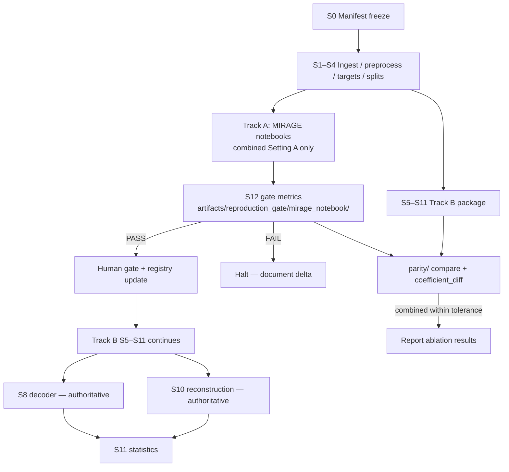

# Execution Plan: Perception-to-Imagery Latent-Target Ablation (Option 3 — Dual-Track Hybrid)

**Date:** 2026-09-10  
**Status:** **Approved** (2026-09-10) — `execute-experiment` in progress; **CSF3 account active** (login verified 2026-10)  
**Compute platform:** University of Manchester **CSF3** (Slurm) — see [CSF operational workflow](#csf3-operational-workflow)  
**Slug:** `perception-imagery-latent-ablation`  
**Model design:** `docs/workflow_stages/model_designs/2026-09-06-perception-imagery-latent-ablation-option-3.md` (approved 2026-09-10)  
**Execution log:** `docs/workflow_stages/execution_plans/2026-09-10-perception-imagery-latent-ablation-execution-log.md` (kickoff 2026-09-10)  
**Prerequisites:** `docs/execution/data-and-compute-prerequisites.md`  
**Upstream:** pipeline definition, experimental strategy, hypothesis formulation, Option 2 package design (Track B inheritance)

---

## Objective

Translate the approved **Option 3 dual-track hybrid** model design into a reproducible, step-by-step execution plan that:

1. Runs **Track A** (unmodified MIRAGE notebooks) for the **S12 reproduction gate only** — combined condition, Setting A, subjects $1,2,5,7$.
2. Runs **Track B** (modular `mirage_ablation/` + `evaluation/` package, inherited from Option 2) for **S5–S11** across all three ablation conditions and both settings.
3. Enforces **Track A pass before Track B ablation reporting** via parity modules and human checkpoint gates.
4. Logs every run with manifest hashes, git commits, and stage metadata in a **structured local experiment log** suitable for a single-researcher academic study.

**This document specifies scripts, paths, checkpoints, and ordering only.** It does not implement code or alter model design.

---

## Traceability

| Upstream artifact                                                                                                     | Role in this plan                                                |
| --------------------------------------------------------------------------------------------------------------------- | ---------------------------------------------------------------- |
| `docs/workflow_stages/hypothesis_formulation/2026-09-06-perception-imagery-latent-ablation-hypothesis-formulation.md` | H₀ framing; primary Option A, secondary Option D                 |
| `docs/workflow_stages/experimental_strategies/2026-09-06-perception-imagery-latent-ablation-experimental-strategy.md` | Splits, metrics, gate thresholds, statistical plan               |
| `docs/workflow_stages/pipeline_definitions/2026-09-06-perception-imagery-latent-ablation-pipeline-definition.md`      | Stages S0–S12, data contracts, HC/PF constraints                 |
| `docs/workflow_stages/model_designs/2026-09-06-perception-imagery-latent-ablation-option-3.md`                        | Dual-track architecture, parity modules, warm-start              |
| `docs/workflow_stages/model_designs/2026-09-06-perception-imagery-latent-ablation-option-2.md`                        | Track B package layout, S7 cache contract, evaluation separation |
| `docs/references/statistical-methods-reference.md`                                                                    | Composite $D$, $R$, permutation ANOVA, Holm, Wald χ²             |

---

## Experiment logging scheme

### Tracker choice: structured local JSON/YAML logs

**Rationale:** Single-researcher academic study; no collaboration dashboard requirement; full reproducibility via version-controlled manifests, git hashes, and filesystem artifacts. Pipeline definition PF-01 lists W&B/MLflow as preferences — this plan opts for **minimal local logging** with optional W&B export as a non-MVP appendix hook.

| Component               | Path                            | Purpose                                                                                          |
| ----------------------- | ------------------------------- | ------------------------------------------------------------------------------------------------ |
| **Experiment registry** | `runs/registry.yaml`            | Top-level study metadata: slug, manifest version, Track A/B status, gate outcome                 |
| **Per-run record**      | `runs/{run_id}/run.json`        | One JSON file per atomic execution unit (stage × setting × condition × subject where applicable) |
| **Stage sidecar**       | `runs/{run_id}/stage_meta.yaml` | Human-readable summary: CLI invoked, inputs, outputs, exit code, duration                        |
| **Execution log**       | `runs/execution_log.md`         | Append-only human narrative (checkpoint approvals, failures, reruns)                             |
| **Hash sidecars**       | `manifests/*.sha256`            | Pre-computed SHA-256 of frozen manifest files                                                    |

### Required fields per `run.json`

```json
{
  "run_id": "20260910-s5-setting_a-combined-subj01",
  "stage_id": "S5",
  "track": "B",
  "setting": "A",
  "condition": "combined",
  "subject_id": 1,
  "manifest_version": "1.0.0",
  "manifest_sha256": "<sha256>",
  "audit_sha256": "<sha256>",
  "git_commit": "<project_repo_sha>",
  "mirage_fork_commit": "<mirage_submodule_sha>",
  "mirage_notebook_commit": "<track_a_only_if_different>",
  "lambda_vdvae": null,
  "lambda_image_cls": null,
  "lambda_text": null,
  "lambda_retrieval": null,
  "seeds": [42, 123, 456],
  "reconstructions_per_seed": 10,
  "started_at": "ISO-8601",
  "finished_at": "ISO-8601",
  "exit_code": 0,
  "artifact_paths": ["artifacts/ridge/..."]
}
```

### Run ID convention

```
{YYYYMMDD}-{stage_lower}-{setting}_{a|b}[-{condition}][-subj{NN}][-{seed}]
```

Examples:

- `20260910-s12-gate-setting_a-combined` — Track A S12 gate run
- `20260910-s7-setting_a-image_only-subj05` — Track B latent decode
- `20260910-parity-coeff-setting_a-combined` — parity audit

### Linking runs to provenance

Before **any** S5 or Track A training:

1. Record `manifest_sha256` and `audit_sha256` in `runs/registry.yaml`.
2. Record `git_commit` (project root) and `mirage_fork_commit` (submodule or vendored path).
3. Block execution if manifest files on disk do not match recorded hashes (preflight CLI).

---

## Repository layout (dual-track)

```
3rd-yr-project/
├── manifests/                          # S0 — frozen before first fit
│   ├── nsd_imagery_test_manifest_v1.json
│   ├── stimulus_overlap_audit.json
│   ├── nsd_imagery_test_manifest_v1.sha256
│   └── stimulus_overlap_audit.sha256
├── configs/
│   ├── experiment/
│   │   ├── setting_a/
│   │   │   ├── combined.yaml
│   │   │   ├── image_only.yaml
│   │   │   └── text_only.yaml
│   │   └── setting_b/
│   │       └── ...
│   ├── track_a/                        # notebook path overrides only
│   │   └── paths.yaml
│   └── environments/
│       ├── track_a.lock                # conda-lock or pip-compile output
│       └── track_b.lock
├── track_a/                            # MIRAGE notebook gate (S12 only)
│   ├── Train.ipynb                     # unmodified logic; pins + paths only
│   ├── recon_inference_mi.ipynb
│   ├── final_evaluations_multi_mi.ipynb
│   └── README.md                       # gate scope documentation
├── mirage_ablation/                    # Track B — S1–S7 (Option 2)
│   ├── config/
│   ├── ingest/
│   ├── targets/
│   ├── splits/
│   ├── ridge/
│   ├── inference/
│   └── mirage_compat/
├── evaluation/                         # Track B — S8–S12 (S12 non-authoritative)
│   ├── decoder/
│   ├── reconstruction/
│   ├── statistics/
│   └── reproduction_gate.py            # internal parity check only
├── parity/                             # Option 3 additions
│   ├── compare_to_track_a.py
│   └── coefficient_diff.py
├── orchestration/
│   ├── stages.yaml                     # DAG: S5→S6→S7→S8→S9→S10→S11
│   └── flush_rules.yaml
├── scripts/                            # CLI entry points (thin wrappers)
│   ├── s0_populate_manifests.py
│   ├── s0_verify_manifests.py
│   ├── preflight.py
│   ├── track_a_gate.sh
│   └── stage_runner.py
├── data/                               # read-only after ingest (PF-03)
│   ├── raw/nsd/
│   ├── raw/nsd_imagery/
│   └── processed/
├── artifacts/
│   ├── reproduction_gate/
│   │   └── mirage_notebook/            # Track A outputs (authoritative S12)
│   ├── ridge/
│   │   └── track_a/                    # optional warm-start source
│   ├── ridge/                          # Track B (manifest-hashed paths below)
│   ├── latents/
│   ├── reconstructions/
│   ├── metrics/
│   │   ├── decoder/
│   │   └── reconstruction/
│   └── analysis/                       # S11 outputs
├── runs/                               # experiment logs (see above)
├── tests/
│   ├── unit/
│   ├── integration/
│   └── parity/
└── execution_plans/
    └── 2026-09-10-perception-imagery-latent-ablation-execution-plan.md
```

### Track-specific artifact roots

| Track | Stage scope                          | Authoritative for                                      | Artifact root                                  |
| ----- | ------------------------------------ | ------------------------------------------------------ | ---------------------------------------------- |
| **A** | S12 gate only (combined, Setting A)  | S12 reconstruction metrics vs MIRAGE Table 1           | `artifacts/reproduction_gate/mirage_notebook/` |
| **B** | S0–S4 shared ingest; S5–S11 ablation | S8 decoder metrics; S10 reconstruction; S11 statistics | `artifacts/{type}/{manifest_sha}/...`          |

**Shared stages S0–S4:** Executed once via Track B package (`mirage_ablation/`). Track A notebooks consume **preprocessed outputs** via `configs/track_a/paths.yaml` — no duplicate ingest unless debugging.

---

## Environment and dependency pinning

### Strategy overview

| Track      | Environment                                    | Pinning mechanism                                                      | Rationale                                                  |
| ---------- | ---------------------------------------------- | ---------------------------------------------------------------------- | ---------------------------------------------------------- |
| **A**      | `envs/track_a/` conda env from MIRAGE upstream | `configs/environments/track_a.lock` + recorded `mirage_fork_commit`    | Maximum fidelity to Kneeland et al. notebook code path     |
| **B**      | `envs/track_b/` separate conda env             | `configs/environments/track_b.lock` + same encoder checkpoint IDs      | Modular package; may use newer pytest/CLI tooling          |
| **Shared** | Frozen model weights                           | SHA-256 checksums in `manifests/model_weights_manifest.json` (S0 task) | HC-02: identical CLIP, VDVAE, Stable Cascade across tracks |

### Pinning checklist (record in `runs/registry.yaml` before first GPU job)

- [ ] Python version (both tracks — document if different)
- [ ] PyTorch + CUDA build
- [ ] GLMsingle v3 commit or package version
- [ ] CLIP checkpoint IDs (ViT-L/14, ViT-bigG/14)
- [ ] Stable Cascade checkpoint paths + hashes
- [ ] VDVAE weights path + hash
- [ ] NumPy / SciPy versions (ridge numerical parity)
- [ ] Random seeds: diffusion $42, 123, 456$; distractor resampling seed logged per draw

### Cross-track shared assets (must match)

- `manifests/nsd_imagery_test_manifest_v1.json` (hash-gated)
- `data/processed/` outputs from S1–S4
- `data/processed/targets/` frozen encoder outputs (S3)
- Model weight files (identical paths or symlinked from `data/frozen_weights/`)

### Tolerance documentation

- **Ridge coefficients (CPU reference):** max abs delta $\leq 10^{-6}$ for warm-start eligibility (`parity/coefficient_diff.py`)
- **S12 reconstruction metrics:** $\pm 0.05$ absolute vs MIRAGE Table 1 (Track A authoritative)
- **Track B vs Track A combined parity:** same $\pm 0.05$ on CLIP 2WC, SSIM, PixCorr per subject (internal gate before ablation reporting)

---

## CSF3 operational workflow

All heavy execution (S1–S11, Track A gate jobs) runs on **CSF3** via **Slurm** (`sbatch` / `squeue` / `scancel`). The laptop is used for Git, documentation, light editing, and SSH to CSF login nodes only. See `docs/CSF/10-min_tutorial.md`, `docs/CSF/response.md`, and `docs/CSF/overview.md`.

### CSF policy constraints (from IT onboarding)

| Rule                                   | Implication for this study                                                                                                                                                                                                                                                      |
| -------------------------------------- | ------------------------------------------------------------------------------------------------------------------------------------------------------------------------------------------------------------------------------------------------------------------------------- |
| **No compute on login nodes**          | Ridge, diffusion, and ingest at scale must be **batch jobs**, not interactive runs on `login3[csf3]`.                                                                                                                                                                           |
| **Up to 4 GPUs** per user concurrently | Schedule S9 as **job arrays** or staggered submits; do not launch all 6,480 runs at once.                                                                                                                                                                                       |
| **Submit steadily**                    | Queue fairly when busy; spread GPU work from Dec–Jan; avoid last-minute dumps.                                                                                                                                                                                                  |
| **No sensitive data**                  | NSD is public research data under DUA — acceptable; do not store unrelated sensitive data on CSF.                                                                                                                                                                               |
| **Home vs scratch**                    | **Home:** backed-up, limited quota — jobscripts, repo clone, env definitions, manifests, small logs. **Scratch:** fast, large, **3-month cleanup** — NSD sync, `data/processed/`, `artifacts/` during runs. **RDS:** long-term archive of final metrics and repro bundle (M10). |
| **Modules / own software**             | Prefer CSF PyTorch/CUDA modules; conda env in home or scratch per [install-your-own software](https://ri.itservices.manchester.ac.uk/csf3/software/) guidance.                                                                                                                  |

### Recommended CSF directory layout

```text
~/comp30030-mirage-ablation/          # git clone of project (home — backed up)
  manifests/
  configs/
  scripts/csf/                        # Slurm jobscripts (version-controlled)
~/scratch/comp30030-mirage-ablation/  # run cwd for batch jobs (symlink or copy jobscripts here)
  data/raw/                           # NSD S3 sync target
  data/processed/
  data/frozen_weights/
  artifacts/
  runs/slurm-logs/                    # slurm-*.out retained; copy summaries to home
```

Record absolute scratch path in `runs/registry.yaml` → `csf.scratch_root` after first login.

### Stage → CSF workload mapping

| Stage              | Where                                                      | Slurm profile (initial)                                                   | Notes |
| ------------------ | ---------------------------------------------------------- | ------------------------------------------------------------------------- | ----- |
| S0 populate/verify | Login node or **serial** / **multicore_small** (≤32 cores) | Short CPU; CLIP overlap audit may need GPU partition if not on login      |       |
| S1–S2 ingest       | **multicore_small** or standard multicore                  | I/O heavy; one job per subject                                            |       |
| S3 targets         | **GPU** partition (1 GPU, L40S or A100)                    | Frozen encoder forward passes                                             |       |
| S5–S6 ridge        | **High-memory** partition                                  | Request RAM ≥128 GB initially; increase if OOM (MIRAGE paper used 512 GB) |       |
| S7 decode          | **GPU** (1×)                                               | Cache latents to scratch                                                  |       |
| S8 metrics         | **multicore_small** or serial                              | No diffusion                                                              |       |
| S9 diffusion       | **GPU** (1–4 GPUs max concurrent)                          | Job array: (condition × subject × seed); walltime generous                |       |
| S10 metrics        | CPU                                                        | Cheaper than S9                                                           |       |
| S11 statistics     | **serial** / small multicore                               | Permutation ANOVA                                                         |       |
| Track A notebooks  | **GPU** + high-mem CPU jobs                                | Wrap notebook steps in jobscripts or papermill                            |       |

Exact partition names (`serial`, `multicore_small`, GPU, high-memory) must be confirmed on CSF with `sinfo` and [GPU jobs documentation](https://ri.itservices.manchester.ac.uk/csf3/batch-slurm/gpu-jobs-slurm/) after account setup.

### Standard job lifecycle (every batch run)

1. Develop or edit jobscript under `~/comp30030-mirage-ablation/scripts/csf/` (home).
2. `cp` jobscript to `~/scratch/comp30030-mirage-ablation/` (or submit from scratch after `cd` there).
3. `sbatch jobscript.sbatch` → record `JOBID` in `runs/{run_id}/run.json`.
4. `squeue -u $USER` until complete; on failure, inspect `slurm-JOBID.out`, adjust `#SBATCH` memory/time/GPU, resubmit.
5. Copy **small** provenance artefacts (metrics CSV, gate JSON, logs) to home or RDS; keep large reconstructions on scratch until exported.

### Data ingress on CSF

Run **AWS CLI sync on the login node** (file transfer only, not training):

```bash
# Example — run from login node; targets scratch
aws s3 sync --no-sign-request s3://natural-scenes-dataset/nsddata/experiments/nsdimagery/ \
  ~/scratch/comp30030-mirage-ablation/data/raw/nsd_imagery/experiments/nsdimagery/
```

Per-subject perception betas: sync to scratch per `docs/execution/data-and-compute-prerequisites.md` Tier 3. Log commands in `runs/execution_log.md`.

### CSF onboarding checklist (execution)

- [x] CSF3 account and login (`z29707aj` on `login3[csf3]`)
- [x] Complete 10-minute Slurm tutorial (`docs/CSF/10-min_tutorial.md`) with own jobscript
- [ ] Create `~/scratch/comp30030-mirage-ablation/` layout
- [ ] Clone repo to `~/comp30030-mirage-ablation/`
- [ ] Record `csf.scratch_root` in `runs/registry.yaml`
- [ ] First `sinfo` / GPU partition smoke test
- [ ] NSD DUA + Tier 1–2 sync to scratch

### Integration with experiment logging

Each `run.json` on CSF jobs should include:

- `host`: `csf3`
- `slurm_job_id`
- `slurm_partition`
- `scratch_path` used as cwd
- `git_commit` from repo on CSF

---

## Manifest population and freeze (S0)

S0 is **shared** and must complete before Track A training or any Track B S5 job.

### Task S0.1 — Stimulus catalogue assembly

| Item               | Detail                                                                                                                           |
| ------------------ | -------------------------------------------------------------------------------------------------------------------------------- |
| **CLI**            | `python scripts/s0_populate_manifests.py --output manifests/nsd_imagery_test_manifest_v1.json`                                   |
| **Inputs**         | NSD-Imagery stimulus documentation; 18 imagery stimulus definitions                                                              |
| **Actions**        | Populate all 18 `imagery_stimuli` entries with `stimulus_id`, `type`, `letter_cue`, `coco_id`, `overlap_label`, `strict_holdout` |
| **Split boundary** | No model fitting — catalogue definition only                                                                                     |
| **Acceptance**     | JSON validates against pydantic schema in `mirage_ablation/config/schema.py`; exactly 18 stimuli; 6 per type                     |

### Task S0.2 — Overlap audit

| Item           | Detail                                                                                                                                                                 |
| -------------- | ---------------------------------------------------------------------------------------------------------------------------------------------------------------------- |
| **CLI**        | `python scripts/s0_populate_manifests.py --audit --threshold 0.85 --output manifests/stimulus_overlap_audit.json`                                                      |
| **Inputs**     | NSD training manifests (sessions 1–40, subjects 1,2,5,7); CLIP ViT-L/14 CLS embeddings                                                                                 |
| **Actions**    | Per subject: exact COCO ID matches; semantic neighbours ($\geq 0.85$); Setting B exclusion lists; conceptual lemma caption holdout (substring match on LLaVA captions) |
| **Acceptance** | Per-subject lists populated; `mirage_split_verification.all_subjects_agree` true (`scripts/compare_mirage_training_split.py`); audit references manifest stimulus IDs |

### Task S0.3 — Distractor catalogues freeze

| Item           | Detail                                                                                                              |
| -------------- | ------------------------------------------------------------------------------------------------------------------- |
| **CLI**        | `python scripts/s0_populate_manifests.py --freeze-catalogues`                                                       |
| **Outputs**    | `data/frozen_catalogues/shared1000_embeddings.npz`; `data/frozen_catalogues/within_type_imagery_list.json`          |
| **Acceptance** | $N=50$ pool documented; 5 within-type distractors per target; no test-trial statistics used in construction (HC-11) |

### Task S0.4 — Model weights manifest

| Item           | Detail                                                              |
| -------------- | ------------------------------------------------------------------- |
| **CLI**        | `python scripts/s0_populate_manifests.py --weights-manifest`        |
| **Output**     | `manifests/model_weights_manifest.json` with SHA-256 per checkpoint |
| **Acceptance** | All HC-02 encoders listed; hashes match on-disk files               |

### Task S0.5 — Hash, commit, human freeze gate

| Item           | Detail                                                                                      |
| -------------- | ------------------------------------------------------------------------------------------- |
| **CLI**        | `python scripts/s0_verify_manifests.py --write-hashes`                                      |
| **Outputs**    | `manifests/*.sha256`; updated `runs/registry.yaml` with `manifest_frozen_at`, hashes        |
| **Human gate** | **Investigator signs off** manifest contents in `runs/execution_log.md` before any training |
| **Acceptance** | Git commit containing frozen manifests; `preflight.py` passes with recorded hashes          |

---

## Downstream flush rules

Defined in `orchestration/flush_rules.yaml`. Any trigger below invalidates listed artifact subtrees **automatically** (stage runner refuses stale paths).

| Trigger                                                              | Invalidates                               | Action                                                      |
| -------------------------------------------------------------------- | ----------------------------------------- | ----------------------------------------------------------- |
| `manifests/nsd_imagery_test_manifest_v1.json` version or hash change | S5–S11 (both tracks); parity reports      | Full retrain and re-evaluate                                |
| `manifests/stimulus_overlap_audit.json` change                       | S4–S11                                    | Rebuild splits; retrain ridges                              |
| Metric definition change (composite $D$, $R$)                        | S8–S11                                    | Recompute metrics and statistics                            |
| Distractor catalogue change                                          | S8, S11                                   | Recompute decoder metrics and stats                         |
| `configs/environments/track_*.lock` change                           | Track-specific stages from first affected | Re-run from first GPU stage; re-verify parity               |
| Track A `mirage_fork_commit` change                                  | Track A S12; parity; optional warm-start  | Re-run gate; re-run Track B combined if warm-start used     |
| Setting A → Setting B                                                | Setting B branch only (S4B–S11B)          | Independent artifact tree under `{manifest_sha}/setting_b/` |

**Flush command:** `python scripts/stage_runner.py --flush --reason <trigger_id> --confirm`

**Manifest hash in paths:** All Track B artifacts include `{manifest_sha}` segment:

```
artifacts/ridge/{manifest_sha}/{setting}/{condition}/subj{s}/head_{name}.npz
artifacts/latents/{manifest_sha}/{setting}/{condition}/{subject_id}/{stimulus_id}.npz
artifacts/reconstructions/{manifest_sha}/{setting}/{condition}/{subject_id}/{stimulus_id}/seed_{seed}/
artifacts/metrics/decoder/{manifest_sha}/{setting}/{condition}/
artifacts/metrics/reconstruction/{manifest_sha}/{setting}/{condition}/
artifacts/analysis/{manifest_sha}/{setting}/
```

---

## Dual-track orchestration



### Compute ordering

| Phase  | Order                                                                                      | Parallelism                                             |
| ------ | ------------------------------------------------------------------------------------------ | ------------------------------------------------------- |
| **0**  | S0 manifest freeze                                                                         | Sequential                                              |
| **1**  | S1–S4 shared preprocessing                                                                 | Per-subject parallel OK                                 |
| **2**  | **Track A gate** (combined, Setting A): Train → inference → eval                           | Sequential notebooks                                    |
| **3**  | **Human gate:** S12 pass/fail                                                              | Blocking                                                |
| **4**  | Track B S5–S6: all conditions, Setting A                                                   | Per (condition × subject) parallel                      |
| **5**  | Optional warm-start: copy Track A ridge → Track B combined if `coefficient_diff.py` passes | Before Track B combined S5 if used                      |
| **6**  | Track B S7 latent cache (mandatory)                                                        | Per (condition × subject) parallel                      |
| **7**  | Track B S8 decoder eval                                                                    | Per condition parallel; no GPU diffusion                |
| **8**  | Track B S9 diffusion                                                                       | Dominant GPU; per (condition × subject × seed) parallel |
| **9**  | Track B S10 reconstruction metrics                                                         | Per condition parallel                                  |
| **10** | Parity: Track B combined vs Track A                                                        | CPU; blocking before ablation report                    |
| **11** | Track B S11 statistics (Setting A primary)                                                 | Sequential                                              |
| **12** | Setting B branch: repeat S4B–S11                                                           | After Setting A complete                                |
| **13** | Exploratory Option C breakdowns                                                            | Non-blocking appendix                                   |

**Rule:** Do **not** report or interpret Track B ablation results (S8–S11) until Track A S12 **PASS** is recorded in `runs/registry.yaml` **and** parity module confirms Track B combined matches Track A within tolerance.

---

## Stage-by-stage task breakdown

### Shared foundation: S1–S4 (Track B package)

Executed via `mirage_ablation/` before Track A notebooks consume data.

#### S1 — Ingestion

| Field            | Value                                                                                                    |
| ---------------- | -------------------------------------------------------------------------------------------------------- |
| **CLI**          | `python -m mirage_ablation.ingest.cli --stage S1 --manifest manifests/nsd_imagery_test_manifest_v1.json` |
| **Inputs**       | BIDS/NIfTI NSD core + NSD-Imagery; GLMsingle v3 beta maps                                                |
| **Outputs**      | `data/processed/betas/{subject_id}/{session_id}/{run_id}.npy`                                            |
| **Split**        | Loads all domains; **no split applied**                                                                  |
| **Verification** | Trial counts match BIDS; 8 subjects present                                                              |
| **Acceptance**   | Preflight shape check; no NaN in masked voxels                                                           |

#### S2 — Preprocessing

| Field            | Value                                                       |
| ---------------- | ----------------------------------------------------------- |
| **CLI**          | `python -m mirage_ablation.ingest.cli --stage S2`           |
| **Outputs**      | `data/processed/betas_masked/`; imagery = mean of 16 reps   |
| **Split**        | Per-run z-scoring within NSD-Imagery runs only (HC-04)      |
| **Verification** | `pytest tests/unit/test_preprocessing_no_imagery_leak.py`   |
| **Acceptance**   | Imagery trials excluded from perception normalisation stats |

#### S3 — Target preparation

| Field            | Value                                                                  |
| ---------------- | ---------------------------------------------------------------------- |
| **CLI**          | `python -m mirage_ablation.targets.cli --stage S3 --train-only`        |
| **Outputs**      | `data/processed/targets/{coco_image_id}/{head}.npz`                    |
| **Split**        | **ID perception training images only**; encoders frozen (HC-02, HC-08) |
| **Verification** | Tensor shapes locked in `tests/unit/test_head_shapes.py`               |
| **Acceptance**   | No imagery stimulus IDs in target index                                |

#### S4 — Train-split construction

| Field            | Value                                                                                 |
| ---------------- | ------------------------------------------------------------------------------------- |
| **CLI**          | `python -m mirage_ablation.splits.cli --setting A` then `--setting B`                 |
| **Outputs**      | `data/processed/splits/{manifest_sha}/setting_{a,b}/train_indices.parquet`            |
| **Split**        | Setting A: exclude shared1000; Setting B: + audit exclusions                          |
| **Verification** | `pytest tests/unit/test_splits.py`; `python scripts/preflight.py --leakage-checklist` |
| **Acceptance**   | 12-item leakage checklist all pass; tune subjects $3,4,6,8$ never in test index       |

---

### Track A — S12 reproduction gate (authoritative)

**Scope:** `combined` condition only; Setting A; subjects $1,2,5,7$. No ablation logic.

#### TA.1 — Environment verification

| Field          | Value                                                                |
| -------------- | -------------------------------------------------------------------- |
| **CLI**        | `bash scripts/track_a_gate.sh --step verify-env`                     |
| **Actions**    | Activate `envs/track_a`; verify `mirage_fork_commit`; log to `runs/` |
| **Acceptance** | All packages match `track_a.lock`; GPU visible                       |

#### TA.2 — Ridge training (combined)

| Field          | Value                                                             |
| -------------- | ----------------------------------------------------------------- |
| **Notebook**   | `track_a/Train.ipynb`                                             |
| **Config**     | `configs/track_a/paths.yaml` (data paths, manifest hash log only) |
| **Outputs**    | `artifacts/reproduction_gate/mirage_notebook/ridge/subj{s}/`      |
| **Split**      | ID perception train only; $\lambda$ tuning subjects 3,4,6,8       |
| **Acceptance** | Checkpoints exist for subjects 1,2,5,7; $\lambda$ logged per head |

#### TA.3 — Imagery inference

| Field          | Value                                                                          |
| -------------- | ------------------------------------------------------------------------------ |
| **Notebook**   | `track_a/recon_inference_mi.ipynb`                                             |
| **Outputs**    | `artifacts/reproduction_gate/mirage_notebook/latents/`; `.../reconstructions/` |
| **Split**      | OOD imagery test subjects 1,2,5,7 only                                         |
| **Acceptance** | 18 stimuli × 4 subjects; 3 seeds × 10 reconstructions per cell                 |

#### TA.4 — Reconstruction evaluation (gate metrics)

| Field          | Value                                                                          |
| -------------- | ------------------------------------------------------------------------------ |
| **Notebook**   | `track_a/final_evaluations_multi_mi.ipynb`                                     |
| **Outputs**    | `artifacts/reproduction_gate/mirage_notebook/metrics/reconstruction_table.csv` |
| **Metrics**    | CLIP 2WC, SSIM, PixCorr on simple + complex imagery                            |
| **Acceptance** | See **S12 gate criteria** below                                                |

#### TA.5 — S12 gate decision

| Field             | Value                                                                                                           |
| ----------------- | --------------------------------------------------------------------------------------------------------------- |
| **CLI**           | `python -m evaluation.reproduction_gate --track A --input artifacts/reproduction_gate/mirage_notebook/metrics/` |
| **Gate criteria** | Each metric within $\pm 0.05$ absolute of MIRAGE Table 1; $\geq 3/4$ subjects pass per metric                   |
| **Outputs**       | `artifacts/reproduction_gate/mirage_notebook/gate_report.json`; exit code 0 = pass                              |
| **Human gate**    | Investigator reviews `gate_report.json` + `execution_log.md` before unlocking Track B reporting                 |
| **On failure**    | **HALT** ablation inference; document environment delta; do not reinterpret ablation results                    |

---

### Track B — S5 ridge mapping (fit)

| Field            | Value                                                                                           |
| ---------------- | ----------------------------------------------------------------------------------------------- |
| **CLI**          | `python -m mirage_ablation.ridge.cli train --config configs/experiment/setting_a/combined.yaml` |
| **Variants**     | `--condition {image_only,text_only,combined}`; `--setting {A,B}`; `--subject {1,2,5,7}`         |
| **Outputs**      | `artifacts/ridge/{manifest_sha}/{setting}/{condition}/subj{s}/head_{name}.npz`                  |
| **Split**        | **Fit on ID perception only**; inactive heads not trained (HC-07)                               |
| **Verification** | VDVAE + retrieval coefficients identical across conditions (confound check logged)              |
| **Acceptance**   | All active heads saved; inactive heads absent                                                   |

**Optional warm-start (after TA.5 pass):**

```bash
python parity/coefficient_diff.py \
  --track-a artifacts/reproduction_gate/mirage_notebook/ridge/ \
  --track-b artifacts/ridge/{manifest_sha}/setting_a/combined/ \
  --tolerance 1e-6
# If pass: skip Track B combined S5 re-fit; copy or symlink checkpoints
```

---

### Track B — S6 $\lambda$ tuning

| Field          | Value                                                                            |
| -------------- | -------------------------------------------------------------------------------- |
| **CLI**        | `python -m mirage_ablation.ridge.cli tune-lambda --config <yaml>`                |
| **Grid**       | $10^3, 10^4, 10^5, 10^6, 10^7$ per active head per condition                     |
| **Criterion**  | Maximize decoder composite $D$ on tuning subjects' 18 imagery stimuli            |
| **Outputs**    | `artifacts/ridge/{manifest_sha}/{setting}/{condition}/lambda_manifest.json`      |
| **Split**      | Tune on $3,4,6,8$ only — never test subjects (HC-06)                             |
| **Acceptance** | $\lambda_h^*$ recorded per head; test-subject models refit at selected $\lambda$ |

---

### Track B — S7 OOD latent inference (mandatory cache)

| Field            | Value                                                                                           |
| ---------------- | ----------------------------------------------------------------------------------------------- |
| **CLI**          | `python -m mirage_ablation.inference.cli decode-latents --config <yaml>`                        |
| **Outputs**      | `artifacts/latents/{manifest_sha}/{setting}/{condition}/{subject_id}/{stimulus_id}.npz`         |
| **Contents**     | Predicted VDVAE, CLS, text, retrieval hidden; metadata ($\lambda_*$, `git_commit`, `condition`) |
| **Split**        | OOD imagery subjects $1,2,5,7$; zero-vector injection per condition table (HC-07)               |
| **Verification** | `pytest tests/unit/test_zero_vector_shapes.py`                                                  |
| **Acceptance**   | 216 cells ($4 \times 18 \times 3$ conditions) cached; S8 and S9 can read same files             |

---

### Track B — S8 decoder-quality evaluation (authoritative for hypothesis)

| Field            | Value                                                                   |
| ---------------- | ----------------------------------------------------------------------- |
| **CLI**          | `python -m evaluation.decoder.cli run --config <yaml>`                  |
| **Reads**        | S7 latents; frozen GT embeddings; distractor catalogues                 |
| **Writes**       | `artifacts/metrics/decoder/{manifest_sha}/{setting}/{condition}/`       |
| **Must not**     | Import Stable Cascade or run diffusion (HC-10)                          |
| **Metrics**      | Top-$k$ ($k \in 1,5,10$), cosine, embedding 2AFC; composite $D_{s,i,c}$ |
| **Verification** | `pytest tests/unit/test_composite_d.py` (144/144 z-pools)               |
| **Acceptance**   | 216 $D_{s,i,c}$ values; conceptual text metrics in separate table       |

**Blocked until:** Track A S12 PASS recorded in registry.

---

### Track B — S9 image synthesis

| Field          | Value                                                                                                    |
| -------------- | -------------------------------------------------------------------------------------------------------- |
| **CLI**        | `python -m mirage_ablation.inference.cli generate --config <yaml>`                                       |
| **Reads**      | S7 latents; frozen Stable Cascade; retrieval module                                                      |
| **Writes**     | `artifacts/reconstructions/{manifest_sha}/{setting}/{condition}/{subject_id}/{stimulus_id}/seed_{seed}/` |
| **Scale**      | $4 \times 18 \times 3 \times 3 \times 10 = 6480$ diffusion runs                                          |
| **Acceptance** | 30 RGB samples per (subject, stimulus, condition); seeds $42,123,456$                                    |

---

### Track B — S10 reconstruction evaluation (authoritative for 3-way comparison)

| Field          | Value                                                                    |
| -------------- | ------------------------------------------------------------------------ |
| **CLI**        | `python -m evaluation.reconstruction.cli run --config <yaml>`            |
| **Reads**      | S9 RGB; GT images (simple + complex)                                     |
| **Writes**     | `artifacts/metrics/reconstruction/{manifest_sha}/{setting}/{condition}/` |
| **Metrics**    | CLIP 2WC, SSIM, PixCorr; composite $R_{s,i,c}$                           |
| **Acceptance** | 48 cells per condition ($4 \times 12$); conceptual excluded from $R$     |

---

### Track B — Parity audit (Option 3)

| Field                  | Value                                                                                                                                                                              |
| ---------------------- | ---------------------------------------------------------------------------------------------------------------------------------------------------------------------------------- |
| **CLI (metrics)**      | `python parity/compare_to_track_a.py --track-a artifacts/reproduction_gate/mirage_notebook/metrics/ --track-b artifacts/metrics/reconstruction/{manifest_sha}/setting_a/combined/` |
| **CLI (coefficients)** | `python parity/coefficient_diff.py` (see warm-start above)                                                                                                                         |
| **Tolerance**          | $\pm 0.05$ absolute per metric per subject; max coeff delta $\leq 10^{-6}$ for warm-start                                                                                          |
| **Outputs**            | `artifacts/parity/{manifest_sha}/parity_report.json`                                                                                                                               |
| **Acceptance**         | Combined Setting A reconstruction metrics match Track A; report logged before ablation narrative                                                                                   |
| **On failure**         | Do not claim ablation results; file issue distinguishing Track A vs Track B divergence                                                                                             |

---

### Track B — S11 statistical aggregation

| Field             | Value                                                                                                                                                                  |
| ----------------- | ---------------------------------------------------------------------------------------------------------------------------------------------------------------------- |
| **CLI**           | `python -m evaluation.statistics.cli run --setting A --manifest-sha <sha>`                                                                                             |
| **Reads**         | S8 + S10 tables; `docs/references/statistical-methods-reference.md`                                                                                                    |
| **Writes**        | `artifacts/analysis/{manifest_sha}/setting_a/`                                                                                                                         |
| **Analyses**      | Freedman–Lane permutation ANOVA on $D_{s,i,c}$ (10 000 perms); Holm post-hocs; Option D Wald χ² on $R \sim D + \text{condition}$; bootstrap CIs; permutation baselines |
| **Blocked until** | Track A S12 PASS + parity pass                                                                                                                                         |
| **Acceptance**    | All tables reproducible from frozen metric CSVs; Setting A labelled primary                                                                                            |

#### Setting B branch

Repeat S4B–S11 with `--setting B`. Same tests; outputs under `setting_b/`. **Secondary report only** (HC-13).

---

## Verification checkpoints summary

| Checkpoint            | Type        | Command / artifact                                | Pass criterion                                |
| --------------------- | ----------- | ------------------------------------------------- | --------------------------------------------- |
| Manifest schema       | Unit        | `pytest tests/unit/test_manifest_schema.py`       | Valid JSON; 18 stimuli                        |
| Leakage checklist     | Integration | `python scripts/preflight.py --leakage-checklist` | 12/12 items                                   |
| Split indices         | Unit        | `pytest tests/unit/test_splits.py`                | No test subjects in tune; no imagery in train |
| Zero-vector shapes    | Unit        | `pytest tests/unit/test_zero_vector_shapes.py`    | 768-d image; $77 \times 1280$ text            |
| Composite $D$         | Unit        | `pytest tests/unit/test_composite_d.py`           | 144-cell z-pools; 216 output cells            |
| Composite $R$         | Unit        | `pytest tests/unit/test_composite_r.py`           | 48 cells per condition                        |
| Head shape contract   | Unit        | `pytest tests/unit/test_head_shapes.py`           | 257×1024 retrieval layout                     |
| Track A S12 gate      | Gate        | `gate_report.json`                                | $\pm 0.05$; $\geq 3/4$ subjects per metric    |
| Parity metrics        | Integration | `parity/compare_to_track_a.py`                    | Track B combined = Track A within tolerance   |
| Parity coefficients   | Integration | `parity/coefficient_diff.py`                      | $\leq 10^{-6}$ max abs delta (warm-start)     |
| VDVAE cross-condition | Confound    | logged in `run.json`                              | Identical coeffs across conditions            |
| Manifest hash gate    | Preflight   | `python scripts/preflight.py`                     | On-disk hash = registry hash                  |

---

## Human checkpoint gates

| Gate ID  | When                    | Reviewer action                                            | Unblocks                     |
| -------- | ----------------------- | ---------------------------------------------------------- | ---------------------------- |
| **HG-0** | After S0.5              | Confirm manifest + audit contents; sign `execution_log.md` | S1, Track A                  |
| **HG-1** | After S4                | Review leakage checklist output                            | S5, Track A                  |
| **HG-2** | After Track A S12       | Review `gate_report.json` vs MIRAGE Table 1                | Track B S8–S11 **reporting** |
| **HG-3** | After parity audit      | Confirm Track B combined matches Track A                   | Ablation results narrative   |
| **HG-4** | Before Setting B        | Confirm Setting A primary complete                         | Setting B branch             |
| **HG-5** | Before manuscript stats | Review S11 tables                                          | `scientific-validation`      |

---

## Failure handling and stop conditions

| Condition                                                      | Action                                                                      |
| -------------------------------------------------------------- | --------------------------------------------------------------------------- |
| NaN loss or metric                                             | Stop stage; log `run.json` with `exit_code != 0`; do not proceed downstream |
| Metric collapse (e.g. chance-level retrieval across all cells) | Stop; invoke `reproducibility-investigator`                                 |
| Shape mismatch                                                 | Stop; fix contract in `heads.py` or manifest                                |
| Manifest drift (hash mismatch)                                 | Stop; run flush; return to S0 or affected stage                             |
| Track A S12 fail                                               | **HALT** ablation reporting; document environment delta                     |
| Track A pass, Track B combined parity fail                     | **HALT** ablation reporting; preserve both artifact trees; run investigator |
| OOM on S9                                                      | Reduce batch parallelism; do not change seeds or sample count               |

---

## Milestones and acceptance criteria

| Milestone                      | Stages        | Acceptance criteria                                           |
| ------------------------------ | ------------- | ------------------------------------------------------------- |
| **M0 — Manifest frozen**       | S0            | Hashes committed; HG-0 signed; preflight passes               |
| **M1 — Data ready**            | S1–S4         | Leakage checklist 12/12; targets and splits for Setting A     |
| **M2 — Track A gate pass**     | TA.1–TA.5     | `gate_report.json` exit 0; HG-2 signed                        |
| **M3 — Track B ridges fit**    | S5–S6         | All conditions Setting A; $\lambda$ manifest complete         |
| **M4 — Latent cache complete** | S7            | 216 cells on disk; metadata valid                             |
| **M5 — Decoder metrics**       | S8            | $D_{s,i,c}$ table; blocked until M2                           |
| **M6 — Reconstructions**       | S9–S10        | 6480 diffusions; $R_{s,i,c}$ table                            |
| **M7 — Parity confirmed**      | parity        | `parity_report.json` pass; HG-3 signed                        |
| **M8 — Primary inference**     | S11 Setting A | Omnibus + Holm + Option D tables                              |
| **M9 — Secondary inference**   | S11 Setting B | Parallel report; labelled secondary                           |
| **M10 — Repro bundle**         | export        | `runs/registry.yaml` + artifact manifest + env locks archived |

---

## CLI entry-point registry

| Stage               | Entry point                                                   | Track  |
| ------------------- | ------------------------------------------------------------- | ------ |
| S0 populate         | `scripts/s0_populate_manifests.py`                            | Shared |
| S0 verify           | `scripts/s0_verify_manifests.py`                              | Shared |
| Preflight           | `scripts/preflight.py`                                        | Shared |
| S1–S2               | `python -m mirage_ablation.ingest.cli`                        | B      |
| S3                  | `python -m mirage_ablation.targets.cli`                       | B      |
| S4                  | `python -m mirage_ablation.splits.cli`                        | B      |
| S5                  | `python -m mirage_ablation.ridge.cli train`                   | B      |
| S6                  | `python -m mirage_ablation.ridge.cli tune-lambda`             | B      |
| S7                  | `python -m mirage_ablation.inference.cli decode-latents`      | B      |
| S8                  | `python -m evaluation.decoder.cli run`                        | B      |
| S9                  | `python -m mirage_ablation.inference.cli generate`            | B      |
| S10                 | `python -m evaluation.reconstruction.cli run`                 | B      |
| S11                 | `python -m evaluation.statistics.cli run`                     | B      |
| S12 gate (Track A)  | `bash scripts/track_a_gate.sh`                                | A      |
| S12 gate (report)   | `python -m evaluation.reproduction_gate --track A`            | A      |
| Parity metrics      | `python parity/compare_to_track_a.py`                         | B      |
| Parity coefficients | `python parity/coefficient_diff.py`                           | B      |
| Orchestration       | `python scripts/stage_runner.py --stage <id> --config <yaml>` | B      |
| Flush               | `python scripts/stage_runner.py --flush --reason <id>`        | Both   |

`orchestration/stages.yaml` defines the DAG with cache policies (S7 cache required before S8/S9; S8 may rerun without S9).

---

## Reproducibility bundle export

After M10, export for archival:

```
exports/{manifest_sha}-{date}/
├── manifests/                  # copies + sha256
├── configs/environments/       # both lock files
├── runs/registry.yaml
├── runs/execution_log.md
├── artifacts/analysis/         # S11 tables
├── gate_report.json            # Track A S12
├── parity_report.json
└── REPRODUCE.md                # ordered command list mirroring this plan
```

---

## Out of scope (MVP / Phase 5 extensions)

The following are **explicitly excluded** from MVP execution. Track A remains frozen combined baseline; extensions run on **Track B only** if pursued later.

| Extension                                           | Status               | Notes                                    |
| --------------------------------------------------- | -------------------- | ---------------------------------------- |
| VDVAE on/off ablation                               | Phase 5              | `configs/extensions/vdvae_ablation.yaml` |
| ROI masks (early vs higher visual cortex)           | Phase 5              | Alternate $V$ in ingest                  |
| MLP backbone                                        | Out of core study    | HC-01 ridge only                         |
| Semantic threshold sensitivity 0.80 / 0.90          | Appendix             | Duplicate Setting B configs              |
| Within-type distractor sensitivity                  | Appendix             | S8 alternate catalogue                   |
| NSD-Imagery vision-run hypothesis tests             | Supplementary sanity | Not hypothesis-testing                   |
| Human rater 2AFC / LLM-as-judge                     | Excluded             | Automated metrics only                   |
| Bayesian estimation                                 | Optional appendix    | Not mandatory                            |
| W&B / MLflow cloud dashboard                        | Optional hook        | Local JSON logs are MVP                  |
| GiT caption decoder diagnostic outputs              | OD-06 optional       | Non-blocking                             |
| Training or fine-tuning Stable Cascade, CLIP, VDVAE | Excluded             | HC-02                                    |
| Regenerating LLaVA captions                         | Excluded             | HC-08                                    |
| Clinical deployment / real-time decoding            | Excluded             | Research pipeline only                   |

---

## Definition of done (execution-plan)

- [x] Experiment logging scheme specified (structured local JSON/YAML)
- [x] Dual-track directory layout documented
- [x] S0 manifest population tasks with acceptance criteria
- [x] Downstream flush rules on manifest change
- [x] Every stage S0–S12 has CLI, artifacts, split annotation, acceptance criteria
- [x] Track A gate before Track B ablation reporting enforced
- [x] Parity modules and warm-start path documented
- [x] Compute ordering and parallelisation guidance
- [x] Environment pinning strategy for Track A vs Track B
- [x] Human checkpoint gates explicit
- [x] MVP vs Phase 5 scope separated
- [x] CSF3 operational workflow (Slurm, home/scratch/RDS, stage→partition mapping)
- [x] Investigator approval of this plan (2026-09-10)
- [x] Ready to invoke `execute-experiment`

---

## Next step

After investigator approval of this plan, invoke `execute-experiment` to implement CLIs, notebooks, packages, and tests per the task breakdown above — beginning with **S0 manifest population** and **M0 manifest freeze**.

---

## Key references

| ID  | Source                                             | Role                                                |
| --- | -------------------------------------------------- | --------------------------------------------------- |
| [1] | Kneeland et al., MIRAGE, PLoS Comput Biol 2026     | Table 1 gate thresholds; Track A notebook authority |
| [2] | Kneeland et al., NSD-Imagery, CVPR 2025            | Benchmark splits and metrics                        |
| [3] | Scotti et al., MindEye, NeurIPS 2023               | Modular eval precedent                              |
| [4] | `docs/references/statistical-methods-reference.md` | $D$, $R$, inference procedures                      |
| [5] | MedARC-AI/MIRAGE GitHub                            | Track A notebook source                             |
