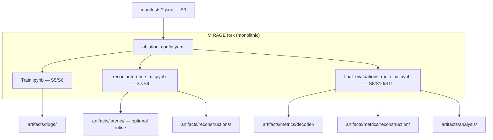
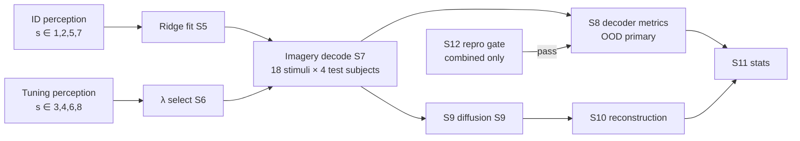

# Model Design Option 1: Monolithic MIRAGE Fork with Inline Ablation Branches

**Date:** 2026-09-09  
**Status:** Candidate — pending user selection  
**Slug:** `perception-imagery-latent-ablation`  
**Upstream:** `pipeline_definitions/2026-09-06-perception-imagery-latent-ablation-pipeline-definition.md`  
**Platform:** [MIRAGE](https://github.com/MedARC-AI/MIRAGE) (ridge backbone, frozen Stable Cascade)

---

## Summary

Preserve MIRAGE’s notebook-centric layout (`Train.ipynb`, `recon_inference_mi.ipynb`, `final_evaluations_multi_mi.ipynb`) and add **inline condition branches** (`image_only` | `text_only` | `combined`) via a single shared config file. Decoder-quality metrics (S8) are computed by extending the existing evaluation notebook with a pre-diffusion section; reconstruction metrics (S10) remain in the post-generation path. Minimal Python extraction — fastest path to S12 reproduction fidelity.

**Mapper class:** ridge regression only (HC-01). **Not in scope:** MLP backbone, VDVAE on/off, ROI masks (Phase 5 extensions).

---

## Architecture

### High-level layout

### Module responsibilities

| Component | Pipeline stages | Role |
| --------- | --------------- | ---- |
| `ablation_config.yaml` | S4–S12 | Single source for `condition`, `setting`, subject roles, $\lambda$ grid, zero-vector protocol |
| `Train.ipynb` | S5, S6 | Per-subject ridge fit; per-head $\lambda$ grid on tuning subjects; head activation mask per condition |
| `recon_inference_mi.ipynb` | S7, S9 | Imagery decode; zero-vector injection for ablated SC guidance; diffusion + retrieval unchanged |
| `final_evaluations_multi_mi.ipynb` | S8, S10, S11, S12 | Pre-diffusion metric block (new); MIRAGE-native post-diffusion metrics; stats scripts inlined or `%run` |
| `manifests/` | S0 | Frozen test catalogue and overlap audit — hash gate before S5 |

### Condition switch mechanism

A **head-activation table** in config mirrors HC-07:

| Head | `image_only` | `text_only` | `combined` |
| ---- | ------------ | ----------- | ---------- |
| VDVAE | fit + decode | fit + decode | fit + decode |
| Image CLS ($768$) | fit + decode | skip fit; zero at SC | fit + decode |
| Text ($77 \times 1280$) | skip fit; zero at SC | fit + decode | fit + decode |
| Retrieval hidden | fit + decode | fit + decode | fit + decode |

Training notebook branches on `active_heads`; inference notebook applies literal zero tensors for inactive SC guidance streams.

### Latent caching (S7)

**Default:** latents written to memory during inference, consumed immediately by evaluation cells in the same notebook session.

**Optional:** append cells to save S7 tensors to `artifacts/latents/{setting}/{condition}/{subject_id}/` as `.pt` sidecars — not enforced by architecture.

### Evaluation package design

No separate Python package. S8 and S10 live as **sequential sections** in `final_evaluations_multi_mi.ipynb`:

1. **S8 block (pre-generation):** load predicted embeddings from inference outputs; compute top-$k$, cosine, embedding 2AFC; aggregate $D_{s,i,c}$ with 144-cell z-reference pools.
2. **S10 block (post-generation):** reuse MIRAGE Table 1 metric code on saved RGB tensors; compute $R_{s,i,c}$.
3. **S11 block:** export CSV/Parquet; call permutation ANOVA + Option D regression (notebook or `%run stats/` scripts).

S12 gate runs as first cells of evaluation notebook on `combined` + Setting A only.

---

## Training procedure (per experimental strategy)

### S5 — Ridge fit

For each $(\text{setting}, \text{condition}, s \in \{1,2,5,7\})$:

1. Load masked perception betas $\mathbf{x} \in \mathbb{R}^{V}$ from S2 tables (Setting A/B exclusions from manifest).
2. Load frozen targets from S3 (VDVAE, CLS, text, retrieval hidden — only active heads for condition $c$).
3. Fit independent ridge models per active head: minimize $\|\mathbf{y} - \mathbf{X}\mathbf{w} - \mathbf{b}\|_2^2 + \lambda \|\mathbf{w}\|_2^2$ with $\lambda$ unset until S6.

**Orchestration:** outer loop over subjects; inner loop over active heads. VDVAE + retrieval heads use **identical training data and code path** across all three conditions (confound control).

### S6 — $\lambda$ tuning

For each $(\text{setting}, \text{condition}, \text{head}_h)$:

1. Fit ridge on tuning subjects $\{3,4,6,8\}$ perception trials (same exclusions).
2. Decode tuning subjects’ 18 imagery stimuli (OOD proxy within tuning cohort).
3. Grid search $\lambda \in \{10^3, \ldots, 10^7\}$; select $\lambda_h^*$ maximizing decoder composite on tuning imagery.
4. Refit test-subject ridges at $\lambda_h^*$ on full ID perception for $s \in \{1,2,5,7\}$.

Matches MIRAGE §4.2.3 between-subject tuning convention [Kneeland et al., 2026].

### Parallelisation

Notebooks accept `--condition` / `--setting` CLI via papermill or nbconvert parameters (PF-04). One job = one $(\text{setting}, \text{condition}, \text{subject})$ triple for training; one job = full imagery eval per condition for inference.

---

## Generalisation / holdout evaluation path

**ID/OOD boundaries enforced in notebook preamble:** assert manifest hash; refuse run if imagery trials appear in training index; assert test subjects never in $\lambda$ selection.

**Setting A** = primary analysis path; **Setting B** = duplicate notebook parameterisation with expanded exclusion list from audit manifest.

---

## Expected strengths (this study)

| Strength | Evidence / rationale |
| -------- | -------------------- |
| **Highest S12 reproduction fidelity** | Minimal divergence from MIRAGE notebook flow reduces environment and wiring drift vs Table 1 [Kneeland et al., 2026; MIRAGE README] |
| **Lowest upfront engineering cost** | No package extraction; familiar MedARC notebook pattern |
| **Direct use of upstream eval code** | CLIP 2WC, SSIM, PixCorr paths already validated in `final_evaluations_multi_mi.ipynb` |
| **Clear audit trail for supervisor** | Notebook order mirrors pipeline stages S5→S12 |

---

## Expected weaknesses (this study)

| Weakness | Impact |
| -------- | ------ |
| **S8/S9 coupling** | Re-running decoder metrics without diffusion requires manual cell edits or full inference re-run |
| **Three-condition duplication** | Three near-copy notebook runs increase risk of subtle config drift between conditions |
| **Weak manifest enforcement** | YAML + notebook params easier to misconfigure than typed pipeline CLI |
| **Statistical code sprawl** | S11 logic split across notebook and ad-hoc scripts complicates downstream flush discipline |
| **Scale** | 6480 diffusion runs (S9) dominate; monolithic reruns are expensive when only S8 formulas change |

---

## Compute / memory profile

| Stage | Compute | Memory / storage |
| ----- | ------- | ---------------- |
| S5 ridge | CPU-friendly; $\mathcal{O}(V \cdot d)$ per head | Coefficient storage $\ll$ 1 GB per subject × condition |
| S6 tuning | $5 \times 3 \times H_{\text{active}} \times 4$ tuning-subject decodes | Moderate CPU |
| S7 inference | GPU for CLIP encode of predictions | Latents optional; $\sim$100 MB if cached |
| S9 synthesis | **Dominant:** 6480 Stable Cascade runs | $\sim$30 RGB images × 216 cells × storage |
| S8 metrics | GPU for CLIP comparisons; cheap vs S9 | Metric tables $\ll$ 1 GB |
| S10 metrics | CPU/GPU per MIRAGE eval | Same order as S8 |

---

## Risks

| Risk | Severity | Mitigation |
| ---- | -------- | ---------- |
| Notebook drift between conditions | Medium | Single `ablation_config.yaml`; hash config in W&B/MLflow (PF-01) |
| S12 pass but ablation wiring wrong | Medium | Gate uses same inference path as ablation; document fork commit |
| Accidental imagery in training index | High | Manifest assert cell at notebook top; unit test on split builder when extracted later |
| Zero-vector protocol error | High | Explicit tensor shape tests ($768$, $77 \times 1280$) in inference notebook |
| Composite $D$ implementation error | Medium | Cross-check against `statistical-methods-reference.md`; sensitivity appendix |
| Diffusion nondeterminism | Low | Log seeds; report multi-seed SD (mandatory) |

---

## Out-of-scope extensions (Phase 5 — future branches)

These require **same manifest** but **separate exploratory reports** — not MVP architecture:

| Extension | Branch location in Option 1 |
| --------- | --------------------------- |
| VDVAE on/off | New config flag + notebook section — **not MVP** |
| ROI masks (early vs higher VC) | Alternate voxel mask path in Train.ipynb — **not MVP** |
| MLP backbone | Replace ridge cells — **explicitly excluded** from core study (HC-01) |
| Semantic threshold sensitivity (0.80/0.90) | Alternate Setting B config — appendix only (OD-09) |

---

## Traceability to pipeline open decisions

| OD ID | Option 1 resolution |
| ----- | ------------------- |
| OD-01 | Inline YAML + notebook branches |
| OD-02 | Keep MIRAGE ridge cells; batching unchanged |
| OD-03 | Optional `.pt` sidecars; not mandatory |
| OD-04 | VDVAE wiring unchanged from upstream |
| OD-05 | Retrieval internals untouched |
| OD-06 | GiT diagnostic cells preserved |
| OD-07 | PCA only if upstream uses it — fit on ID perception |
| OD-08 | Stats primarily in notebook |
| OD-09 | Config duplicate for sensitivity settings |

---

## Key references

| ID | Source | Role |
| -- | ------ | ---- |
| [1] | Kneeland et al., MIRAGE, PLoS Comput Biol 2026 | Ridge parallel heads, $\lambda$ tuning, SC inference |
| [2] | Kneeland et al., NSD-Imagery, CVPR 2025 | Cross-task benchmark, metric conventions |
| [3] | Scotti et al., MindEye, NeurIPS 2023 | Latent retrieval/cosine as decoding diagnostics |
| [4] | MedARC-AI/MIRAGE GitHub | Notebook entry points |
