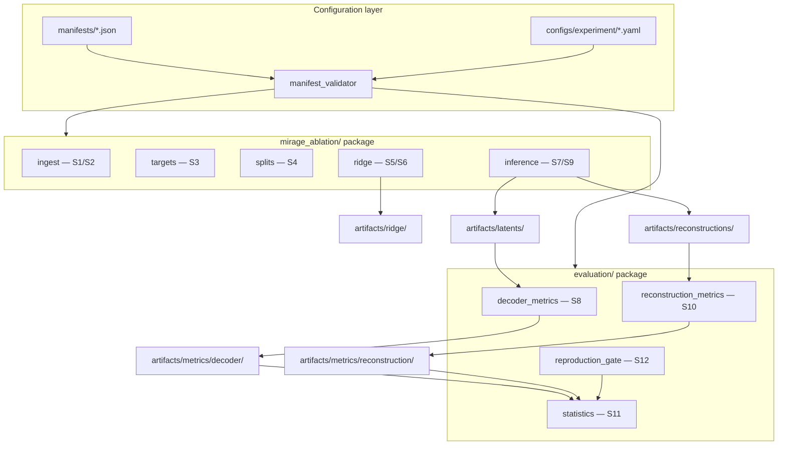
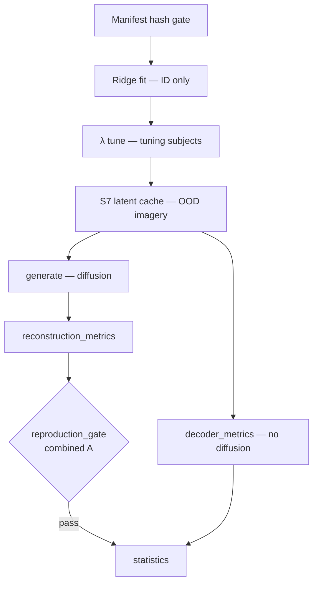

# Model Design Option 2: Modular Config-Driven Pipeline Package

**Date:** 2026-09-09  
**Status:** Candidate — pending user selection  
**Slug:** `perception-imagery-latent-ablation`  
**Upstream:** `pipeline_definitions/2026-09-06-perception-imagery-latent-ablation-pipeline-definition.md`  
**Platform:** MIRAGE fork restructured as importable Python packages with declarative configuration

---

## Summary

Extract MIRAGE ridge training, imagery inference, and evaluation into a **typed, config-driven package** while preserving numerical parity with upstream notebooks. A single manifest-validated config schema drives all three ablation conditions, both settings (A/B), and enforces the zero-vector protocol. **Decoder evaluation (S8)** and **reconstruction evaluation (S10)** are separate subpackages sharing only S7 latent artifacts and manifest contracts.

**Mapper class:** ridge regression only (HC-01). **Recommended default** in comparison doc.

---

## Architecture

### Package layout



### Proposed directory structure (implementation scope for execution-plan)

```
mirage_ablation/
  config/
    schema.py              # pydantic/dataclass validation vs manifest
    conditions.py          # HC-07 head table + zero-vector builder
  ingest/                  # S1–S2
  targets/                 # S3 frozen encoder calls
  splits/                  # S4 Setting A/B index builders
  ridge/
    trainer.py             # S5 per-subject, per-head fit
    lambda_tune.py         # S6 grid on tuning subjects
    heads.py               # VDVAE, CLS, text, retrieval head adapters
  inference/
    decode_latents.py      # S7 OOD imagery
    generate.py            # S9 Stable Cascade + retrieval (MIRAGE-compat)
evaluation/
  decoder/                 # S8 — pre-generation only
    retrieval.py
    cosine.py
    embedding_2afc.py
    composite_d.py         # $D_{s,i,c}$ with 144-cell z-pools
  reconstruction/          # S10 — post-generation only
    clip_2wc.py
    ssim.py
    pixcorr.py
    composite_r.py
  statistics/              # S11
  reproduction_gate.py     # S12
configs/
  setting_a/
    combined.yaml
    image_only.yaml
    text_only.yaml
  setting_b/               # expanded exclusions
    ...
manifests/                 # frozen JSON (unchanged contract)
artifacts/                 # pipeline storage (PF-03)
```

### Condition switch mechanism

**Declarative, not procedural:** each experiment YAML specifies:

```yaml
condition: image_only  # image_only | text_only | combined
setting: A             # A | B
active_heads: [vdvae, image_cls, retrieval_hidden]  # derived from condition table
sc_guidance:
  image: decoded       # decoded | zero
  text: zero           # decoded | zero
```

`conditions.py` maps condition name → head set + SC guidance mode. Inactive heads: **no fit**, **no checkpoint**, zero tensor at inference (literal zeros, HC-07).

### Latent caching strategy (S7)

**Mandatory contract:** S7 writes versioned, manifest-hashed artifacts:

```
artifacts/latents/{manifest_sha}/{setting}/{condition}/{subject_id}/{stimulus_id}.npz
```

Each file stores: predicted VDVAE, CLS, text, retrieval hidden; metadata (`lambda_*`, `git_commit`, `condition`).

**S8 and S9 consume the same cache:**

- S8 reads embeddings only — **no GPU diffusion**.
- S9 reads latents + runs Stable Cascade — **can run after S8 completes**.

Enables decoder-metric iteration without 6480 diffusion reruns when only composite weighting or distractor resampling logic changes.

### Ridge head training orchestration

| Loop level | Iteration | Output artifact |
| ---------- | --------- | --------------- |
| Setting | A, B | Separate ridge directories (downstream flush on manifest change) |
| Condition | 3 levels | Head mask applied inside trainer |
| Subject | $s \in \{1,2,5,7\}$ | `ridge/{setting}/{condition}/subj{s}/head_{name}.npz` |
| Head | active only | Independent $\lambda_h^*$ from S6 |

**S6 orchestration (`lambda_tune.py`):**

1. For each $(\text{setting}, c, h)$: fit on tuning-subject perception.
2. Decode 18 imagery stimuli per tuning subject; score decoder composite (same formula as primary endpoint).
3. Store $\lambda_h^*$ in run manifest sidecar.
4. Refit test-subject models at selected $\lambda$.

VDVAE + retrieval: **same code path and data** for all $c$; coefficients should match across conditions up to numerical tolerance (confound check logged in W&B).

### Evaluation package design

**Hard separation enforced by import boundaries:**

| Package | Reads | Writes | Must not import |
| ------- | ----- | ------ | --------------- |
| `evaluation.decoder` | S7 latents, frozen GT embeddings, distractor catalogues | `artifacts/metrics/decoder/` | Stable Cascade, diffusion |
| `evaluation.reconstruction` | S9 RGB, GT images | `artifacts/metrics/reconstruction/` | Ridge trainer |
| `evaluation.statistics` | S8 + S10 tables | `artifacts/analysis/` | Training code |
| `evaluation.reproduction_gate` | S10 combined Setting A | pass/fail report | Ablation conditions |

**Composite $D_{s,i,c}$:** implemented once in `composite_d.py` with explicit z-reference pools (144 image / 144 text cells per investigator-approved aggregation note 2026-09-09).

**S12 gate:** standalone entry point comparing combined Setting A reconstruction metrics to MIRAGE Table 1 ($\pm 0.05$, $\geq 3/4$ subjects); sets process exit code to block S11 ablation stats on failure.

---

## Training procedure

Identical mathematical protocol to Option 1 and experimental strategy:

- **Train:** NSD perception, $s \in \{1,2,5,7\}$, shared1000 excluded (Setting A); audit exclusions (Setting B).
- **Tune:** $\lambda$ on $\{3,4,6,8\}$ imagery decoder composite.
- **Test:** NSD-Imagery imagery, 18 stimuli, mean of 16 repetitions.

Package advantage: `splits/build_indices.py` unit-tested against manifest schema; leakage checklist (12 items) automated as pytest + pre-flight CLI.

---

## Generalisation / holdout evaluation path



**Cross-task generalisation** is evaluated exclusively on OOD imagery cells ($4 \times 18 \times 3 = 216$ for $D$). Vision-run sanity checks (supplementary) live in optional `evaluation/sanity/` module — not hypothesis-testing.

---

## Expected strengths (this study)

| Strength | Rationale |
| -------- | --------- |
| **Decoder vs reconstruction isolation** | Directly implements proposal novelty: latent metrics before generative prior [hypothesis formulation; HC-10] |
| **Leakage-safe splits** | Typed manifest validation reduces high-severity risks (imagery in train, test subjects in $\lambda$ tune) |
| **Fair $\lambda$ across conditions** | Central `lambda_tune.py` ensures identical grid and tuning subjects per head |
| **Downstream flush discipline** | Manifest version in artifact paths invalidates stale S5–S11 automatically |
| **Testability** | Composite $D$, distractor resampling, zero-vector shapes unit-testable |
| **Parallelisation** | CLI stage runners: `ridge train`, `inference decode`, `eval decoder`, `eval reconstruct` (PF-04) |

MindEye precedent: separate retrieval-focused embeddings vs diffusion-prior reconstruction paths benefit from **modular evaluation** even when sharing a backbone [Scotti et al., 2023].

---

## Expected weaknesses (this study)

| Weakness | Rationale |
| -------- | --------- |
| **Higher upfront refactor cost** | Extracting MIRAGE notebooks into packages risks subtle numerical drift vs upstream |
| **S12 parity risk** | Must prove package inference matches notebook on combined condition before ablation |
| **Stable Cascade wiring fragility** | OD-04/OD-05 still depend on fork-specific img2img/retrieval internals |
| **Two codepaths during transition** | Notebooks may remain as reference until parity tests pass |

---

## Compute / memory profile

Comparable to Option 1 for S5–S10 FLOPs. **Additional benefits:**

| Aspect | Option 2 delta |
| ------ | -------------- |
| S8 rerun cost | Near-zero GPU if latents cached |
| Disk | +$\sim$2–5 GB for full S7 latent store (216 cells × heads) |
| Engineering time | +2–4 weeks vs Option 1 (estimate for execution-plan) |
| CI / tests | CPU-only tests for splits, composites, zero tensors |

S9 remains dominant: $4 \times 18 \times 3 \times 3 \times 10 = 6480$ diffusion samples.

---

## Risks

| Risk | Severity | Mitigation |
| ---- | -------- | ---------- |
| Package vs MIRAGE numerical drift | High | S12 gate + coefficient diff tests on combined |
| Over-engineered config | Medium | Minimal YAML surface; condition table in code |
| Retrieval behaviour change | Medium | Freeze retrieval module import from MIRAGE; behaviour tests on 16-candidate pool |
| VDVAE latent layout mismatch | Medium | Lock tensor shapes in `heads.py` against S3 contract |
| Small-$N$ stats coded incorrectly | Medium | `statistics/` mirrors `statistical-methods-reference.md` exactly |

---

## Out-of-scope extensions (Phase 5)

Implemented as **optional config profiles** without changing core package boundaries:

| Extension | Integration |
| --------- | ----------- |
| VDVAE on/off | `configs/extensions/vdvae_ablation.yaml` — **not MVP** |
| ROI masks | `ingest/masks/{early,higher}.nii.gz` alternate $V$ — **not MVP** |
| MLP backbone | `ridge/backbone=mlp` — **out of core study** (HC-01) |
| Semantic threshold 0.80/0.90 | `setting: B_sensitivity` duplicate configs — appendix |

---

## MIRAGE compatibility layer

Thin `mirage_compat/` submodule wraps upstream Stable Cascade, VDVAE decode, retrieval, and GiT calls **without modification**. Ablation logic lives only in `conditions.py` and `inference/decode_latents.py`. Preserves frozen weights (HC-02) and 16-candidate retrieval schedule (OD-05 behaviour).

---

## Traceability to pipeline open decisions

| OD ID | Option 2 resolution |
| ----- | ------------------- |
| OD-01 | Hydra/YAML + pydantic schema |
| OD-02 | `ridge/trainer.py` with memory-mapped betas |
| OD-03 | **Mandatory** S7 latent cache on disk |
| OD-04 | `mirage_compat/vdvae.py` |
| OD-05 | `mirage_compat/retrieval.py` — behaviour frozen |
| OD-06 | Optional GiT hook in inference |
| OD-07 | `targets/pca.py` if needed — ID-only fit |
| OD-08 | `evaluation/statistics/` package |
| OD-09 | Alternate setting configs |

---

## Key references

| ID | Source | Role |
| -- | ------ | ---- |
| [1] | Kneeland et al., MIRAGE, 2026 | Parallel ridge heads, imagery inference pipeline |
| [2] | Kneeland et al., NSD-Imagery, CVPR 2025 | Evaluation splits and metrics |
| [3] | Scotti et al., MindEye, NeurIPS 2023 | Separate retrieval vs reconstruction evaluation |
| [4] | MedARC-AI/MIRAGE GitHub | Source notebook extraction target |
