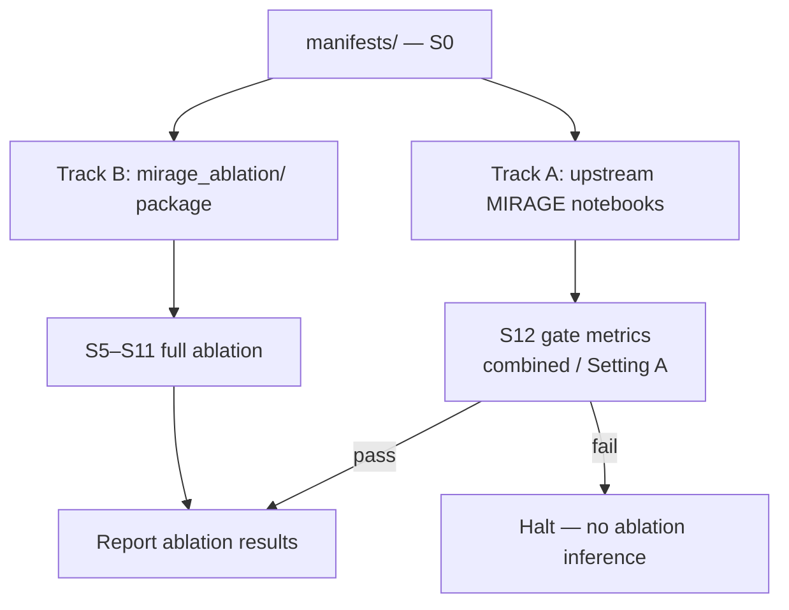
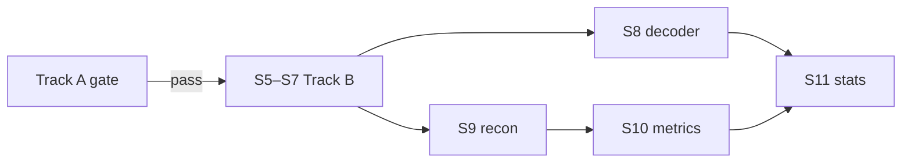

# Model Design Option 3: Dual-Track Hybrid (MIRAGE Notebook Gate + Modular Ablation Engine)

**Date:** 2026-09-09  
**Status:** **Approved** (2026-09-10)  
**Slug:** `perception-imagery-latent-ablation`  
**Upstream:** `pipeline_definitions/2026-09-06-perception-imagery-latent-ablation-pipeline-definition.md`

---

## Summary

Run **two parallel implementation tracks**:

1. **Track A (reproduction):** unmodified MIRAGE notebooks for **S12 reproduction gate only** (`combined`, Setting A, subjects 1,2,5,7).
2. **Track B (science):** modular ablation engine (same design as Option 2) for all three conditions, S8 decoder metrics, S10 reconstruction, and S11 statistics.

Track A must pass before Track B ablation results are reported. Tracks share manifests, frozen encoders, and $\lambda$ grid but may differ in artifact paths until parity is demonstrated.

**Mapper class:** ridge regression only. **Trade-off:** maximum S12 fidelity with clean ablation architecture; highest maintenance burden.

---

## Architecture

### Track A — reproduction shim

| Artifact | Source | Purpose |
| -------- | ------ | ------- |
| `Train.ipynb` | MIRAGE fork, minimal env pins | Train combined ridge only |
| `recon_inference_mi.ipynb` | MIRAGE fork | Imagery reconstruction for gate |
| `final_evaluations_multi_mi.ipynb` | MIRAGE fork | CLIP 2WC, SSIM, PixCorr vs Table 1 |

**Changes allowed in Track A:** dependency pins, path configs, manifest hash logging — **no ablation logic**.

Output: `artifacts/reproduction_gate/mirage_notebook/` with metric table + environment manifest.

### Track B — ablation engine

Identical modular package to **Option 2** with additions:

| Module | Role |
| ------ | ---- |
| `parity/compare_to_track_a.py` | Diff combined Setting A reconstruction metrics Track A vs Track B |
| `parity/coefficient_diff.py` | Max abs delta on ridge weights for combined condition |
| `orchestration/stages.yaml` | DAG: S5→S6→S7→S8→S9→S10→S11 with cache policies |

**Latent caching:** mandatory on Track B (same as Option 2).

**Condition switches:** config-driven (same as Option 2).

### Evaluation package design

| Eval type | Track A | Track B |
| --------- | ------- | ------- |
| S12 reconstruction gate | **Authoritative** | Must match within tolerance |
| S8 decoder metrics | Not run | **Authoritative** for hypothesis |
| S10 reconstruction (ablation) | Not run | **Authoritative** for 3-way comparison |
| S11 statistics | Not run | **Authoritative** |

Rationale: MIRAGE notebooks do not implement pre-diffusion latent ablation metrics (project novelty). Track B owns all hypothesis-testing endpoints; Track A owns baseline trust.

---

## Training procedure

### Track A

Single run: `combined`, Setting A, subjects 1,2,5,7 train; $\lambda$ from subjects 3,4,6,8 per MIRAGE default.

### Track B

Full factorial: $2$ settings $\times$ $3$ conditions $\times$ $4$ test subjects for S5–S11.

**Efficiency shortcut (optional):** after Track A passes, **warm-start** Track B combined condition from Track A ridge checkpoints if `coefficient_diff.py` confirms bitwise or near-bitwise parity on CPU reference (pipeline reproducibility spec).

---

## Generalisation / holdout evaluation path

Same ID/OOD boundaries as Options 1–2. Track B enforces:

- No imagery in ridge/$\lambda$/PCA fit (HC-04).
- Frozen distractor catalogues (HC-11).
- S12 gate external to ablation DAG — ablation S11 blocked on gate failure.

---

## Expected strengths (this study)

| Strength | Rationale |
| -------- | --------- |
| **Strongest S12 defensibility** | Gate metrics computed with upstream notebook code path [MIRAGE README] |
| **Clean ablation science code** | Track B implements decoder-before-diffusion separation without notebook constraints |
| **Supervisor-facing reproduction table** | Track A output directly comparable to Kneeland et al. Table 1 |
| **Parity audit trail** | Explicit diff module documents any Track A/B delta |

---

## Expected weaknesses (this study)

| Weakness | Rationale |
| -------- | --------- |
| **Highest maintenance cost** | Two environments/paths to keep synchronized |
| **Risk of divergent results** | If Track B combined $\neq$ Track A, ambiguous which pipeline is "correct" |
| **Duplicate compute** | Combined condition trained twice unless warm-start succeeds |
| **Complex orchestration** | Stage DAG + dual tracks increases execution-plan surface area |

---

## Compute / memory profile

| Component | Overhead vs Option 2 |
| --------- | -------------------- |
| Track A gate run | +1× combined train + inference + eval (~fraction of full ablation) |
| Track B | Same as Option 2 |
| Parity tests | CPU-only, negligible |
| Storage | Track A + Track B artifact trees until parity confirmed |

Total GPU: Track A + Track B S9 (6480 diffusions) + optional duplicate combined if warm-start fails.

---

## Risks

| Risk | Severity | Mitigation |
| ---- | -------- | ---------- |
| Track A passes, Track B combined fails gate internally | High | Parity module; report both; do not claim ablation until resolved |
| Environment skew between tracks | Medium | Shared conda lockfile; same CLIP/SC checkpoints |
| Investigators question dual pipelines | Medium | Pre-register Track A as gate-only in Methods |
| Timeline slip | Medium | Run Track A first; parallelise Track B conditions after pass |

---

## Out-of-scope extensions (Phase 5)

Extensions run on **Track B only**; Track A remains frozen combined baseline:

- VDVAE on/off, ROI masks, MLP backbone — **not MVP** (same as Options 1–2).

---

## When to choose Option 3

Prefer when **S12 reproduction credibility** is weighted above engineering simplicity — e.g., if initial environment replication attempts show metric drift. Otherwise Option 2 achieves most benefits with lower duplication.

---

## Key references

| ID | Source | Role |
| -- | ------ | ---- |
| [1] | Kneeland et al., MIRAGE, 2026 | Table 1 gate thresholds |
| [2] | MedARC-AI/MIRAGE GitHub | Track A notebook authority |
| [3] | Scotti et al., MindEye, 2023 | Modular eval precedent |
