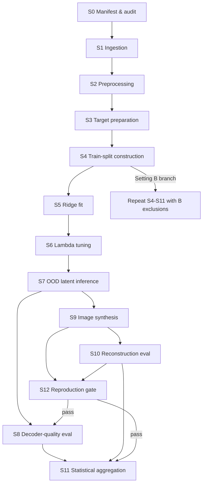

# Pipeline Definition: Perception-to-Imagery Latent-Target Ablation

**Date:** 2026-09-07  
**Status:** Approved — model design Option 3 locked (2026-09-10)  
**Source experimental strategy:** `experimental_strategies/2026-09-06-perception-imagery-latent-ablation-experimental-strategy.md`  
**Source hypothesis formulation:** `hypothesis_formulation/2026-09-06-perception-imagery-latent-ablation-hypothesis-formulation.md`  
**Model design:** `model_designs/2026-09-06-perception-imagery-latent-ablation-option-3.md`  
**Next step:** `execution-plan`

---

## Objective

Translate the investigator-approved experimental strategy into a **bounded computational pipeline** that:

1. Fits ridge regressions from NSD **perception** fMRI to MIRAGE latent targets under three ablation conditions (image-only, text-only, combined).
2. Decodes NSD-Imagery **imagery** trials (OOD) and evaluates **decoder quality before diffusion** separately from **reconstruction quality after diffusion**.
3. Enforces leakage controls via frozen manifests, fixed distractor catalogues, and strict ID/OOD boundaries.
4. Leaves MIRAGE-fork implementation details to `model-design` without predetermining architecture beyond experimentally fixed choices (ridge backbone, frozen Stable Cascade, ablation table).

**Platform reference (scoping only):** [MIRAGE](https://github.com/MedARC-AI/MIRAGE) — fork as execution substrate; do not treat upstream repo layout as authoritative for this project.

---

## Pipeline stages

Stages are ordered for dependency; **S12** is a hard gate before ablation inference. **Setting B** repeats **S4–S11** with expanded training exclusions defined in the audit manifest.

| Stage ID | Stage | Input | Output | ID/OOD boundary |
| -------- | ----- | ----- | ------ | --------------- |
| **S0** | Manifest & overlap audit | NSD session manifests; 18 imagery stimulus definitions; CLIP ViT-L/14 CLS for semantic neighbours | `manifests/nsd_imagery_test_manifest_v1.json`; `manifests/stimulus_overlap_audit.json`; SHA-256 hashes recorded | Defines **OOD test catalogue** and Setting B exclusion lists; **no model fitting** |
| **S1** | Ingestion | BIDS/NIfTI (NSD core + NSD-Imagery); GLMsingle v3 beta maps | Trial-indexed beta volumes at 1.8 mm in `nsdgeneral` mask | Loads all domains; **split applied in S4+** |
| **S2** | Preprocessing | Raw betas | Masked voxel vectors; imagery = mean over 16 repetitions per stimulus; per-run z-scoring within NSD-Imagery runs (vision vs imagery scored separately) | **No imagery trial** used to fit normalisation for perception training; **no cross-run or test-set statistics** for z-scoring |
| **S3** | Target preparation | Perception-training image IDs; fixed LLaVA v1.5-13B captions (MIRAGE artifacts); frozen CLIP / VDVAE weights | Ridge supervision targets: VDVAE latents, image CLS ($768$), text ($77 \times 1280$), retrieval hidden ($257 \times 1024$ flattened) | Targets computed from **training images only**; encoders **frozen** |
| **S4** | Train-split construction | S1–S3 outputs; audit manifest | Indexed training tables for **Setting A** (exclude `shared1000`) and **Setting B** (+ exact targets, semantic neighbours $\geq 0.85$, conceptual lemma caption holdout) | **ID:** NSD perception, subjects $\{1,2,5,7\}$ with setting-specific exclusions. **OOD:** all NSD-Imagery imagery trials. **Tune pool:** subjects $\{3,4,6,8\}$ perception only |
| **S5** | Ridge mapping (fit) | ID fMRI features $\mathbf{x} \in \mathbb{R}^{V}$; active targets per condition | Fitted ridge coefficients per active head; condition = `image_only` \| `text_only` \| `combined` | **Fit on ID perception only**; inactive heads **not trained**; VDVAE + retrieval heads **always trained identically** across conditions |
| **S6** | $\lambda$ tuning | Tuning-subject perception fit + tuning-subject imagery decode proxy | Selected $\lambda$ per active ridge head per condition from grid $\{10^3, \ldots, 10^7\}$ | **Tune on subjects $\{3,4,6,8\}$ only** — never on test subjects $\{1,2,5,7\}$; criterion = decoder-quality composite on tuning subjects' 18 imagery stimuli |
| **S7** | OOD latent inference | Test-subject imagery betas (18 stimuli $\times$ 4 subjects); fitted ridges + selected $\lambda$ | Predicted latents per stream before diffusion; zero-vector injection for ablated Stable Cascade guidance per condition table | **OOD evaluation units:** imagery trials for subjects $\{1,2,5,7\}$ only |
| **S8** | **Decoder-quality evaluation** (pre-generation) | S7 predicted embeddings + ground-truth embeddings | Per-cell metrics: top-$k$ retrieval ($k \in \{1,5,10\}$), cosine, embedding 2AFC; stream composites; $D_{s,i,c}$ | **Primary inference on OOD imagery**; distractors from **fixed catalogues** (`shared1000`, within-type imagery list) — no test statistics inform pools |
| **S9** | Image synthesis | S7 latents; frozen Stable Cascade; retrieval module; seeds $\{42, 123, 456\}$; 10 samples/seed/stimulus | RGB reconstructions ($30$ per subject $\times$ stimulus $\times$ condition) | Same OOD trials as S7–S8; img2img / VDVAE / retrieval paths **unchanged** across conditions |
| **S10** | **Reconstruction evaluation** (post-generation) | S9 images; ground-truth images (simple + complex) | CLIP 2WC, SSIM, PixCorr; reconstruction composite $R_{s,i,c}$; conceptual-only text metrics | Image metrics on **simple + complex OOD only** (12 stimuli/subject); conceptual excluded from $R$ |
| **S11** | Statistical aggregation | $D_{s,i,c}$, $R_{s,i,c}$, raw metric tables | Omnibus permutation ANOVA; Holm post-hocs; Option D cluster-robust regression; bootstrap CIs; permutation baselines | Analysis units locked to manifest; Setting A = **primary**; Setting B = **secondary** parallel report |
| **S12** | Reproduction gate | Combined condition, Setting A, S9–S10 on simple+complex imagery | Pass/fail vs MIRAGE Table 1 ($\pm 0.05$ absolute; $\geq 3/4$ subjects per metric) | **Must pass before S8–S11 ablation comparisons**; failure halts ablation inference |

### Stage dependency diagram



---

## Data contracts

### Subject and role identifiers

| Symbol | Values | Role |
| ------ | ------ | ---- |
| $s_{\text{test}}$ | $\{1, 2, 5, 7\}$ | Ridge train (perception) + OOD imagery test |
| $s_{\text{tune}}$ | $\{3, 4, 6, 8\}$ | $\lambda$ selection only — never final evaluation |
| $c$ | `image_only`, `text_only`, `combined` | Ablation condition |

### Trial keys

| Domain | Key schema | Notes |
| ------ | ---------- | ----- |
| NSD perception (train/tune) | `{subject_id, session_id, run_id, trial_index, coco_image_id}` | Exclude `shared1000` coco IDs (Setting A); apply audit exclusions (Setting B) |
| NSD-Imagery imagery (test) | `{subject_id, stimulus_id, run_type=imagery}` | 18 stimuli; beta = mean of 16 repetitions |
| NSD-Imagery vision (sanity) | `{subject_id, stimulus_id, run_type=vision}` | Supplementary only — **not hypothesis-testing** |

**Stimulus ID:** canonical string from frozen manifest (e.g. `simple_bar_0deg`, complex COCO-linked IDs, conceptual lemma labels).

### Tensor shapes (per trial unless noted)

| Artifact | Shape / type | Stage |
| -------- | ------------ | ----- |
| fMRI beta (masked) | $\mathbf{x} \in \mathbb{R}^{V}$; $V$ = `nsdgeneral` voxel count for subject | S2 → S5, S7 |
| Imagery beta (aggregated) | $\mathbf{x}_{s,i} \in \mathbb{R}^{V}$ — one vector per $(s, i)$ | S2 → S7 |
| VDVAE target | MIRAGE default latent shape (fork-defined) | S3, S5 |
| Image CLS target / prediction | $\mathbb{R}^{768}$ | S3, S5, S7, S8 |
| Text target / prediction (generation) | $\mathbb{R}^{77 \times 1280}$ | S3, S5, S7 → S9 |
| Text vector (metrics only) | $\bar{\mathbf{t}} \in \mathbb{R}^{1280}$ via mean-pool over 77 tokens | S8 |
| Retrieval hidden target / prediction | $\mathbb{R}^{257 \times 1024}$ → flattened unit vector | S3, S5, S7 (diagnostic) |
| Ground-truth image (simple/complex) | RGB, resolution per MIRAGE eval script | S10 |
| Reconstruction output | RGB, same as GT pipeline | S9, S10 |

### Ground-truth embedding contracts (S8)

| Stimulus type | GT embedding for cosine / retrieval / 2AFC |
| ------------- | ------------------------------------------ |
| Simple, complex | CLIP ViT-L/14 CLS of GT image (image stream); CLIP ViT-bigG/14 text of caption or image-aligned prompt per experimental strategy |
| Conceptual | CLIP ViT-bigG/14 mean-pooled text of prompt `"a photo of {concept_label}"` — **not** an image embedding |

### Evaluation cell counts

| Object | Count | Formula |
| ------ | ----- | ------- |
| Decoder cells per condition | 72 | $4 \times 18$ |
| Omnibus $D_{s,i,c}$ cells | 216 | $4 \times 18 \times 3$ |
| Reconstruction $R$ cells per condition | 48 | $4 \times 12$ (simple + complex only) |
| z-score reference (image stream) | 144 | image-only + combined cells |
| z-score reference (text stream) | 144 | text-only + combined cells |

### Frozen manifest files

**Primary test manifest:** `manifests/nsd_imagery_test_manifest_v1.json`

Required fields (minimum contract):

```json
{
  "version": "1.0.0",
  "hash_algorithm": "sha256",
  "subjects": [1, 2, 5, 7],
  "tuning_subjects": [3, 4, 6, 8],
  "imagery_stimuli": [{ "stimulus_id": "...", "type": "simple|complex|conceptual", "overlap_label": "..." }],
  "train_exclusions": { "shared1000": true, "setting_b_semantic_threshold": 0.85 },
  "conditions": ["image_only", "text_only", "combined"],
  "seeds": [42, 123, 456],
  "reconstructions_per_seed": 10
}
```

**Overlap audit:** `manifests/stimulus_overlap_audit.json` — per-subject exact-match lists, semantic-neighbour lists (threshold $0.85$), Setting B exclusion image IDs, conceptual lemma holdout caption matches.

**Change control:** increment manifest version + re-hash → **full downstream flush** (all stages S5–S11).

### Condition-specific pipeline behaviour (hard contract)

| Component | `image_only` | `text_only` | `combined` |
| --------- | ------------ | ----------- | ---------- |
| VDVAE ridge + decoder | On | On | On |
| Image CLS ridge | On | Off | On |
| Text ridge | Off | On | On |
| Retrieval hidden ridge | On | On | On |
| SC image guidance | Decoded CLS | Zero ($768$) | Decoded CLS |
| SC text guidance | Zero ($77 \times 1280$) | Decoded text | Decoded text |

Zero = literal zero tensor, not omitted connection.

---

## Constraint discipline

### Hard constraints (fixed by experimental design)

| ID | Constraint |
| -- | ---------- |
| HC-01 | **MIRAGE** is the fixed platform; **ridge regression** is the fixed mapper class |
| HC-02 | **Stable Cascade**, **CLIP**, and **VDVAE** weights are frozen — no fine-tuning on imagery |
| HC-03 | Train = NSD **perception** for $s \in \{1,2,5,7\}$; test = NSD-Imagery **imagery** for same subjects |
| HC-04 | **No imagery trial** enters ridge fitting, $\lambda$ tuning, PCA/normalisation fitting, or target encoding |
| HC-05 | **`shared1000`** COCO IDs excluded from perception training (Setting A minimum) |
| HC-06 | $\lambda$ selected on subjects $\{3,4,6,8\}$ only — **independent $\lambda$ per active ridge head per condition**, same grid |
| HC-07 | Three ablation conditions only; inactive ridge heads not fit; zero-vector guidance protocol as table above |
| HC-08 | Training captions = **fixed** LLaVA v1.5-13B MIRAGE artifacts — not regenerated |
| HC-09 | Imagery inference text = **brain-decoded ridge output only** — no GT captions at test time |
| HC-10 | Decoder metrics computed **before** Stable Cascade; reconstruction metrics **after** |
| HC-11 | Primary distractor pools and test manifest **frozen before first fit** (S0) |
| HC-12 | Reproduction gate (S12) must pass before ablation statistical inference |
| HC-13 | Setting A = primary analysis; Setting B = secondary (semantic neighbour $0.85$ + conceptual lemma holdout) |
| HC-14 | Primary statistical endpoint = $D_{s,i,c}$ composite (216 cells); Option D = $R_{s,i,c}$ regression controlling for $D$ |

### Preferences (implementation flexibility)

| ID | Preference |
| -- | ---------- |
| PF-01 | Experiment tracker: Weights & Biases or MLflow — log manifest hash, condition, $\lambda$, seeds |
| PF-02 | Compute: GPU for CLIP/Stable Cascade; CPU acceptable for ridge fit if numerically identical |
| PF-03 | Storage root: `data/`, `artifacts/`, `manifests/` under project root (exact subpaths open) |
| PF-04 | Parallelisation: per-subject or per-condition job granularity |
| PF-05 | Cache precomputed CLIP targets on training images to avoid repeated encoding |

### Open for model-design

| ID | Decision deferred |
| -- | ----------------- |
| OD-01 | MIRAGE fork module layout and config mechanism for condition switches |
| OD-02 | Ridge implementation details (batching, memory mapping, exact GLMsingle beta file naming) |
| OD-03 | Whether to cache intermediate latents on disk vs recompute in S8/S9 |
| OD-04 | Exact VDVAE latent tensor layout and img2img wiring within fork |
| OD-05 | Retrieval module candidate pool construction internals (must preserve 16-candidate, seed-schedule **behaviour**) |
| OD-06 | GiT caption decoder integration for diagnostic outputs |
| OD-07 | PCA or additional dimensionality reduction — **if used**, fit on ID perception only |
| OD-08 | Statistical analysis code organisation (single package vs notebooks) |
| OD-09 | Sensitivity analyses (semantic thresholds $0.80$/$0.90$, within-type distractors) — same pipeline, alternate config |

---

## Non-functional requirements

### Reproducibility

| Requirement | Specification |
| ----------- | --------------- |
| Random seeds | Diffusion seeds $\{42, 123, 456\}$; distractor resampling seed logged per draw |
| Dependency pinning | Record MIRAGE fork commit, PyTorch/CUDA, GLMsingle version, CLIP checkpoint IDs |
| Manifest hashing | SHA-256 of `nsd_imagery_test_manifest_v1.json` and `stimulus_overlap_audit.json` logged **before** S5 |
| Determinism | Same manifest + commit + seeds → bitwise-identical ridge coefficients (CPU reference); document GPU nondeterminism tolerance for diffusion |
| Downstream flush | Any change to splits, metrics, distractor protocol, or manifest schema invalidates S5–S11 outputs |

### Experiment tracking fields (minimum)

Each run record must include:

- `manifest_version`, `manifest_sha256`, `audit_sha256`
- `setting` (`A` \| `B`)
- `condition` (`image_only` \| `text_only` \| `combined`)
- `subject_id`, `stage_id`
- `lambda_*` per active head
- `git_commit`, `mirage_fork_commit`
- `seeds`, `reconstructions_per_seed`
- metric snapshot paths for S8 and S10

### Storage layout (recommended)

| Path | Contents |
| ---- | -------- |
| `data/raw/nsd/` | NSD BIDS derivatives (read-only after ingest) |
| `data/raw/nsd_imagery/` | NSD-Imagery BIDS |
| `data/processed/betas/` | GLMsingle outputs, masked trial arrays |
| `data/processed/targets/` | Frozen ridge supervision tensors |
| `artifacts/ridge/` | Fitted coefficients per condition × setting × subject-group |
| `artifacts/latents/` | S7 decoded embeddings (pre-diffusion) |
| `artifacts/reconstructions/` | S9 RGB outputs by seed |
| `artifacts/metrics/decoder/` | S8 tables |
| `artifacts/metrics/reconstruction/` | S10 tables |
| `artifacts/analysis/` | S11 statistical outputs |
| `manifests/` | Frozen JSON + hash sidecars |

### Runtime and scale (order-of-magnitude)

| Stage | Scale driver |
| ----- | ------------ |
| S1–S2 | Full NSD sessions 1–40 × 8 subjects (tune subjects needed for S6 only) |
| S5 | 3 conditions × 2 settings × parallel ridge heads |
| S6 | 5 $\lambda$ × 3 conditions × active heads × tuning-subject imagery proxy |
| S9 | $4 \times 18 \times 3 \times 3 \times 10 = 6480$ diffusion runs (dominant GPU cost) |
| S8, S10 | CPU/GPU embedding metrics — cheap relative to S9 |

---

## Out of scope

This pipeline definition **does not** include:

| Exclusion | Rationale |
| --------- | --------- |
| Model architecture design beyond ridge + MIRAGE ablation table | Owned by `model-design` |
| Execution scripts, CLI, SLURM, or container definitions | Owned by `execution-plan` |
| Hyperparameter values other than registered $\lambda$ grid | Selected in S6 per strategy |
| Human rater 2AFC or LLM-as-judge evaluation | Automated metrics only |
| NSD-Imagery **vision** run hypothesis tests | Sanity check only |
| MLP backbone, VDVAE on/off, ROI mask ablations | Phase 5 extensions — same manifest if run, separate exploratory report |
| Bayesian estimation | Optional appendix only |
| Training or fine-tuning Stable Cascade, CLIP, or VDVAE | Frozen by design |
| Regenerating LLaVA captions or modifying MIRAGE caption artifacts | Fixed targets |
| Ingesting or modelling raw k-space / pre-GLMsingle fMRI | Betas assumed from GLMsingle v3 |
| Clinical deployment, real-time decoding, or online adaptation | Research pipeline only |

---

## Traceability

| Experimental strategy requirement | Pipeline stage(s) | Contract / note |
| --------------------------------- | ----------------- | --------------- |
| Cross-task train perception → test imagery | S4, S5, S7 | HC-03, HC-04 |
| Subjects 1,2,5,7 train+test; 3,4,6,8 tune | S4, S6 | Subject role table |
| Three latent-target conditions | S5, S7 | Condition table HC-07 |
| Setting A primary / Setting B secondary | S4 branch, S11 | HC-13; audit-driven exclusions |
| Semantic neighbour threshold 0.85 | S0, S4 | `stimulus_overlap_audit.json` |
| Conceptual lemma caption holdout (Setting B) | S0, S4 | Substring match on LLaVA captions |
| Frozen test manifest | S0 | `nsd_imagery_test_manifest_v1.json` |
| GLMsingle v3, 1.8 mm, `nsdgeneral`, per-run z-score | S1, S2 | Preprocessing contract |
| 16 imagery reps → mean beta | S2 | Imagery trial key |
| Independent $\lambda$ per head per condition | S6 | HC-06 |
| Decoder metrics: top-$k$, cosine, embedding 2AFC | S8 | Pre-generation only |
| Decoder composite $D_{s,i,c}$ | S8, S11 | 216-cell omnibus input |
| Reconstruction: CLIP 2WC, SSIM, PixCorr | S10 | Post-generation only |
| Reconstruction composite $R_{s,i,c}$ | S10, S11 | 48 cells per condition |
| Conceptual text-only metrics | S8, S10 | Excluded from $R$ |
| Zero-vector ablation protocol | S7, S9 | HC-07 |
| Fixed captions train / decoded text test | S3, S7 | HC-08, HC-09 |
| Retrieval + VDVAE fixed across conditions | S5, S9 | Documented confound |
| 3 seeds × 10 reconstructions | S9 | Manifest `seeds`, `reconstructions_per_seed` |
| shared1000 retrieval distractors ($N=50$, 100 resamples) | S8 | Fixed catalogue |
| Within-type embedding 2AFC (5 distractors) | S8 | Fixed imagery stimulus list |
| Reproduction gate ±0.05 vs MIRAGE Table 1 | S12 | HC-12 |
| Freedman–Lane permutation ANOVA on $D$ | S11 | Primary Option A |
| Holm pairwise post-hocs | S11 | Pre-registered contrasts |
| Option D cluster-robust regression $R \sim D + \text{condition}$ | S11 | Secondary Option D |
| Bootstrap CIs, permutation baselines, multi-seed SD | S11 | Uncertainty bundle |
| Exploratory Option C by stimulus type | S11 | Descriptive only |
| Leakage checklist (12 items) | S0–S12 | Enforced at stage boundaries |
| Downstream flush on manifest change | S0 | Version + hash increment |

---

## Approval checklist (pipeline-definition)

- [x] Every stage has explicit ID/OOD handling
- [x] Decoder-quality (S8) separated from reconstruction (S10)
- [x] Data contracts sufficient for model-design (shapes, keys, manifests)
- [x] No undocumented architecture commitments beyond ridge + MIRAGE + ablation table
- [x] Hard vs preference vs open constraints separated
- [x] Traceability to experimental strategy complete
- [x] Ready to invoke **`model-design`** (Option 3 approved 2026-09-10)
- [ ] Ready to invoke **`execution-plan`**

---

## Key references

| ID | Source | Role |
| -- | ------ | ---- |
| [1] | `experimental_strategies/2026-09-06-perception-imagery-latent-ablation-experimental-strategy.md` | Authoritative protocol |
| [2] | `hypothesis_formulation/2026-09-06-perception-imagery-latent-ablation-hypothesis-formulation.md` | H₀ framing |
| [3] | `docs/references/statistical-methods-reference.md` | Metric and inference definitions |
| [4] | Kneeland et al., MIRAGE, PLoS Comput Biol 2026 | Platform behaviour |
| [5] | Kneeland et al., NSD-Imagery, CVPR 2025 | Benchmark splits and metrics |
