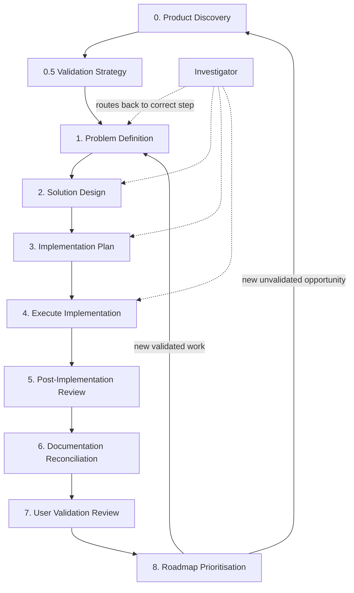

# Business Workflow Overview

This is a **governed, dual-track product and engineering process**. It separates *what to build and why* from *how to build it*, and keeps each stage owned by a specialist agent. Work moves forward in sequence, with explicit artifacts at each step, and upstream changes can force downstream steps to be revisited.

The workflow is governed by the **`business-manager-agent`**.

For research and scientific paper workflows, see the separate [Scientific Workflow](./scientific-workflow-overview.md) and **`scientific-manager-agent`**.

---

## Dual tracks

- **Product track** — opportunity, assumptions, validation, user evidence, roadmap
- **Engineering track** — problem scope, design, plan, build, review, doc reconciliation

A third path runs **in parallel**: **diagnosis** when something already built is not behaving as expected.

---

## Workflow stages

| Step | Specialist | What it produces |
|------|------------|------------------|
| **0** | `product-discovery` | Product opportunity, target users, assumptions, riskiest hypotheses → `product_discovery/` |
| **0.5** | `validation-strategy` | PoC/experiment plan, success/failure signals, evidence plan → `validation_strategies/` |
| **1** | `problem-definition` | One buildable engineering problem, scoped and unambiguous → `problem_definitions/` |
| **2** | `solution-design` | Research-backed design options and comparison → `solution_designs/` |
| **3** | `implementation-plan` | Step-by-step executable plan → `implementation_plans/` |
| **4** | `execute-implementation-plan` | Actual code/config/tests + execution log |
| **5** | `post-implementation-review` | Audit of planned vs actual → `post_implementation_reviews/` |
| **6** | `documentation-reconciliation` | Updates living design/plan docs to match reality |
| **7** | `user-validation-review` | Evidence-based verdict (persevere/pivot/pause/stop) → `user_validation_reviews/` |
| **8** | `roadmap-prioritisation` | Prioritised backlog and next entry point → `roadmaps/` |

**Diagnostic (any time):** `investigator` diagnoses unexpected behaviour in an existing implementation, maps the issue to the correct workflow stage, and recommends where to revisit — without fixing code or editing living docs.

---

## Product vs standalone engineering work

Not every task runs the full product track.

- **New product / PoC / idea** → starts at **Product Discovery** (step 0)
- **Validated feature with a known scope** → can enter at **Problem Definition** (step 1)
- **Bug fix, refactor, or standalone technical task** → can enter directly at **Problem Definition**, skipping product discovery and validation strategy

The `business-manager-agent` decides which entry point fits your request.

---

## Cascade rules

A core rule: **if step N changes, all steps after N may need revisiting.**

Examples:

- Problem definition changes → design, plan, execution, review, and downstream product steps may all be stale
- Validation strategy changes before execution → engineering scope and everything below it may need revisiting
- Product opportunity pivots → the whole downstream chain may need revisiting

**Two important exceptions:**

1. **Documentation reconciliation** updates design/plan docs to record what was *already built*. That does **not** trigger a cascade — it is retroactive, not prospective.
2. **User validation review** records findings only. A cascade happens only if *you* choose a prospective change (new scope, pivot, different target user, etc.).

---

## Business Manager Agent role

The **Business Manager Agent** (`business-manager-agent`) is the **workflow orchestrator**. It does **not** produce product, engineering, code, review, or documentation artifacts itself. It **routes, enforces, mediates, and governs**.

### What the Business Manager Agent does

1. **Interpret intent** — Determine which lifecycle step is affected: ideation, validation planning, scope change, execution, review, feedback synthesis, prioritisation, or diagnosis.

2. **Route to exactly one specialist** — Delegate to one subagent per turn, always to the **earliest affected step** in the sequence. Never skip forward, never invoke multiple specialists at once, and never let a specialist decide routing.

3. **Enforce cascade rules** — Before allowing downstream work, check whether upstream artifacts have changed. If step 3 is requested but step 2 is stale, stop and require step 2 first.

4. **Mediate between you and specialists** — Reformulate requests, relay questions and answers, relay outputs faithfully without reinterpretation.

5. **Preserve human control** — Pause when your judgement is needed: design selection, deviation approval, pivot decisions, roadmap priorities.

### What the Business Manager Agent does not do

- Create or edit opportunity docs, validation strategies, problem definitions, designs, plans, code, reviews, or roadmaps
- Execute implementation steps
- Silently skip steps or allow stale downstream work
- Trigger cascades when reconciliation or validation review only records completed reality

### Typical interaction pattern

1. You send a request
2. The business manager agent determines the affected step and whether any cascade applies
3. The business manager agent briefly explains the routing decision (1–3 sentences)
4. The business manager agent delegates to the appropriate specialist
5. The business manager agent relays their output or questions back to you
6. The business manager agent states the next required step, or waits for your instruction

---

## Example: how routing works in practice

If you say *"I have an idea for a study planner app"*, the business manager agent routes to **`product-discovery`** — not problem definition or solution design, because the opportunity and assumptions are not yet defined.

If you say *"The login flow is broken after we deployed"*, the business manager agent routes to **`investigator`** — something already built is misbehaving, so we diagnose first.

If you say *"Build it"* but there is no approved implementation plan, the business manager agent will not route to execution. It will identify the missing prerequisite and route there instead.

If you say *"I need to run an fMRI decoding experiment for my paper"*, the business manager agent should route to **`scientific-manager-agent`** — that is a research workflow, not a product workflow.

---

## Agent and skill locations

All subagents: `~/.cursor/agents/<name>.md`  
All skills: `~/.cursor/skills/<name>/SKILL.md`

These are **global** (user-level), not tied to any single project repo.

---

## In short

The business workflow is a **sequenced pipeline of specialist agents**, each producing a specific artifact before the next step can proceed. **The business manager agent is the process guardian** — it keeps you on the right step, enforces sequencing and cascade rules, and hands work to the right specialist without doing their work itself.
