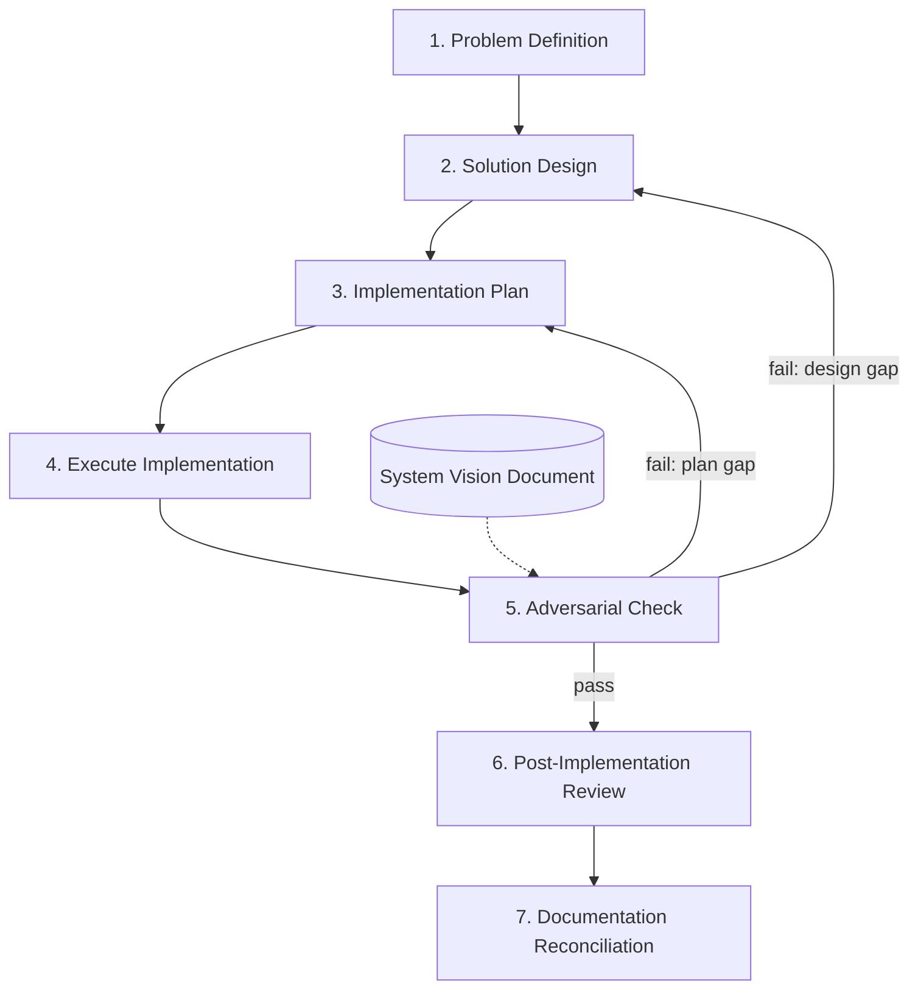
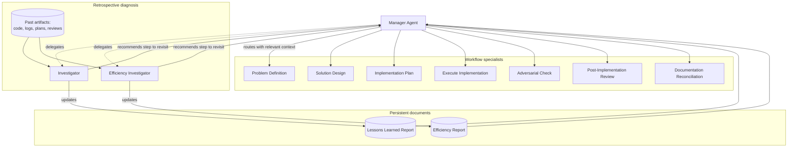

# Legacy Workflow Overview

This document describes the **original engineering workflow** that the current [Business Workflow](./workflow-overview.md) evolved from. It was a **governed, single-track engineering process**: scope the problem, design the solution, plan and build it, verify it against a system vision, review what was built, and reconcile living documentation.

Unlike the current workflow, this version had **no product track**. There was no product discovery, validation strategy, user validation review, or roadmap prioritisation. Work entered directly at problem definition.

A second path ran **in parallel**: **retrospective diagnosis** — examining what had already been built or done, without speaking to the agents who produced it. Findings were written to persistent reports, which the **manager agent** then used as context when routing future work.

---

## The Workflow Stages

### Main pipeline

Sequential dependencies between stages. The manager agent delegated each step in turn; specialists did not call each other directly.

### Context, memory, and retrospective diagnosis

The **Efficiency Report** and **Lessons Learned Report** were fed into the **manager agent**, not directly into workflow specialists. When routing to any step, the manager attached the relevant lessons and efficiency practices as context for that agent's turn.

Investigators did **not** speak to other agents. They examined **past artifacts only** — code, execution logs, plans, reviews, and other completed work — then updated their report and recommended which step the manager should revisit.

| Step  | Specialist                     | What it produces                                                                                                       |
| ----- | ------------------------------ | ---------------------------------------------------------------------------------------------------------------------- |
| **1** | `problem-definition`           | One buildable engineering problem, scoped and unambiguous → `problem_definitions/`                                     |
| **2** | `solution-design`              | Research-backed design options and comparison → `solution_designs/`                                                    |
| **3** | `implementation-plan`          | Step-by-step executable plan → `implementation_plans/`                                                                 |
| **4** | `execute-implementation-plan`  | Actual code/config/tests + execution log                                                                               |
| **5** | `adversarial-checker`          | Pass/fail verdict against the system vision document; routes back to design or plan on failure → `adversarial_checks/` |
| **6** | `post-implementation-review`   | Audit of planned vs actual → `post_implementation_reviews/`                                                            |
| **7** | `documentation-reconciliation` | Updates living design/plan docs to match reality                                                                       |

**Diagnostic (any time, retrospective only):**

| Specialist                | Purpose                                                                                                                                                                                                                                                                                      |
| ------------------------- | -------------------------------------------------------------------------------------------------------------------------------------------------------------------------------------------------------------------------------------------------------------------------------------------- |
| `investigator`            | Examines **past artifacts** (implemented code, logs, plans, reviews) when something is not behaving as expected. Does not speak to other agents. Maps the issue to the correct workflow stage, updates the **Lessons Learned Report**, and recommends which step the manager should revisit. |
| `efficiency-investigator` | Examines **past artifacts** and completed work to identify workflow or process improvements. Does not speak to other agents. Surfaces efficiency gains, redundant steps, and better strategies; updates the **Efficiency Report**; and recommends which step the manager should revisit.     |

The manager agent read both reports and, on every routing decision, forwarded the **relevant** lessons and efficiency practices as context to whichever specialist was invoked next.

---

## Persistent Documents (Workflow Memory)

Three living documents evolved alongside the system. They gave the workflow a form of **institutional memory** — recording what had been learned so future runs could improve rather than repeat mistakes.

### 1. System Vision Document

The authoritative description of what the system **should be**: requirements, properties, constraints, and non-negotiable qualities.

- **Used by:** `adversarial-checker` (step 5)
- **Purpose:** After implementation, the adversarial checker compared the built system against this document. If the implementation did not satisfy the vision, it failed the check and routed back upstream.
- **Location:** `system_vision/` (living document)

### 2. Efficiency Report

A cumulative record of **how the workflow and agents could work better**.

- **Written by:** `efficiency-investigator` (after examining past artifacts)
- **Read by:** **Manager agent** — which selected and attached relevant efficiency practices as context when routing to any workflow specialist
- **Purpose:** Captured efficiency strategies, behavioural improvements, redundant steps to eliminate, and patterns that made agents faster or more effective. Workflow specialists did not read this document directly; they received only the relevant excerpts via the manager.
- **Location:** `efficiency_report/` (living document)

### 3. Lessons Learned Report

A cumulative record of **operational and practical issues** encountered during work — distinct from efficiency concerns.

- **Written by:** `investigator` (after examining past artifacts)
- **Read by:** **Manager agent** — which selected and attached relevant lessons as context when routing to any workflow specialist
- **Purpose:** Captured things like unavailable libraries, environment blockers, tooling failures, confusing requirements, or situations where agents got stuck. These were practical lessons, not workflow-optimisation notes. Workflow specialists did not read this document directly; they received only the relevant excerpts via the manager.
- **Location:** `lessons_learned/` (living document)

---

## The Adversarial Check (Step 5)

The adversarial checker sat **between execution and post-implementation review**. It was a deliberate gate: implementation was not considered complete until it passed scrutiny against the system vision.

### What it did

1. Read the **System Vision Document** and the completed implementation.
2. Checked whether the built system satisfied the stated requirements and properties.
3. Returned a **pass** or **fail** verdict.

### On failure

If the check failed, the adversarial checker routed back to either:

- **Solution Design** (step 2) — when the gap was architectural or conceptual, or
- **Implementation Plan** (step 3) — when the design was sound but the plan or execution diverged.

After the upstream step was revisited and implementation re-executed, the **adversarial check had to run again**. There was no bypass — a failed check blocked progress to post-implementation review until it passed.

---

## Entry Points

All work entered at **Problem Definition** (step 1). There was no separate product or validation track.

- **New feature or capability** → start at Problem Definition
- **Bug fix, refactor, or standalone technical task** → start at Problem Definition
- **Something already built is misbehaving** → route to `investigator` first, then revisit the correct upstream step
- **Want to improve how the workflow runs** → route to `efficiency-investigator` at any time

The **manager agent** (equivalent to today's `business-manager-agent`) decided which entry point and specialist fit the request, and attached relevant context from the efficiency and lessons learned reports when delegating.

---

## Cascade Rules (How Changes Propagate)

The core rule was unchanged: **if step N changes, all steps after N may need revisiting.**

Examples:

- Problem definition changes → design, plan, execution, adversarial check, review, and reconciliation may all be stale
- Solution design changes → plan, execution, adversarial check, and everything below may need revisiting
- Adversarial check fails → routes back to design or plan; execution and all downstream steps must be redone after the fix

**One important exception:**

- **Documentation reconciliation** updates design/plan docs to record what was *already built*. That does **not** trigger a cascade — it is retroactive, not prospective.

---

## The Manager Agent's Role

The **manager agent** (predecessor to today's **Business Manager Agent**) governed the process. It did **not** produce engineering artifacts itself. It **routed, enforced, mediated, and governed** — and was the sole conduit for workflow memory.

### What the manager agent did

1. **Interpret intent** — Determine which lifecycle step was affected: scope change, design, planning, execution, adversarial check, review, reconciliation, or diagnosis.
2. **Route to exactly one specialist** — Delegate to one subagent per turn, always to the **earliest affected step** in the sequence. Never skip forward, never invoke multiple specialists at once.
3. **Inject workflow memory as context** — Read the **Efficiency Report** and **Lessons Learned Report**, select the entries relevant to the upcoming step, and attach them to the delegation prompt. Workflow specialists received lessons and efficiency practices only through the manager — not by reading the reports themselves.
4. **Enforce cascade rules** — Before allowing downstream work, check whether upstream artifacts had changed. Block stale downstream work and name the prerequisite step.
5. **Enforce the adversarial gate** — Do not route to post-implementation review until the adversarial check had passed against the system vision document.
6. **Mediate between you and specialists** — Reformulate requests, relay questions and answers, and preserve human control over design choices, deviations, and scope decisions.
7. **Act on investigator recommendations** — When an investigator or efficiency investigator returned a recommended revisit step, route there — investigators did not route to other agents directly.

### What the manager agent did not do

- Create or edit problem definitions, designs, plans, code, reviews, or persistent memory documents directly
- Execute implementation steps
- Silently skip steps or allow stale downstream work to continue
- Bypass a failed adversarial check
- Allow investigators to interrogate other agents — investigators examined artifacts only

---

## How This Evolved into the Current Workflow

The legacy workflow was **engineering-only** with a strong verification gate (adversarial check against system vision) and two diagnostic paths (investigator + efficiency investigator) backed by persistent memory documents.

The current [Business Workflow](./workflow-overview.md) extended this by adding:

| Added in current workflow                                   | Replaced or removed in legacy                                                                   |
| ----------------------------------------------------------- | ----------------------------------------------------------------------------------------------- |
| Product Discovery (step 0)                                  | —                                                                                               |
| Validation Strategy (step 0.5)                              | —                                                                                               |
| User Validation Review (step 7)                             | —                                                                                               |
| Roadmap Prioritisation (step 8)                             | —                                                                                               |
| Single `investigator`                                       | Split into `investigator` + `efficiency-investigator`                                           |
| Post-implementation review as direct follow-on to execution | `adversarial-checker` gate between execution and review                                         |
| —                                                           | System Vision Document, Efficiency Report, Lessons Learned Report as persistent workflow memory |

---

## Example: How Routing Worked in Practice

If you said *"Add a caching layer to the API"*, the manager agent routed to `**problem-definition`**, attaching any relevant lessons (e.g. past dependency issues) and efficiency practices (e.g. prefer incremental scoping) from the persistent reports.

If you said *"The login flow is broken after we deployed"*, the manager agent routed to `**investigator*`* — which examined the deployed code, logs, and prior artifacts (not the agents who built them), updated the lessons learned report, and recommended which step to revisit. The manager then routed there with the new lesson attached as context.

If you said *"This workflow keeps re-planning the same thing — can we do better?"*, the manager agent routed to `**efficiency-investigator*`* — which reviewed past plans and execution logs, updated the efficiency report, and recommended changes. On the next routing decision, the manager would attach the new efficiency practices to whichever specialist it invoked.

If execution completed but the adversarial checker found the implementation violated a system vision property, the manager routed back to `**solution-design**` or `**implementation-plan**`. Post-implementation review did not proceed until the check passed.

If you said *"Build it"* but there was no approved implementation plan, the manager agent would not route to execution. It would name the missing prerequisite and route there instead.

---

## In Short

The legacy workflow was a **sequenced engineering pipeline** with a mandatory **adversarial verification gate** against a system vision, **two retrospective diagnostic specialists** (investigator for problems, efficiency investigator for process improvement), and **three persistent documents** that gave the workflow memory. The **manager agent** was the sole reader of the efficiency and lessons learned reports — it injected relevant context into every delegation. Investigators examined past artifacts only; they never spoke to other agents. It prioritised building the right thing correctly over product discovery, user validation, and roadmap prioritisation — those concerns were added in the evolved workflow.