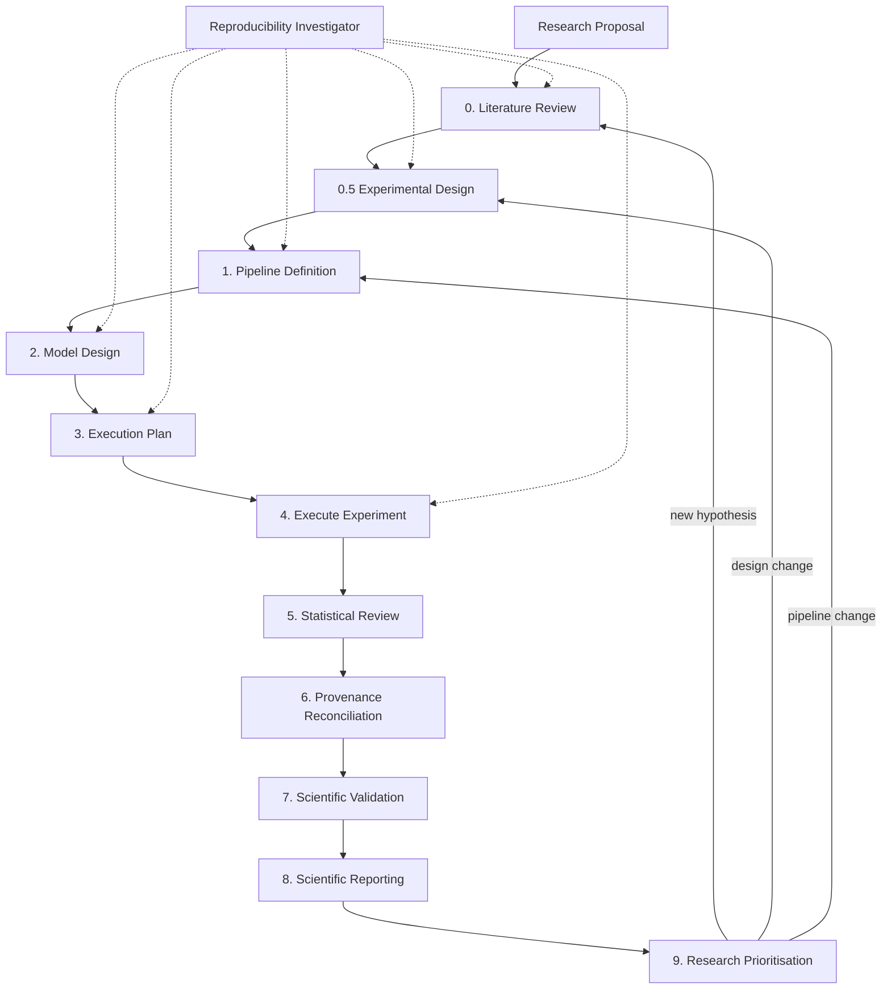

# Scientific Workflow Overview

This workflow turns an approved **research proposal** into reproducible experimental work and evidence suitable for a **research paper**. It is governed by the **`scientific-manager-agent`**.

Nothing in the workflow hardcodes a dataset, metric, or tooling choice. Those are determined from **your proposal** and locked in progressively through hypothesis formulation and experimental design.

For product/engineering work, see the separate [Business Workflow](./workflow-overview.md).

---

## Entry point: the research proposal

The workflow assumes you start with (or are developing) a **research proposal** that states:

- The research question and motivation
- The domain and data sources you intend to use
- The hypothesis or hypotheses to test
- Rough methodological direction
- What a successful outcome would look like

Step 0 (`literature-review`) does not replace the proposal — it **formalises** it: synthesises prior work, sharpens the cognitive gap, defines H₀/H₁, and documents biological or domain constraints **for the specific study described in the proposal**.

Each downstream step inherits from the proposal and upstream artifacts. A future project with a different dataset, domain, or metrics uses the same workflow structure with different content.

---

## Dual tracks

- **Hypothesis track** — literature review, experimental design, scientific validation, scientific reporting, research prioritisation
- **Computational track** — pipeline definition, model design, execution plan, experiment execution, statistical review, provenance reconciliation

**Diagnostic (parallel):** `reproducibility-investigator` — data leakage, baseline failure, distribution-shift collapse, or reproducibility breaks.

---

## Workflow stages

| Step | Specialist | What it produces |
|------|------------|------------------|
| **0** | `literature-review` | Cognitive gap, null hypothesis, domain constraints → `docs/workflow_stages/hypothesis_formulation/` |
| **0.5** | `experimental-design` | Splits, CV, metrics, leakage controls → `docs/workflow_stages/experimental_strategies/` |
| **1** | `pipeline-definition` | Scoped computational problem → `docs/workflow_stages/pipeline_definitions/` |
| **2** | `model-design` | Architecture options and comparison → `docs/workflow_stages/model_designs/` |
| **3** | `execution-plan` | Reproducible scripting plan → `docs/workflow_stages/execution_plans/` |
| **4** | `execute-experiment` | Trained models, evaluations, run logs → `runs/` + `docs/workflow_stages/execution_plans/*-execution-log.md` |
| **5** | `statistical-review` | Metric audit, fitting validity → `docs/workflow_stages/statistical_reviews/` |
| **6** | `provenance-reconciliation` | Living docs aligned with executed reality |
| **7** | `scientific-validation` | Evidence-based H₀ verdict → `docs/workflow_stages/scientific_verdicts/` |
| **8** | `scientific-reporting` | Manuscript section drafts → `docs/workflow_stages/manuscript_drafts/<study>/` |
| **9** | `research-prioritisation` | Next studies ranked → `docs/workflow_stages/future_research/` |

**Paper output:** Step 8 drafts Methods, Results, Discussion, and a skeletal Introduction outline as separate files per section. It does **not** produce a complete paper, Title, or Abstract — final narrative, introduction expansion, and submission remain human-led.

Each study gets a folder under `manuscript_drafts/YYYY-MM-DD-<slug>/`:

| File | Purpose |
|------|---------|
| `index.md` | Manifest, upstream links, review checklist |
| `introduction-outline.md` | Skeletal outline only (not full Introduction) |
| `methods.md` | Procedures as executed |
| `results.md` | Neutral findings (no interpretation) |
| `discussion.md` | Interpretation, limitations, tentative implications |
| `figures-and-tables.md` | Captions and artifact paths |

---

## What is an experiment tracker?

An **experiment tracker** is whatever system you use to **record each experimental run** so results are comparable and reproducible. It is not a fixed product — it is a **role** in the workflow, chosen per project in the execution plan.

A tracker typically logs:

| Field | Why it matters |
|-------|----------------|
| Run ID | Uniquely identifies this execution |
| Git commit hash | Links code state to results |
| Hyperparameters | Records what was actually trained |
| Metrics (per epoch/step) | Shows training dynamics |
| Artifacts | Model checkpoints, prediction files, plots |
| Environment | Python/CUDA versions, dependency lockfile |
| Data manifest hash | Proves which data split was used |

**Examples (choose based on proposal constraints, not workflow defaults):**

| Approach | When it fits |
|----------|--------------|
| **MLflow** | Standard ML projects; local or server-backed |
| **Weights & Biases (W&B)** | Cloud dashboards, team collaboration |
| **Structured local logs** | Minimal academic setups — JSON/YAML per run + execution log |
| **Lab notebook + version control** | Small single-researcher studies |

Step 3 (`execution-plan`) specifies **which tracker** (or logging scheme) this study uses. Step 4 (`execute-experiment`) writes to it. Step 6 (`provenance-reconciliation`) ensures living docs record the actual parameters logged.

---

## Proposal-driven configuration

These are **not workflow defaults** — they are **decisions made per study** from the proposal and locked in experimental design:

| Decision | Where it is defined | Example (one project) | Example (another project) |
|----------|---------------------|----------------------|---------------------------|
| Dataset(s) | Proposal → hypothesis formulation → experimental design | fMRI perception + imagery benchmark | EEG motor imagery |
| Train/test split | Experimental design | Subject-level ID/OOD | K-fold on trials |
| Primary metric | Experimental design | Semantic similarity | Classification accuracy |
| Tracker | Execution plan | MLflow local | JSON run logs |
| Architecture family | Model design | Ridge regression mapper | Transformer encoder |

If the proposal changes prospectively, upstream steps must be revisited (cascade rules below).

---

## Data leakage rules

When the experimental design defines **In-Distribution (ID)** training data and **Out-of-Distribution (OOD)** test data (common but not mandatory — the design may use other split logic):

- ID and OOD must remain strictly separated through all computational steps.
- If **experimental design** changes (e.g. training split redefined), **flush and re-run** all downstream computational work.
- Frozen test manifests must not be altered after execution begins.

---

## Cascade rules

**If step N changes prospectively, revisit all steps after N.**

| Change | Downstream impact |
|--------|-------------------|
| Hypothesis formulation | Design → pipeline → … → reporting → prioritisation |
| Experimental design (splits, metrics) | **Full computational flush** |
| Pipeline definition | Model → plan → execution → … |
| Model design | Plan → execution → … |

### Exceptions

1. **Provenance reconciliation** — retroactive only; does **not** trigger cascade.
2. **Scientific validation** — records verdict only; cascade only if you choose a prospective change.
3. **Scientific reporting** — records section drafts only; revisit when upstream artifacts change prospectively.

---

## Human-in-the-loop (mandatory)

| Step | Human owns |
|------|------------|
| Proposal approval | Research direction and scope |
| 0 | Null hypothesis and domain constraints |
| 0.5 | Split design, metrics, leakage controls |
| 2 | Architecture selection |
| 4 | Training and evaluation oversight |
| 7 | Hypothesis verdict acceptance |
| 8 | Manuscript section review and final narrative |
| Paper | Introduction expansion, Title/Abstract, submission |

Agents excel at **procedural execution**. **Hypothesis framing, causal reasoning, and final paper authorship remain human-owned.**

---

## Scientific Manager Agent role

The **`scientific-manager-agent`** routes requests, enforces leakage rules and cascades, mediates between you and specialists, and does **not** author scientific artifacts.

Invoke with: *"Act as the scientific-manager-agent"* or `@scientific-manager-agent`.

---

## Agent and skill locations

All subagents: `~/.cursor/agents/<name>.md`  
All skills: `~/.cursor/skills/<name>/SKILL.md`  
Shared writing conventions (math notation): `~/.cursor/skills/scientific-writing-conventions/SKILL.md`

These are **global** (user-level), not copied into individual project repos.
