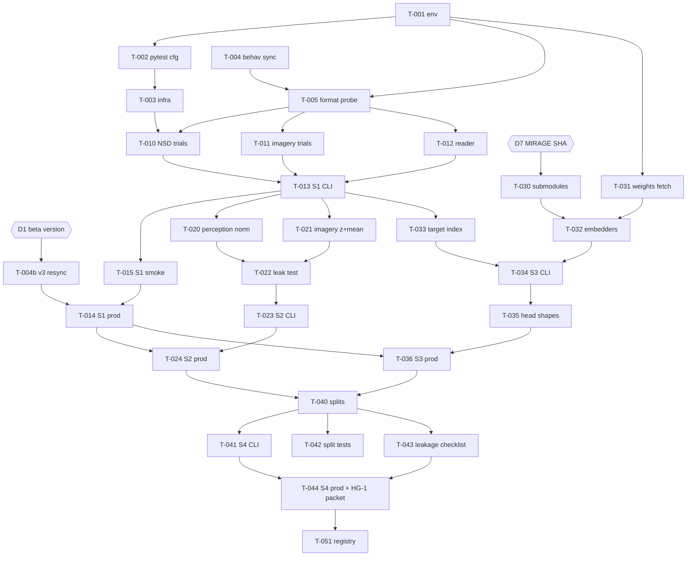

# Implementation Plan: M1 Shared Ingest Foundation (S1–S4, Track B)

**Date:** 2026-10-27
**Author:** AI-assisted (implementation-plan subagent)
**Status:** Under Review — awaiting investigator approval and decisions D1–D8 (§4)
**Study slug:** `perception-imagery-latent-ablation`
**Solution design (approved):** `docs/workflow_stages/model_designs/2026-09-06-perception-imagery-latent-ablation-option-3.md` (Option 3, inheriting Option 2 Track B package layout)
**Execution plan (approved, governs S1–S4 CLIs):** `docs/workflow_stages/execution_plans/2026-09-10-perception-imagery-latent-ablation-execution-plan.md` § *Shared foundation: S1–S4*
**Problem definition equivalent:** `docs/workflow_stages/pipeline_definitions/2026-09-06-perception-imagery-latent-ablation-pipeline-definition.md` (stages, data contracts, HC/PF/OD constraints)
**Chosen option:** Option 3 — Dual-Track Hybrid (Track B package owns S0–S4 shared ingest)
**Blocker addressed:** B12 (`S1–S4 ingest CLIs not implemented`) in the execution log
**Research verified:** Yes — live sources cited in §3 (Exa, Context7, Hugging Face Hub listing, NSD S3 listing, read-only CSF inspection 2026-10-27)

---

## 1. Summary

This plan implements the four shared Track B stages that turn raw NSD and NSD-Imagery data on CSF scratch into analysis-ready, leakage-checked inputs for ridge training (S5) and the Track A gate:

- **S1 ingest:** per-subject trial tables and `nsdgeneral`-masked beta matrices for all 8 subjects (perception sessions and the NSD-Imagery session).
- **S2 preprocess:** perception z-scoring fitted on training trials only, per-run z-scoring of NSD-Imagery runs, and the 16-repetition imagery mean. Includes the HC-04 leakage unit test.
- **S3 targets:** frozen-encoder ridge targets (image CLS 768, text 77×1280, retrieval hidden 257×1024, VDVAE 91168) for perception training images only. These are computed through the unmodified MIRAGE embedder code.
- **S4 splits:** Setting A and Setting B train, tune and test index tables, plus the 12-item leakage checklist in `scripts/preflight.py --leakage-checklist`.

**Highest-risk items, front-loaded in sequencing:**

1. **Beta-version mismatch (C1):** the beta version on scratch is not the one MIRAGE and the NSD-Imagery benchmark use. This needs an investigator decision (D1) before any production run of S1.
2. **S3 depends on vendored MIRAGE and Stable Cascade code plus about 30 GB of weights and images** that are not yet on scratch (C7).
3. **On-disk data formats are unverified.** These are the HDF5 axis order, the `.mat` version of the imagery design files, and the trial-to-stimulus mapping. A probe task (T-005) proves them before the stage code is trusted.

All production compute runs as Slurm batch jobs on CSF3. Unit tests use synthetic fixtures and run on the laptop and on CSF. Real-data integration tests run on CSF only.

---

## 2. Scope Traceability

### 2.1 Requirements → tasks

| Requirement (source) | Plan task(s) |
| --- | --- |
| S1 CLI `python -m mirage_ablation.ingest.cli --stage S1 --manifest …` (exec plan S1) | T-010, T-011, T-012, T-013 |
| S1 "loads all domains; no split applied" (exec plan S1; pipeline S1) | T-013 (writes perception and imagery for subjects 1–8; no exclusions) |
| S1 verification "trial counts match BIDS; 8 subjects present" | T-010 (three-source trial reconciliation, see C5), T-013 acceptance |
| S1 acceptance "preflight shape check; no NaN in masked voxels" | T-012, T-013 |
| GLMsingle betas at 1.8 mm, `nsdgeneral` mask (pipeline S1; strategy §Preprocessing) | T-012; beta version per D1 |
| S2 CLI `--stage S2`; imagery = mean of 16 reps (exec plan S2) | T-021, T-023 |
| S2 per-run z-scoring within NSD-Imagery runs (HC-04; strategy checklist item 5) | T-021 |
| S2 `pytest tests/unit/test_preprocessing_no_imagery_leak.py` (exec plan S2) | T-022 |
| S2 acceptance "imagery trials excluded from perception normalisation stats" | T-020, T-022 |
| S3 CLI `python -m mirage_ablation.targets.cli --stage S3 --train-only` | T-033, T-034, T-036 |
| S3 targets from ID perception training images only; frozen encoders (HC-02, HC-08) | T-031, T-032, T-033 |
| S3 `tests/unit/test_head_shapes.py` (exec plan S3; verification table "257×1024 retrieval layout") | T-035 |
| S3 acceptance "no imagery stimulus IDs in target index" | T-033 (with audited exceptions per D4 / C2) |
| PF-05 cache CLIP targets on training images | T-034 (targets written once per image, reused by S5/S6) |
| S4 CLI `python -m mirage_ablation.splits.cli --setting A` then `--setting B` | T-040, T-041, T-044 |
| S4 outputs `data/processed/splits/{manifest_sha}/setting_{a,b}/train_indices.parquet` | T-040 (plus the test and tune index files needed for acceptance) |
| S4 Setting A excludes `shared1000`; Setting B adds audit exclusions (HC-05, HC-13) | T-040 |
| S4 `pytest tests/unit/test_splits.py` | T-042 |
| S4 `python scripts/preflight.py --leakage-checklist`, 12 items, HG-1 | T-043 |
| Tune subjects {3,4,6,8} never in the test index (exec plan S4; HC-06) | T-040, T-042, T-043 (L4) |
| Run logging `runs/{run_id}/run.json` + `stage_meta.yaml` (exec plan § logging) | T-003 |
| Track A consumes S1–S4 outputs without duplicate ingest (exec plan § Track-specific roots) | T-020 output format contract (MIRAGE `load_nsd`-compatible `betas` dataset) |
| CSF: no compute on login nodes; `sbatch` from `scripts/csf/` (AGENTS.md; exec plan § CSF3) | T-014, T-024, T-036, T-044, T-050 |
| Manifest hash gate before stage execution (exec plan § Linking runs to provenance) | T-003 (shared hash-gate helper reused by every CLI) |

### 2.2 Explicitly out of scope

- S0 work: CLIP semantic audit (B11), `shared1000_embeddings.npz` catalogue (S0.3), and any manifest content change. T-031 runs the **existing** S0.4 weights-manifest CLI; it adds no S0 code.
- Track A vendoring of notebooks and `configs/track_a/paths.yaml` (B8). T-030 pins only the MIRAGE and Stable Cascade source needed for the S3 embedders.
- S5 and later stages, `orchestration/`, `parity/`, `evaluation/`.
- NSD-Imagery vision-trial aggregates. Vision trials are ingested and z-scored as part of the run blocks, but no 8-repetition vision means are produced because they are supplementary only.
- W&B or MLflow logging. Local JSON/YAML logging is the MVP.

### 2.3 Product / validation traceability

N/A — research pipeline, not product-led work.

---

## 3. Research Summary

### 3.1 Search queries and lookups used

1. Exa: "Natural Scenes Dataset data manual betas_fithrf func1pt8mm betas_session hdf5 int16 divide by 300 percent signal change"
2. Exa: "NSD-Imagery dataset betas_nsdimagery.hdf5 imagery runs vision runs trial design 18 stimuli repetitions"
3. Exa fetch: MedARC-AI/MIRAGE `src/utils.py` (`load_nsd`, `create_whole_region_*`, `load_nsd_mental_imagery`)
4. Exa fetch: MedARC-AI/MIRAGE `src/Train.ipynb`, `src/sc_reconstructor.py`, `src/vdvae.py`, `src/setup.sh`, README
5. Exa fetch: Stability-AI/StableCascade `train/train_c.py` (CLIP checkpoint names)
6. Hugging Face Hub `hf_fs ls`: `datasets/reesekneeland/MIRAGE`, `datasets/reesekneeland/MIRAGE/models`, `datasets/pscotti/mindeyev2`
7. Exa: "PyTorch 2.2 release notes Python 3.12 support; torch 2.1 supported Python versions"
8. Exa: "Lustre filesystem best practices avoid many small files HPC scratch"
9. Context7 `/h5py/h5py`: chunked datasets, compression, chunk cache (`rdcc_nbytes`)
10. Context7 `/nipy/nibabel`: array-proxy (`dataobj`) slicing vs `get_fdata`
11. Context7 `/websites/pandas_pydata`: `DataFrame.to_parquet(index=False)`, pyarrow engine
12. Context7 `/scipy/scipy`: `loadmat` and MATLAB v7.3 support
13. Context7 `/pytest-dev/pytest`: registering markers, `--strict-markers`
14. Context7 `/websites/huggingface_co_huggingface_hub`: `HF_HUB_OFFLINE`, `HF_HOME`, `HF_HUB_CACHE`
15. Read-only CSF inspection (2026-10-27): scratch raw layout, S3 prefix listing for subj01, `behav/responses.tsv` header, Python module availability

### 3.2 Key findings

| # | Finding | Source | Reliability tier | Affects task(s) |
| --- | --- | --- | --- | --- |
| R1 | The NSD-Imagery benchmark trained on the full 40 NSD sessions (shared1000 excluded), using `nsdgeneral` (13k–16k voxels per subject), and evaluated on **beta version 3 (`betas_fithrf_GLMdenoise_RR`)**. | [NSD-Imagery CVPR 2025 supplement](https://openaccess.thecvf.com/content/CVPR2025/supplemental/Kneeland_NSD-Imagery_A_Benchmark_CVPR_2025_supplemental.pdf) | 1 (primary paper) | D1, T-012, T-013 |
| R2 | NSD-Imagery has 12 runs: vision, imagery and attention × simple/complex/conceptual, with the imagery runs done twice. Each run is 8 reps × 6 stimuli (576 trials); imagery has **16 reps per stimulus**. Data are **z-scored within each run**, vision and imagery separately. | [NSD-Imagery arXiv 2506.06898](https://arxiv.org/html/2506.06898) | 1 | T-011, T-021 |
| R3 | MIRAGE reads beta v3 for perception and imagery (`create_whole_region_unnormalized` and `create_whole_region_imagery_unnormalized` default `GLMdenoise=True`). The mask is `nsdgeneral == 1`; betas are ÷300. Perception z-scoring is **per voxel, pooled across sessions, with mean/std fitted on non-shared1000 training trials only**. Imagery is z-scored per run block (`visA`…`attC`) with `zscore()` (`torch.std` + 1e-6). | [MIRAGE `src/utils.py`](https://github.com/MedARC-AI/MIRAGE/blob/main/src/utils.py) | 3 (maintainer code; Track A authority) | D1, D2, T-012, T-020, T-021 |
| R4 | MIRAGE `load_nsd` takes training trials from `nsd_stim_info_merged.csv` rows with `subject{s} != 0 & shared1000 == False`, using `subject{s}_rep{0..2} − 1` as 0-based scan IDs. It drops IDs `≥ num_sessions × 750` (planned but not acquired). Session counts: {1:40, 2:40, 3:32, 4:30, 5:40, 6:32, 7:40, 8:30}. | [MIRAGE `src/utils.py`](https://github.com/MedARC-AI/MIRAGE/blob/main/src/utils.py) | 3 | T-010, T-040 |
| R5 | MIRAGE targets come from `coco_images_224_float16.hdf5` (mindeyev2) and `mid_length_captions_73K.npy` (default `caption_type=medium`), indexed by the 0-based 73k `nsdId`. Embedders: `SC_Reconstructor(embedder_only=True).embed_image` (CLS, `(N,1,768)`), `embed_image(hidden=True)` (`257×1024`, then L2-normalised along dim 2), `embed_text` (`hidden_states[-1]`, `77×1280`), and `VDVAE.embed_latent` (flattened 91168). | [MIRAGE `Train.ipynb`](https://github.com/MedARC-AI/MIRAGE/blob/main/src/Train.ipynb), [`sc_reconstructor.py`](https://github.com/MedARC-AI/MIRAGE/blob/main/src/sc_reconstructor.py), [`vdvae.py`](https://github.com/MedARC-AI/MIRAGE/blob/main/src/vdvae.py) | 3 | T-030–T-035 |
| R6 | `SC_Reconstructor.__init__` loads Stage C (`stage_c_bf16.safetensors`, plus `effnet_encoder` and `previewer`) **even with `embedder_only=True`**, and runs CLIP in bfloat16. The CLIP checkpoints are `openai/clip-vit-large-patch14` (image) and `laion/CLIP-ViT-bigG-14-laion2B-39B-b160k` (text). | [MIRAGE `sc_reconstructor.py`](https://github.com/MedARC-AI/MIRAGE/blob/main/src/sc_reconstructor.py); [StableCascade `train/train_c.py`](https://github.com/Stability-AI/StableCascade/blob/master/train/train_c.py) | 3 | T-031, T-032; gives a concrete CLIP source relevant to B11 |
| R7 | `reesekneeland/MIRAGE` (HF) provides `effnet_encoder`, `previewer`, `stage_a`, `stage_b_bf16`, `stage_c_bf16` safetensors, `imagenet64-iter-1600000-model-ema.th` (VDVAE), and the caption `.npy` files. It has **no precomputed CLIP targets**. `pscotti/mindeyev2` provides `coco_images_224_float16.hdf5` (22 GB) and `shared1000.npy`. | Hugging Face Hub listing (`hf_fs ls`, 2026-10-27) | 2 (vendor host) | T-031 |
| R8 | MIRAGE `setup.sh` pins `torch==2.1.0`, `torchvision==0.16.0`, `transformers==4.37.2`, `accelerate==0.24.1`, `h5py==3.10.0`, `nibabel==5.2.1`, `pandas==2.2.0`, `kornia==0.7.1`. Notebook metadata shows Python 3.11.10. | [MIRAGE `src/setup.sh`](https://github.com/MedARC-AI/MIRAGE/blob/main/src/setup.sh) | 3 | T-001, T-030 |
| R9 | PyTorch 2.1 supports Python **≥3.8, ≤3.11** only. CSF `miniforge` defaults to Python 3.12.8, so the Track B env must pin Python 3.11. | [PyTorch RELEASE.md compatibility matrix](https://github.com/pytorch/pytorch/blob/a21327e0b03cc18850a0608be2d9c5bd38fd4646/RELEASE.md) | 1 | T-001 |
| R10 | NSD `betas_session*.hdf5` hold int16 betas; divide by 300 for percent signal change. HDF5 supports random access by trial. | [cvnlab/nsdexamples via Context7](https://github.com/cvnlab/nsdexamples/blob/master/matlab/html/example02_loaddata.html) | 3 | T-012 |
| R11 | Lustre performs poorly with many small files. Aggregate into large files (HDF5/NetCDF) with large sequential reads, and avoid thousands of files per directory. | [OzSTAR Lustre guide](https://supercomputing.swin.edu.au/docs/1-getting_started/Optimising-Lustre.html); [NASA HECC Lustre best practices](https://www.nas.nasa.gov/hecc/support/kb/lustre-best-practices_226.html); [INCD Lustre best practices](https://wiki.incd.pt/books/filesystem-user-guide/page/lustre-best-practices) | 1–2 (HPC centres) | D3, T-013, T-034 |
| R12 | `h5py.create_dataset` supports explicit `chunks`, compression, and a per-dataset chunk cache (`rdcc_nbytes`, default 1 MiB). Chunk shape drives performance. | [h5py docs (Context7)](https://github.com/h5py/h5py/blob/master/docs/high/group.rst) | 1 | T-013, T-020, T-034 |
| R13 | nibabel `img.dataobj[...]` slices from disk without loading or caching the whole array; `get_fdata()` caches a float copy. | [nibabel images_and_memory (Context7)](https://github.com/nipy/nibabel/blob/master/doc/source/images_and_memory.rst) | 1 | T-005, T-012 |
| R14 | `scipy.io.loadmat` reads v4/v6/v7–7.2 only and raises `NotImplementedError` for v7.3 (HDF5), which needs h5py. | [SciPy `_mio.py` (Context7)](https://github.com/scipy/scipy/blob/main/scipy/io/matlab/_mio.py) | 1 | T-010, T-011 |
| R15 | `to_parquet(index=False)` avoids a spurious `__index_level_0__` column; pyarrow is the default engine when installed. | [pandas IO docs (Context7)](https://pandas.pydata.org/docs/user_guide/io.html) | 1 | T-010, T-011, T-033, T-040 |
| R16 | Register custom pytest markers and enforce them with `--strict-markers`; deselect with `-m "not …"`. | [pytest mark docs (Context7)](https://github.com/pytest-dev/pytest/blob/main/doc/en/how-to/mark.rst) | 1 | T-002 |
| R17 | `HF_HUB_OFFLINE=1` means no Hub HTTP calls and cache-only loads (error if missing). `HF_HOME` also stores the **token**; `HF_HUB_CACHE` relocates only the cache. | [huggingface_hub env vars (Context7)](https://huggingface.co/docs/huggingface_hub/en/package_reference/environment_variables) | 1 | T-031, T-036 |
| R18 | CSF3: GPU partitions are `gpuL` (L40S 48 GB) and `gpuA` (A100 80 GB), up to 4 GPUs free at point of use, 4-day max walltime. `serial` and `multicore_small` have 4–6 GB RAM per core; job arrays support `%N` throttling; `seff`/`sacct -o maxrss` report peak memory. | Local CSF docs `docs/CSF/nvidia_gpu_jobs.md`, `high_memory_jobs.md`, `job_arrays.md` (copies of UoM RI docs) | 1 (institutional) | T-014, T-024, T-036, T-044 |
| R19 | NSD S3 for subj01 `func1pt8mm` has `betas_fithrf/`, `betas_fithrf_GLMdenoise_RR/`, `nsdimagerybetas_fithrf/` and `nsdimagerybetas_fithrf_GLMdenoise_RR/`. Scratch currently holds **only `betas_fithrf` and `nsdimagerybetas_fithrf`** (40 sessions for subj01). `nsddata/ppdata/subjNN/behav/responses.tsv` has columns `SUBJECT SESSION RUN TRIAL 73KID 10KID …`. | Read-only `aws s3 ls` and `ls` via `ssh csf3` (2026-10-27) | 1 (primary data host) | C1, D1, T-004, T-010 |
| R20 | CSF base `miniforge` Python has **no `h5py` or `scipy`**, so an environment task is required before any probe. | Read-only `ssh csf3` check (2026-10-27) | 1 | T-001 |

### 3.3 Implementation risks surfaced by research

- **Parity drift with Track A:** wrong beta version (R1, R3, R19), per-run vs pooled normalisation (R3), or a different caption file or embedder dtype (R5, R6) would make the S12 parity audit fail for reasons unrelated to the ablation.
- **Order-dependent VDVAE encoding:** `VDVAE.embed_latent` returns `stats[j]['z']`. Whether this is a posterior sample (stochastic) or a mean must be verified empirically in T-032. If stochastic, the coefficient-parity tolerance of 1e-6 will not hold for the VDVAE head.
- **Environment fragility:** the torch 2.1 pin forces Python 3.11 (R9). Stable Cascade needs git-installed helper packages (R8).
- **Lustre small-file pressure** if the execution plan's per-image/per-run file layout were implemented literally (R11). See D3.

---

## 4. Design–Plan Conflicts, Gaps and Pending Decisions

The plan is written assuming the **recommended default** for each decision below. Implementation of all code tasks can proceed under the defaults. **Production runs (T-014, T-024, T-036, T-044) are blocked until D1 is recorded**, and HG-1 is blocked until D4 and D5 are recorded. The executor records each decision (who, date, choice) in the implementation execution log and in `runs/execution_log.md`. If the investigator rejects a default in a way that changes the science (D1 alternative, D2, D4), route to `execution-plan` / `provenance-reconciliation` to update the living execution plan. This plan does not edit upstream documents.

| ID | Issue | Impact | Recommended resolution (plan default) |
| --- | --- | --- | --- |
| **C1 / D1** | **Beta version.** The pipeline says "GLMsingle v3 beta maps", and MIRAGE plus the NSD-Imagery benchmark use v3 = `betas_fithrf_GLMdenoise_RR` (R1, R3). However, `data-and-compute-prerequisites.md` says "beta version 2: `betas_fithrf`", and `sync_m1_perception_subj.sbatch` explicitly **excludes** `*betas_fithrf_GLMdenoise_RR*`. All ~420 GB on scratch is v2, for perception and imagery (R19). | **High.** S12 reproduction fidelity and Track A/B parity depend on matching MIRAGE inputs. A wrong choice invalidates S1–S11. | **Use v3 (`betas_fithrf_GLMdenoise_RR`)** for perception and imagery. Run the conditional re-sync task T-004b. S1 takes `--beta-version`, records it in every output, and downstream stages refuse mismatches. Smoke tests (T-015) may run on the v2 data already present. |
| **C2 / D4** | **S3 acceptance "no imagery stimulus IDs in target index" conflicts with the HG-0-accepted Setting A mask.** `nsd_stim_info_merged.csv` marks nsdIds 30857 and 61178 (subj2), 65873 (subj5) and 53882 (subj7) as `shared1000=False` training images. These are NSD-Imagery complex stimuli, and MIRAGE trains on them (`mirage_split_verification.all_subjects_agree=true`, HG-0 statement). Tuning subject 3 also saw nsdIds 0 and 28752. | **High.** A literal check fails Setting A by construction; removing the images breaks S12 parity. | **Setting A target index includes these images.** The S3 check reports them as *audited exceptions*: each must appear in `stimulus_overlap_audit.json` `per_subject.*.exact_seen` (test subjects) or be listed in `targets/index.parquet` with `imagery_overlap=true` (tuning subjects). Any other imagery-stimulus ID is a FAIL. Setting B excludes all of them (T-040). **Flag to S0 owner:** `complex_nsd00000` (artwork) has `nsd_id=0` / `coco_id=532481`, which is a real NSD scene seen by subj3; verify this is not a population error (route to `reproducibility-investigator` if unclear). |
| **C3 / D3** | **Storage layout.** The execution plan writes `data/processed/betas/{subject}/{session}/{run}.npy` (≈3.7k files) and `data/processed/targets/{coco_image_id}/{head}.npz` (≈70k images × 4 heads ≈ 280k files). That conflicts with Lustre guidance (R11) and with Track A's single-matrix input format (R3). | **Medium.** Metadata-server pressure, slow S5 loads, and harder Track A consumption. | Keep the **logical keys** but store **one HDF5 per subject and domain** for betas (S1/S2) and **one HDF5 per head** for targets, each with a parquet index (§5 data contracts). Lookup APIs (`TargetStore.get(coco_image_id, head)`, `TrialTable.lookup(subject, session, run, trial)`) preserve the plan's addressing. If rejected, only the writer functions in T-013/T-034 change. |
| **C4 / D2** | **Perception normalisation is unspecified,** and Setting B normalisation could leak. The pipeline and strategy only forbid imagery in normalisation. MIRAGE pools sessions and fits on Setting A training trials (R3). Under Setting B, fitting on Setting A trials would let strict-holdout images inform normalisation (checklist item 3: "excluded … before any fit"). | **Medium.** Leakage-checklist integrity for Setting B. | **Setting-specific normalisation:** S2 fits per-voxel mean/std (ddof=1, pooled across sessions) on that setting's training trials only. Setting A matches MIRAGE; Setting B stats are produced only when the Setting B split is buildable (blocked on B11). |
| **C5 / D6** | **"Trial counts match BIDS":** BIDS `nsddata_rawdata` is not synced and is not needed. | Low | Reconcile three official NSD sources: `nsd_stim_info_merged.csv` rep columns, `nsd_expdesign.mat` (`masterordering`, `subjectim`) and `ppdata/subjNN/behav/responses.tsv`, plus the HDF5 trial dimension. The `RUN` column of `responses.tsv` supplies `run_id`. |
| **C6 / D5** | **Leakage checklist "12/12 pass" at HG-1** includes items that cannot be fully satisfied at S4: item 12 (reproduction gate) happens after HG-1; item 7 (distractor catalogues) awaits S0.3/B11; item 3 (Setting B) awaits B11. | **Medium.** HG-1 could never pass literally. | Each item asserts the **control state at the S4 boundary** (definitions in T-043). Item 12 passes if no S8–S11 artefacts exist and registry HG-2 ≠ PASS. Items 3 and 7 may report `DEFERRED` with reason codes. Exit code 0 requires zero `FAIL` and `DEFERRED` only on the allow-list `{L3 (Setting B not built), L7 (S0.3 pending)}`. The investigator accepts or rejects the DEFERRED items at HG-1. |
| **C7 / D7** | **S3 needs MIRAGE and Stable Cascade source,** which overlaps B8 (Track A not vendored). `SC_Reconstructor` loads Stage C even in embedder-only mode (R6). | **Medium.** S3 cannot run until the source is pinned and ~7.4 GB of Stage C, effnet and previewer weights are on scratch. | Pin upstream `MedARC-AI/MIRAGE` and `Stability-AI/StableCascade` as git submodules under `third_party/` at the HEAD SHAs on the execution date. Record `mirage_fork_commit` in the registry. Track A must later vendor notebooks from the **same** SHA. Use the upstream embedders unmodified (Option 2 `mirage_compat` contract). |
| **C8** | **Python version:** CSF default 3.12.8 vs torch 2.1.0 (R9). | Medium | A single conda prefix env with Python 3.11 at `~/scratch/comp30030-mirage-ablation/envs/track_b`, locked in `configs/environments/track_b.lock`. |
| **C9 / D8** | **Setting B exclusions for tuning subjects {3,4,6,8}** are not in the audit (`per_subject` covers 1,2,5,7 only). | Low now (Setting B blocked on B11) | S4 `--setting B` refuses to build unless the audit has `clip_audit_status == "complete"` **and** per-subject entries for all 8 subjects. Route to the S0 owner when B11 is resolved. |
| **C10** | **VDVAE determinism** is unknown (R5 note). | Medium (affects later coefficient parity) | T-032 encodes the same image twice. If outputs differ, seed `torch.manual_seed(42)` before each image (MIRAGE seeds once globally), record `vdvae_seed_policy` in the targets metadata, and flag that coefficient-diff parity for the VDVAE head needs a relaxed tolerance (route to `execution-plan`). |
| **C11** | **Conventions not fixed upstream:** the `{manifest_sha}` path segment format, and the `run_id` setting segment for setting-agnostic stages. | Low | `{manifest_sha}` = first 12 hex characters of `manifest_sha256` (full hash in metadata). Run IDs: `{YYYYMMDD}-s1-shared-subj{NN}`, `{YYYYMMDD}-s2-setting_a-subj{NN}`, `{YYYYMMDD}-s3-shared-{head}`, `{YYYYMMDD}-s4-setting_{a|b}`. |

---

## 5. Data Contracts (scratch vs repo)

### 5.1 Location rules

| Class | Location | Git? | Notes |
| --- | --- | --- | --- |
| Code, tests, jobscripts, env locks | `~/comp30030-mirage-ablation/` (CSF home clone), mirrored from the laptop repo | Yes | `git push` from the laptop, `git pull` on CSF (AGENTS.md) |
| Frozen manifests | `manifests/` | Yes | S1–S4 read only. The exception is `model_weights_manifest.json`, which is written by the existing S0.4 CLI in T-031. |
| Raw inputs (read-only) | `$SCRATCH/data/raw/…` | No (`data/` gitignored) | `SCRATCH=/net/scratch/z29707aj/comp30030-mirage-ablation` |
| Processed outputs | `$SCRATCH/data/processed/…` | No | `MIRAGE_ABLATION_DATA_ROOT=$SCRATCH/data` in every jobscript |
| Smoke outputs | `$SCRATCH/data/processed/_smoke/…` | No | Any `--sessions` / `--limit` run writes here only; never consumed downstream |
| Frozen weights and images | `$SCRATCH/data/frozen_weights/…` | No | `HF_HUB_CACHE=$SCRATCH/data/frozen_weights/hf_hub_cache` (the token stays in home `~/.cache/huggingface`) |
| Run records (small) | `$SCRATCH/runs/{run_id}/` → copied to repo `runs/{run_id}/` | Yes (copied) | `run.json`, `stage_meta.yaml`, `*_report.json`, `leakage_checklist.json` |
| Slurm logs | `$SCRATCH/runs/slurm-logs/` | No | Jobs are submitted from `$SCRATCH` so relative `#SBATCH -o` paths resolve there |
| Conda env | `$SCRATCH/envs/track_b` | No (lock file is in git) | Rebuildable from `configs/environments/track_b.lock` if scratch cleanup removes it |

### 5.2 Raw inputs consumed (already on scratch unless marked)

| Input | Path under `$SCRATCH/data/raw/` | Stage |
| --- | --- | --- |
| Perception betas (`BV` per D1) | `nsd/betas/subj{NN}/func1pt8mm/{BV}/betas_session{SS}.hdf5` | S1 |
| Imagery betas | `nsd_imagery/betas/subj{NN}/func1pt8mm/nsdimagery{BV}/betas_nsdimagery.hdf5` | S1 |
| `nsdgeneral` ROI | `nsd/ppdata/subj{NN}/func1pt8mm/roi/nsdgeneral.nii.gz` | S1 |
| Stimulus info | `nsd/experiments/nsd/nsd_stim_info_merged.csv` | S1, S4 |
| Experimental design | `nsd/experiments/nsd/nsd_expdesign.mat` | S1 |
| **Behavioural responses (new, T-004)** | `nsd/ppdata/subj{NN}/behav/responses.tsv` | S1 |
| Imagery design | `nsd_imagery/experiments/nsdimagery/{designmatrixGLMsingle,visA_dm,…,attC_dm,A_pair_list,B_pair_list,C_pair_list}.mat`, `cue_pair_list.xlsx` | S1 |
| Captions (HC-08) | `../frozen_weights/mirage_hf/mid_length_captions_73K.npy` | S3 |
| **NSD images 224 (new, T-031)** | `../frozen_weights/mindeyev2/coco_images_224_float16.hdf5` | S3 |
| **SC weights and VDVAE (new, T-031)** | `../frozen_weights/mirage_hf/{effnet_encoder,previewer,stage_c_bf16}.safetensors`, `imagenet64-iter-1600000-model-ema.th` | S3 |
| **CLIP checkpoints (new, T-031)** | `$HF_HUB_CACHE` for `openai/clip-vit-large-patch14`, `laion/CLIP-ViT-bigG-14-laion2B-39B-b160k` | S3 |

### 5.3 Stage outputs

`{NN}` = zero-padded subject (01–08); `T_s` = acquired perception trials (750 × sessions); `V_s` = `nsdgeneral` voxel count; `T_img` = imagery-session trials (expected 576, confirmed in T-005).

**S1 — `$SCRATCH/data/processed/betas/subj{NN}/`**

| File | Content |
| --- | --- |
| `perception.h5` | Dataset `betas`, float32 `(T_s, V_s)`, percent signal change (int16 ÷ 300). Row `r` = 0-based global trial index `(session−1)·750 + (trial−1)`. Chunks `(64, V_s)`. Attrs: `beta_version`, `scale_divisor=300`, `mask_sha256`, `voxel_order` (from T-005), `n_sessions`, `git_commit`, `run_id`. |
| `perception_trials.parquet` | `subject_id:int8, session_id:int16, run_id:int8, trial_in_session:int16 (1..750), global_trial_index:int32, nsd_id:int32 (0-based 73k), coco_image_id:int64, shared1000:bool, rep_index:int8 (0..2)`. One row per acquired trial; `global_trial_index` equals the `perception.h5` row. |
| `imagery.h5` | Dataset `betas`, float32 `(T_img, V_s)`, percent signal change, same mask and voxel order |
| `imagery_trials.parquet` | `subject_id, beta_index:int16 (= imagery.h5 row), run_label (visA…attC, imgA_1…imgC_2), run_type {vision,imagery,attention}, stim_set {A,B,C}, trial_in_run:int16, letter_cue, stimulus_id (manifest ID; null where the design has no single target, e.g. attention streams)` |
| `mask.npz` | `nsdgeneral_bool` (3-D volume), `flat_index` (int64 indices in the HDF5 axis order), `voxel_count` |
| `$SCRATCH/runs/{run_id}/s1_report.json` | Per-subject counts, NaN counts, three-source reconciliation result, HDF5-vs-NIfTI parity result |

**S2 — `$SCRATCH/data/processed/betas_masked/subj{NN}/`**

| File | Content |
| --- | --- |
| `perception_z_setting_{a,b}.h5` | Dataset `betas` float32 `(T_s, V_s)` = `(x − μ_setting) / σ_setting` applied to **all** perception trials. Row order matches `perception.h5`, so it is a drop-in input for MIRAGE `load_nsd(betas=…)` (Track A contract). |
| `norm_stats_setting_{a,b}.npz` | `mean (V_s), std (V_s)`, `ddof=1`, `n_fit_trials`, `fit_trial_index_sha256`, `setting`, `beta_version` |
| `imagery_z.h5` | Dataset `betas` float32 `(T_img, V_s)`; each run block z-scored with its own per-voxel mean/std (`ddof=1`, +1e-6 on std, matching MIRAGE `zscore`) |
| `imagery_mean16.npz` | `betas (18, V_s)` = mean of the z-scored imagery trials per stimulus; `stimulus_ids (18,)` in manifest order; `n_reps (18,)` (all must equal 16) |
| `$SCRATCH/runs/{run_id}/s2_report.json` | Per-subject: fit-trial count, any `std == 0` voxels (count and handling), imagery rep counts |

**S3 — `$SCRATCH/data/processed/targets/`**

| File | Content |
| --- | --- |
| `index.parquet` | `row:int32, nsd_id:int32, coco_image_id:int64, seen_by_subjects:list<int8>, in_setting_a_train:bool, imagery_overlap:bool, imagery_stimulus_id:string(nullable)` |
| `image_cls.h5` | Dataset `targets` float32 `(N, 768)` |
| `text.h5` | Dataset `targets` float32 `(N, 77, 1280)` |
| `retrieval_hidden.h5` | Dataset `targets` float32 `(N, 257, 1024)`, L2-normalised per token (dim=−1), as in MIRAGE `Train.ipynb` |
| `vdvae.h5` | Dataset `targets` float32 `(N, 91168)` |
| each `*.h5` attrs | `encoder_id`, `weights_sha256`, `compute_dtype=bfloat16` (CLIP), `caption_file` + `caption_sha256` (text head), `image_source` + sha256, `mirage_commit`, `stablecascade_commit`, `vdvae_seed_policy`, `git_commit` |
| `targets_meta.json` | Head shape table, N, sha256 of each `.h5`, exception list (D4) |

**S4 — `$SCRATCH/data/processed/splits/{manifest_sha}/setting_{a,b}/`**

| File | Content |
| --- | --- |
| `train_indices.parquet` | `subject_id, role {train (1,2,5,7), tune (3,4,6,8)}, global_trial_index, session_id, run_id, trial_in_session, nsd_id, coco_image_id, rep_index, target_row` (→ `targets/index.parquet.row`) |
| `test_index.parquet` | `subject_id ∈ {1,2,5,7}, stimulus_id, type, imagery_mean_row` (→ `imagery_mean16.npz` row); exactly 72 rows |
| `tune_imagery_index.parquet` | `subject_id ∈ {3,4,6,8}, stimulus_id, type, imagery_mean_row`; exactly 72 rows (S6 proxy) |
| `split_meta.json` | `manifest_sha256, audit_sha256, setting, beta_version, git_commit`, per-subject counts, exclusion counts by reason (`shared1000`, `exact_seen`, `semantic_neighbour`, `lemma_caption`, `no_target`) |
| `$SCRATCH/runs/{run_id}/leakage_checklist.json` | 12 items: `{id, description, status ∈ {PASS, FAIL, DEFERRED}, reason, evidence}` |

---

## 6. Work Breakdown Structure

Conventions for every task: Python 3.11; `from __future__ import annotations`; argparse CLIs; paths only via `mirage_ablation.config.paths`; **no `torch` import in S1, S2 or S4 modules**; every CLI runs the manifest hash gate (T-003) before work and writes `run.json` and `stage_meta.yaml`.

### Phase 0 — Environment, infrastructure, data probes

#### T-001: Track B environment and lock file
- **Effort:** M
- **Dependencies:** —
- **Design reference:** Exec plan § Environment and dependency pinning (Track B); R8, R9, R20; C8
- **Description:** Define the CPU requirements and the GPU extras, then create the CSF conda env and lock it.
- **Inputs:** `requirements-track-b.txt`; MIRAGE `setup.sh` pins (R8)
- **Outputs:**
  - `requirements-track-b.txt` extended: `numpy<2`, `scipy`, `h5py==3.10.0`, `nibabel==5.2.1`, `pandas==2.2.0`, `pyarrow`, `openpyxl`, `pydantic>=2,<3`, `PyYAML`, `pytest==8.3.3`
  - `requirements-track-b-gpu.txt`: `torch==2.1.0`, `torchvision==0.16.0`, `transformers==4.37.2`, `accelerate==0.24.1`, `safetensors`, `einops>=0.7.0`, `kornia==0.7.1`, `omegaconf==2.3.0`, `ftfy`, `regex`, plus the git-installed `pytorch-gradual-warmup-lr` and `pytorch-tools` that Stable Cascade imports (R8). Install torch from the official CUDA wheel index for 2.1.0 (confirm the cu118/cu121 index URL on pytorch.org "previous versions" at execution time).
  - `scripts/csf/create_track_b_env.sbatch` (`-p serial`): `module load miniforge` → `conda create -p $SCRATCH/envs/track_b python=3.11` → pip installs → `pip freeze > $SCRATCH/runs/env/track_b.freeze.txt`
  - `configs/environments/track_b.lock` (the freeze output, copied to the repo)
- **Acceptance criteria:**
  - [ ] The env imports `h5py, scipy.io, nibabel, pandas, pyarrow, pydantic, openpyxl` (checked by a one-line import probe inside the job)
  - [ ] `python --version` in the env reports 3.11.x
  - [ ] The lock is committed, and registry `environment_pins.track_b_python` is updated by the executor
  - [ ] The laptop venv (Python 3.11) installs `requirements-track-b.txt` and runs the existing `tests/unit` green

#### T-002: Pytest configuration and fixture builders
- **Effort:** S
- **Dependencies:** T-001
- **Design reference:** R16; Exec plan § Verification checkpoints
- **Description:** Add `pytest.ini` (`testpaths = tests`, `addopts = --strict-markers`, markers `csf_data: requires real scratch data` and `gpu: requires CUDA`). Add `tests/conftest.py` builders that generate tiny synthetic NSD-like inputs at test time: a 4×5×6 volume, an `nsdgeneral` NIfTI with values {−1, 0, 1}, 2 sessions × 10 trials int16 HDF5, a stim CSV with `subjectN_repJ` columns including an unacquired ID, `responses.tsv`, a v5 `.mat` via `scipy.io.savemat`, and a v7.3-like HDF5 `.mat`. No binary fixtures are committed.
- **Inputs:** Existing `tests/unit/*`
- **Outputs:** `pytest.ini`, `tests/conftest.py`, `tests/integration/__init__.py`
- **Acceptance criteria:**
  - [ ] `python -m pytest tests/unit -q` passes on the laptop, including the existing `test_manifest_schema.py` and `test_mirage_split.py`
  - [ ] `python -m pytest -m "csf_data" -q` on the laptop collects tests but skips all of them (skip if `MIRAGE_ABLATION_DATA_ROOT` is missing)

#### T-003: Shared infrastructure — paths, subjects, provenance, hash gate
- **Effort:** M
- **Dependencies:** T-002
- **Design reference:** Exec plan § Experiment logging scheme, § Linking runs to provenance; C11
- **Description:**
  - Extend `mirage_ablation/config/paths.py` with `processed_dir()`, `betas_dir(subj)`, `betas_masked_dir(subj)`, `targets_dir()`, `splits_dir(manifest_sha, setting)`, `smoke_root()`, `runs_dir()` and `manifest_sha_short()` (12 hex).
  - Add `mirage_ablation/config/subjects.py` with `TEST_SUBJECTS=(1,2,5,7)`, `TUNE_SUBJECTS=(3,4,6,8)`, `SESSIONS={1:40,2:40,3:32,4:30,5:40,6:32,7:40,8:30}` and `TRIALS_PER_SESSION=750`. Import the existing `s0/training_mask.TEST_SUBJECTS` rather than duplicating it.
  - Add `mirage_ablation/provenance.py`. `make_run_id(stage, setting, subject=None, extra=None)` follows the exec-plan convention plus C11. `write_run_record(...)` emits `run.json` with the exec-plan required fields (null where N/A) plus `host`, `slurm_job_id`, `slurm_array_task_id`, `slurm_partition`, `scratch_path`, `beta_version`, `input_hashes`, `output_paths`. It also writes `stage_meta.yaml` (CLI argv, inputs, outputs, exit code, duration).
  - `verify_manifest_hashes()` refactors the sidecar check from `scripts/preflight.py` into the package; `preflight.py` then calls it, with behaviour unchanged.
- **Inputs:** `runs/registry.yaml` hashes; `manifests/*.sha256`
- **Outputs:** the modules above; `tests/unit/test_provenance.py`, `tests/unit/test_paths.py`
- **Acceptance criteria:**
  - [ ] `make_run_id("S2","A",subject=1)` → `YYYYMMDD-s2-setting_a-subj01`; `make_run_id("S1",None,subject=1)` → `YYYYMMDD-s1-shared-subj01`
  - [ ] The hash gate raises when the manifest bytes differ from the sidecar, and when the sidecar differs from `registry.yaml` `provenance.manifest_sha256`
  - [ ] `run.json` validates against a pydantic model containing every field in the exec-plan example
  - [ ] `python scripts/preflight.py` output is unchanged on the laptop

#### T-004: Fetch missing S1 metadata (behavioural responses)
- **Effort:** S
- **Dependencies:** —
- **Design reference:** C5 / D6; R19
- **Description:** Add `scripts/csf/sync_m1_behav.sh`, which runs `aws s3 sync --no-sign-request s3://natural-scenes-dataset/nsddata/ppdata/subj{NN}/behav/ $SCRATCH/data/raw/nsd/ppdata/subj{NN}/behav/` for NN = 01…08. It supports `DRYRUN=1`, following the `sync_m0_metadata.sh` pattern. This is a small transfer, allowed on the login node per the exec plan § Data ingress.
- **Outputs:** the script; eight `responses.tsv` files on scratch
- **Acceptance criteria:**
  - [ ] 8 files present; header begins `SUBJECT SESSION RUN TRIAL 73KID 10KID`
  - [ ] Sync logged with timestamp in `runs/execution_log.md`

#### T-004b: (Conditional on D1 = v3) Re-sync perception and imagery betas at beta version 3
- **Effort:** M
- **Dependencies:** D1 recorded
- **Design reference:** C1 / D1
- **Description:**
  - Parametrise `scripts/csf/sync_m1_perception_subj.sbatch` with `BETA_VERSION` (default `betas_fithrf_GLMdenoise_RR`). The `S3_SRC`/`S3_DST` paths use it, and the exclude of the chosen version is removed. The partition stays `serial`, with the existing retry loop.
  - Add `IMAGERY_BETA_VERSION` to `sync_m0_metadata.sh`, or a dedicated `sync_m1_imagery_betas.sh`, for `nsdimagerybetas_fithrf_GLMdenoise_RR`.
  - Submit one subject at a time per the existing policy, using the submit-and-handoff pattern (AGENTS.md).
  - Do not delete the v2 trees until the investigator approves (rollback path).
- **Outputs:** `$SCRATCH/data/raw/nsd/betas/subj{NN}/func1pt8mm/betas_fithrf_GLMdenoise_RR/`, `$SCRATCH/data/raw/nsd_imagery/betas/subj{NN}/func1pt8mm/nsdimagerybetas_fithrf_GLMdenoise_RR/`
- **Acceptance criteria:**
  - [ ] `betas_session{SS}.hdf5` count per subject equals `SESSIONS[subj]`
  - [ ] `aws s3 sync --dryrun` reports 0 deltas per subject, mirroring the 2026-10-27 subj03 parity check
  - [ ] Job IDs logged in `runs/execution_log.md` and the registry `data_access.m1_perception_sync` block

#### T-005: Data-format probe on CSF (de-risk before stage code)
- **Effort:** M
- **Dependencies:** T-001, T-004
- **Design reference:** R10, R13, R14; C5
- **Description:** Implement `mirage_ablation/ingest/probe.py` and expose it as `python -m mirage_ablation.ingest.cli --stage S1 --probe --subject 1 --beta-version <BV>`. It writes `$SCRATCH/runs/{run_id}/format_probe.json` recording:
  - (a) h5py dataset names, shapes, dtypes and chunks for `betas_session01.hdf5` and `betas_nsdimagery.hdf5`
  - (b) NIfTI shape of `betas_session01.nii.gz` and `nsdgeneral.nii.gz`, plus the unique mask values
  - (c) the HDF5 axis permutation relative to NIfTI. Determine it by comparing `nii.dataobj[..., t]` with the HDF5 slice for t = 0…9 under candidate permutations; record the one with exact equality.
  - (d) the `.mat` version and top-level keys of `nsd_expdesign.mat`, `designmatrixGLMsingle.mat`, each `*_dm.mat` and `*_pair_list.mat`. Try `scipy.io.loadmat` first; on `NotImplementedError`, use the h5py reader.
  - (e) the `responses.tsv` row count for subj01
  - (f) the imagery trial count in the betas file vs the design-matrix columns

  Submit as `scripts/csf/s1_probe.sbatch` (`-p serial`).
- **Outputs:** `probe.py`, the sbatch, `format_probe.json` (copied to repo `runs/`)
- **Acceptance criteria:**
  - [ ] A unique axis permutation gives exact equality for all 10 probe trials (recorded as `voxel_order`)
  - [ ] Unique `nsdgeneral` values are recorded and include 1
  - [ ] The imagery betas trial count equals the design trial count (expected 576 per R2; record the actual value)
  - [ ] For every design `.mat`, the reader used (`scipy`/`h5py`) is recorded
  - [ ] **If any criterion fails, stop and route to `reproducibility-investigator`** before T-010–T-013

### Phase 1 — S1 Ingestion

#### T-010: NSD perception trial table builder
- **Effort:** M
- **Dependencies:** T-003, T-005
- **Design reference:** Pipeline § Trial keys; R4; C5
- **Description:** Implement `mirage_ablation/ingest/nsd_trials.py::build_perception_trials(subject, stim_csv, expdesign_mat, responses_tsv, n_sessions) -> DataFrame`.
  - **Source 1 (CSV):** for rows with `subject{s} != 0`, take `subject{s}_rep{0..2}`, drop NaN or 0, convert to 0-based, and **drop IDs ≥ 750·n_sessions** (MIRAGE parity, R4).
  - **Source 2 (`nsd_expdesign.mat`):** `subjectim[s−1, masterordering[t]−1] − 1` → `nsd_id` for each acquired trial t.
  - **Source 3 (`responses.tsv`):** `(SESSION, RUN, TRIAL, 73KID−1)`.
  - Reconcile all three into one table (schema §5.3). `run_id` comes from `responses.tsv` `RUN`. Assert one row per acquired trial with identical `nsd_id` across sources. Join `coco_image_id` and `shared1000` from the CSV. Reuse `training_mask.shared1000_coco_ids` semantics where applicable.
- **Inputs:** §5.2 metadata files
- **Outputs:** the module; `tests/unit/test_nsd_trials.py`
- **Acceptance criteria:**
  - [ ] Unit test: the synthetic fixture with an unacquired rep ID drops exactly that row
  - [ ] Unit test: a deliberate mismatch between sources raises `TrialReconciliationError` naming the subject, session and trial
  - [ ] Unit test: `global_trial_index` is 0…T_s−1, contiguous and unique; `rep_index ∈ {0,1,2}`
  - [ ] Real data (T-015): row count == 750 × `SESSIONS[s]` and == the `responses.tsv` row count for all 8 subjects

#### T-011: NSD-Imagery trial table builder
- **Effort:** M
- **Dependencies:** T-003, T-005
- **Design reference:** Pipeline § Trial keys (imagery); R2, R3; manifest `imagery_stimuli[*].letter_cue`
- **Description:** Implement `mirage_ablation/ingest/imagery_trials.py::build_imagery_trials(subject, design_dir, cue_xlsx, manifest) -> DataFrame` using the structures recorded in T-005.
  - Map each beta index to a run block label (`visA`…`attC`, `imgA_1`…`imgC_2`) from `designmatrixGLMsingle.mat` and the per-run `*_dm.mat`.
  - Map each trial's cue to `stimulus_id` via `letter_cue` in the frozen manifest (cross-checked against `cue_pair_list.xlsx` and `*_pair_list.mat`).
  - The mapping must use only official NSD-Imagery files. MIRAGE's `nsdimagery_stimuli.pkl3` is not on scratch and is not required; if it is later obtained, an optional parity test may compare `exps`/`cues`.
- **Outputs:** the module; `tests/unit/test_imagery_trials.py`
- **Acceptance criteria:**
  - [ ] Unit test (synthetic design): 12 run blocks; every imagery stimulus has exactly 16 imagery trials; every simple/complex stimulus has 8 vision trials
  - [ ] Unit test: an unknown letter cue raises
  - [ ] Real data (T-015), all 8 subjects: 18 distinct imagery `stimulus_id`s, each with 16 imagery trials; total rows == imagery betas trial count

#### T-012: Mask and beta reader
- **Effort:** M
- **Dependencies:** T-005
- **Design reference:** Pipeline S1; R3, R10, R13
- **Description:** Implement `mirage_ablation/ingest/betas.py`:
  - `load_nsdgeneral(subject) -> Mask` sets `True` where the value is 1.0 after `nan_to_num`, as in MIRAGE, and exposes `flat_index` in the probe's `voxel_order`.
  - `iter_session_betas(subject, session, beta_version, mask) -> ndarray (750, V)` reads the session HDF5 with h5py, applies the mask with the recorded axis permutation, and returns float32 ÷ 300. It streams one session at a time.
  - `read_imagery_betas(subject, beta_version, mask) -> ndarray (T_img, V)`.
  - The NIfTI path is test/parity only: it uses `nib.load(...).dataobj` slices and never calls `get_fdata()` on full 4-D volumes.
- **Outputs:** the module; `tests/unit/test_betas_reader.py`
- **Acceptance criteria:**
  - [ ] Unit test: the synthetic HDF5 and NIfTI fixtures give identical masked vectors
  - [ ] Unit test: the int16 → float32 ÷300 scaling is exact on known values
  - [ ] Unit test: a mask with value −1 voxels excludes them
  - [ ] The reader never holds more than one session array in memory (asserted via the generator interface)

#### T-013: S1 CLI and writer
- **Effort:** M
- **Dependencies:** T-010, T-011, T-012
- **Design reference:** Exec plan S1 CLI; D3 storage layout; §5.3
- **Description:** Implement `mirage_ablation/ingest/cli.py` and `mirage_ablation/ingest/__main__.py` (so `python -m mirage_ablation.ingest.cli` works).

  ```
  --stage {S1,S2}  --manifest PATH (required for S1)
  --subject N | --all-subjects
  --beta-version {betas_fithrf_GLMdenoise_RR,betas_fithrf} (required; no silent default until D1)
  --sessions A-B (smoke only → writes under _smoke/)
  --probe  --overwrite
  ```

  For S1 the CLI:
  - runs the hash gate
  - builds the trial tables
  - streams sessions into `perception.h5` (pre-allocated `(T_s, V_s)` float32, chunks `(64, V_s)`, `fill_time='never'` per R12)
  - writes `imagery.h5`, both parquet tables (`index=False`, R15) and `mask.npz`
  - computes NaN counts
  - runs the HDF5-vs-NIfTI parity check on trials 0, 374 and 749 of session 1
  - writes `s1_report.json` and the run record

  Refuse to overwrite existing outputs without `--overwrite`. Write to `*.tmp` and `os.replace` on success, so partial outputs are never visible.
- **Outputs:** the CLI; S1 files per §5.3; `tests/unit/test_ingest_cli_s1.py` (end-to-end on synthetic fixtures)
- **Acceptance criteria:**
  - [ ] Synthetic end-to-end: the output shapes, parquet schemas and attrs match §5.3; re-running without `--overwrite` exits non-zero
  - [ ] `--sessions` writes only under `_smoke/`
  - [ ] An interrupted write leaves no file at the final path (test by raising mid-write)
  - [ ] Real data (T-014): 8 subjects; `T_s` matches `SESSIONS`; `V_s` lies in [13 000, 16 000] (R1) or the deviation is explained in the report; `perception.h5` NaN count == 0 and `imagery.h5` NaN count == 0 (**any NaN is a FAIL**, per the exec-plan acceptance); parity check exact

#### T-014: S1 production jobscript and run
- **Effort:** S
- **Dependencies:** T-013, T-015 PASS, D1 recorded (and T-004b complete if D1 = v3)
- **Design reference:** Exec plan § Stage → CSF workload mapping (S1–S2); R18
- **Description:** Add `scripts/csf/s1_ingest.sbatch` with `#!/bin/bash --login`, `-p serial`, `-n 1`, `-a 1-8%4`, `-t 1-0`, `-o runs/slurm-logs/s1-%A_%a.out`, `-J mirage_s1`. It activates the env, exports `MIRAGE_ABLATION_DATA_ROOT`, `cd`s to the repo, and runs `python -m mirage_ablation.ingest.cli --stage S1 --manifest manifests/nsd_imagery_test_manifest_v1.json --subject ${SLURM_ARRAY_TASK_ID} --beta-version ${BETA_VERSION}`. Submit it from `$SCRATCH` with `--export=ALL,BETA_VERSION=<D1>`. If `seff` shows OOM, resubmit the failed tasks on `-p multicore_small -n 4`.
- **Outputs:** the jobscript; S1 outputs for 8 subjects; job ID logged
- **Acceptance criteria:**
  - [ ] All 8 array tasks `COMPLETED 0:0` (`sacct`, or a `squeue` + log-tail fallback if SlurmDB is unavailable)
  - [ ] Eight `s1_report.json` files show PASS; run records copied to the repo `runs/`

#### T-015: S1 smoke and integration tests on real data
- **Effort:** S
- **Dependencies:** T-013, T-050
- **Design reference:** Risk-first sequencing
- **Description:** Add `tests/integration/test_s1_real_data.py` (`@pytest.mark.csf_data`). It runs S1 for subj01 with `--sessions 1-2` into `_smoke/`, asserts the §5.3 contracts, and runs the full trial-table reconciliation (T-010, T-011) for **all 8 subjects** without reading betas.
- **Acceptance criteria:**
  - [ ] Passes via `scripts/csf/pytest_track_b.sbatch` with `PYTEST_ARGS="-m csf_data tests/integration/test_s1_real_data.py"`

### Phase 2 — S2 Preprocessing

#### T-020: Perception normalisation (setting-specific, train-only)
- **Effort:** M
- **Dependencies:** T-013
- **Design reference:** HC-04; strategy checklist items 1 and 3; R3; C4 / D2
- **Description:** Implement `mirage_ablation/ingest/preprocess.py`:
  - `fit_perception_norm(perception_h5, fit_rows) -> NormStats` makes a chunked two-pass computation over the `fit_rows` only, with float64 accumulators and `ddof=1`.
  - `fit_rows` come from `select_norm_fit_rows(trials, setting)`. Setting A = rows with `shared1000 == False`. Setting B = Setting A minus the audit exclusions; it raises `SettingBUnavailable` if `clip_audit_status != "complete"`.
  - The function signature accepts **only a perception table/array**. It raises `TypeError` or `ValueError` if handed imagery data or rows outside the perception table.
  - `apply_norm` writes `perception_z_setting_{a,b}.h5` for **all** trials.
  - Voxels with `std == 0` in the fit set are set to 0 after centring and counted in the report.
- **Outputs:** the module; S2 perception outputs
- **Acceptance criteria:**
  - [ ] Unit test: stats equal a NumPy reference (`np.mean`, `np.std(ddof=1)` on fit rows) within `atol=1e-6`
  - [ ] Unit test: the output dataset is named `betas`, the row order is identical to `perception.h5`, and the dtype is float32 (Track A drop-in contract)
  - [ ] Unit test: Setting B raises `SettingBUnavailable` with the current audit (`pending_weights`)

#### T-021: Imagery per-run z-scoring and 16-rep mean
- **Effort:** M
- **Dependencies:** T-013
- **Design reference:** Exec plan S2; pipeline S2; HC-04; R2, R3
- **Description:**
  - `zscore_imagery_by_run(imagery_betas, imagery_trials) -> ndarray`: each `run_label` block is z-scored with its own per-voxel mean and `std(ddof=1)+1e-6`, matching MIRAGE `zscore` semantics. Statistics are never shared across blocks.
  - `mean_imagery_reps(imagery_z, imagery_trials, manifest) -> (18, V)` averages imagery-type trials per `stimulus_id` in manifest order and asserts exactly 16 reps each.
  - Write `imagery_z.h5` and `imagery_mean16.npz`.
- **Outputs:** functions in `preprocess.py`; S2 imagery outputs
- **Acceptance criteria:**
  - [ ] Unit test: each block of the output has mean ≈ 0 and std ≈ 1 per voxel (`atol=1e-5`)
  - [ ] Unit test: a stimulus with 15 reps raises
  - [ ] Real data: all 8 subjects produce `(18, V_s)` with `n_reps == 16` everywhere

#### T-022: Leakage unit test `tests/unit/test_preprocessing_no_imagery_leak.py`
- **Effort:** S
- **Dependencies:** T-020, T-021
- **Design reference:** Exec plan S2 verification; HC-04; strategy checklist items 1 and 5
- **Description:** A perturbation-based test suite on synthetic data:
  1. Multiplying all imagery betas by 1000 leaves perception `NormStats` bit-identical.
  2. Perturbing shared1000 perception trials leaves Setting A stats bit-identical, while perturbing a training trial changes them.
  3. Perturbing imagery run block k changes `imagery_z` only within block k.
  4. Passing imagery data to `fit_perception_norm` raises.
  5. `imagery_mean16` uses only `run_type == "imagery"` rows; perturbing vision or attention rows leaves it unchanged.
  6. Under Setting B (with a synthetic "complete" audit), perturbing an excluded training image leaves the stats unchanged.
- **Outputs:** the test file
- **Acceptance criteria:**
  - [ ] `python -m pytest tests/unit/test_preprocessing_no_imagery_leak.py -q` passes on the laptop and on CSF
  - [ ] Each of the 6 assertions is a separately named test function (reported individually at HG-1)

#### T-023: S2 CLI
- **Effort:** S
- **Dependencies:** T-020, T-021
- **Design reference:** Exec plan S2 CLI
- **Description:** Wire `--stage S2 --subject N|--all-subjects [--norm-setting A|B] [--overwrite]` into `ingest/cli.py`. It verifies that the S1 `beta_version` attr is consistent across inputs, writes `s2_report.json` and run records, and uses atomic writes.
- **Acceptance criteria:**
  - [ ] Synthetic end-to-end test passes; `--norm-setting B` exits non-zero with the reason `SettingBUnavailable` under the current audit

#### T-024: S2 production jobscript and run
- **Effort:** S
- **Dependencies:** T-023, T-014
- **Description:** Add `scripts/csf/s2_preprocess.sbatch`, following the T-014 pattern (`-p serial`, `-a 1-8%4`). It may be chained with `sbatch --dependency=afterok:<S1_ARRAY_JOBID>`.
- **Acceptance criteria:**
  - [ ] 8 tasks `COMPLETED 0:0`; 8 `s2_report.json` PASS; run records copied

### Phase 3 — S3 Target preparation

#### T-030: Pin MIRAGE and Stable Cascade sources
- **Effort:** S
- **Dependencies:** D7 recorded
- **Design reference:** Option 2 § MIRAGE compatibility layer; C7; R5, R6
- **Description:** Add git submodules `third_party/MIRAGE` (`https://github.com/MedARC-AI/MIRAGE`) and `third_party/StableCascade` (`https://github.com/Stability-AI/StableCascade`) at the recorded SHAs. Do not edit the submodule contents. Record the SHAs in registry `provenance.mirage_fork_commit` (executor) and in `configs/environments/track_b.lock` comments.
- **Acceptance criteria:**
  - [ ] `git submodule status` shows both SHAs; on CSF, `git submodule update --init` succeeds
  - [ ] The registry `mirage_fork_commit` is non-null

#### T-031: Fetch frozen S3 inputs and record hashes
- **Effort:** M
- **Dependencies:** T-001
- **Design reference:** HC-02, HC-08; R6, R7, R17; prerequisites doc § Source B
- **Description:**
  - Extend `scripts/csf/hf_selective_download.py` with named profiles. **Do not expand to full repos.**
    - `s3_mirage`: `effnet_encoder.safetensors`, `previewer.safetensors`, `stage_c_bf16.safetensors`, `imagenet64-iter-1600000-model-ema.th` → `frozen_weights/mirage_hf/`
    - `s3_mindeye`: `coco_images_224_float16.hdf5` → `frozen_weights/mindeyev2/`
    - `s3_clip`: `snapshot_download` of `openai/clip-vit-large-patch14` and `laion/CLIP-ViT-bigG-14-laion2B-39B-b160k` into `HF_HUB_CACHE=$SCRATCH/data/frozen_weights/hf_hub_cache`, using `allow_patterns` for config, tokenizer and safetensors files
  - Submit via `scripts/csf/hf_selective_download.sbatch` (`-p serial`).
  - Then run the **existing** `python scripts/s0_populate_manifests.py --weights-manifest` with root = `$SCRATCH/data/frozen_weights`, so that `manifests/model_weights_manifest.json` lists the sha256 of every S3 artefact, including `mid_length_captions_73K.npy` and `coco_images_224_float16.hdf5`. Its path layout may need a `--root` argument; if so, that is a minimal change within the existing S0.4 CLI.
- **Acceptance criteria:**
  - [ ] Every file listed exists; `model_weights_manifest.json` `status != "empty"` and contains a sha256 for each
  - [ ] With `HF_HUB_OFFLINE=1`, a CPU probe loads the tokenizer and configs for both CLIP repos from cache (no network)
  - [ ] The HF token remains in home `~/.cache/huggingface`; `HF_HOME` is not redirected

#### T-032: `mirage_compat` embedders
- **Effort:** L (high risk)
- **Dependencies:** T-030, T-031
- **Design reference:** Option 2 § MIRAGE compatibility layer; R5, R6; C10
- **Description:** Implement `mirage_ablation/mirage_compat/embedders.py`. `MirageEmbedders(cache_dir, device)` adds `third_party/MIRAGE/src` and `third_party/MIRAGE/src/StableCascade` (or the pinned `third_party/StableCascade` symlinked per MIRAGE's expected layout) to `sys.path`. It instantiates the upstream `SC_Reconstructor(embedder_only=True, compile_models=False)` and `VDVAE`, and exposes four methods:
  - `image_cls(pil_list) -> (B,768)` (squeeze the singleton seq dim)
  - `retrieval_hidden(pil_list) -> (B,257,1024)`, L2-normalised along the last dim as in `Train.ipynb`
  - `text(captions) -> (B,77,1280)`
  - `vdvae(pil) -> (91168,)`

  All outputs are cast to float32 on CPU. Image tensors are converted from `coco_images_224_float16.hdf5` exactly as `Train.ipynb` does: `torch.from_numpy(images[idx])`, then `transforms.ToPILImage()`. Upstream code is called without modification, and `torch.no_grad()` plus `eval()` are asserted. A determinism probe encodes the same image twice for each head and records whether the outputs are bit-identical.
- **Outputs:** the module; `tests/unit/test_mirage_compat_contract.py` (mocks upstream classes; checks the shape and dtype contract and that no `requires_grad` parameters exist); `tests/integration/test_embedders_gpu.py` (`@pytest.mark.gpu @pytest.mark.csf_data`, encodes 4 images and 4 captions)
- **Acceptance criteria:**
  - [ ] GPU integration test passes on `gpuL`: shapes are exact; retrieval token norms equal 1 ± 1e-5
  - [ ] The determinism result is recorded per head; if VDVAE is non-deterministic, the seed policy from C10 is implemented and the determinism test passes under it
  - [ ] No parameter has `requires_grad=True` (HC-02), asserted at construction

#### T-033: Target image index (train-only) with audited exceptions
- **Effort:** M
- **Dependencies:** T-013 (trial tables), T-003
- **Design reference:** Exec plan S3 split annotation and acceptance; C2 / D4
- **Description:** Implement `mirage_ablation/targets/index.py::build_target_index(trial_tables, manifest, audit)`.
  - Take the union over subjects 1–8 of the `nsd_id`s of acquired trials with `shared1000 == False` (Setting A training images). This is a superset of Setting B, so Setting B needs no extra targets.
  - Mark `imagery_overlap=true` and `imagery_stimulus_id` where an `nsd_id` or `coco_image_id` equals a manifest imagery stimulus.
  - `check_no_imagery_leak(index, audit)`: every `imagery_overlap` row seen by a test subject must be listed in that subject's audit `exact_seen`. Tuning-subject-only overlaps are allowed and reported. Any other overlap is an error.
  - Rows are sorted by `nsd_id` so the index is deterministic.
- **Outputs:** the module; `index.parquet`
- **Acceptance criteria:**
  - [ ] Unit test: the synthetic case with an unaudited overlap raises; an audited one passes with an exception record
  - [ ] Unit test: shared1000 `nsd_id`s are never present
  - [ ] Real data: the exceptions list equals {30857 (s2), 61178 (s2), 65873 (s5), 53882 (s7)} for test subjects, plus whatever tuning-subject overlaps exist (expected 0 and 28752 for s3). The list is reported in `targets_meta.json`.

#### T-034: S3 CLI and writer
- **Effort:** M
- **Dependencies:** T-032, T-033
- **Design reference:** Exec plan S3 CLI; D3; PF-05
- **Description:** Implement `mirage_ablation/targets/cli.py` (plus `__main__.py`).

  ```
  --stage S3 --train-only (required; refuse otherwise)
  --head {image_cls,text,retrieval_hidden,vdvae} | --all-heads
  --limit N (smoke → _smoke/)
  --resume
  ```

  - Pre-allocate `{head}.h5` (chunks `(64, *shape)` for small heads and `(1, 257, 1024)` for retrieval). Write in index order in batches of 50, matching `Train.ipynb` `emb_batch_size` for the CLIP heads, and batch size 1 for VDVAE.
  - Checkpoint progress with an attr `rows_done`, so `--resume` continues after a walltime kill.
  - The text head reads `mid_length_captions_73K.npy[nsd_id]` (HC-08; never regenerated).
  - Compute each file's sha256 after completion, then write `targets_meta.json` and the run records.
  - Provide `mirage_ablation/targets/store.py::TargetStore.get(coco_image_id | nsd_id, head)`, the logical lookup preserving the exec-plan addressing (C3).
- **Outputs:** the CLI, the store, and the S3 files per §5.3
- **Acceptance criteria:**
  - [ ] Synthetic end-to-end with mocked embedders: files, shapes and attrs are correct; `--resume` after an injected failure produces output identical to an uninterrupted run
  - [ ] Running without `--train-only` exits non-zero
  - [ ] Real data: all four heads have `rows_done == N`, NaN count 0, and a `targets_meta.json` exception list per T-033

#### T-035: `tests/unit/test_head_shapes.py`
- **Effort:** S
- **Dependencies:** T-034
- **Design reference:** Exec plan S3 verification; pipeline § Tensor shapes; Option 2 risk "lock tensor shapes in heads.py"
- **Description:** Add `mirage_ablation/targets/heads.py` `HEAD_SPECS = {image_cls: (768,), text: (77,1280), retrieval_hidden: (257,1024), vdvae: (91168,)}`, which S5 also imports. Tests assert:
  - the spec values
  - that the writer rejects arrays of the wrong shape
  - that `TargetStore.get` returns the spec shape and float32
  - that retrieval rows are unit-norm per token
- **Acceptance criteria:**
  - [ ] `python -m pytest tests/unit/test_head_shapes.py -q` passes on the laptop and on CSF

#### T-036: S3 production jobscript and run
- **Effort:** S
- **Dependencies:** T-034, T-035, T-031, T-032 GPU test PASS
- **Design reference:** Exec plan § CSF mapping (S3 GPU); R18
- **Description:** Add `scripts/csf/s3_targets.sbatch` with `-p gpuL`, `-G 1`, `-n 8`, `-t 2-0`, `-a 0-3` (array index → head), `-o runs/slurm-logs/s3-%A_%a.out`. It exports `HF_HUB_OFFLINE=1` and `HF_HUB_CACHE=$SCRATCH/data/frozen_weights/hf_hub_cache`, and runs with `--resume` so walltime kills are recoverable by resubmitting. Concurrency stays ≤ 4 GPUs (CSF limit, R18).
- **Acceptance criteria:**
  - [ ] 4 tasks `COMPLETED 0:0`; T-034 real-data criteria met; run records copied

### Phase 4 — S4 Train-split construction and leakage checklist

#### T-040: Split index builder (Setting A and Setting B)
- **Effort:** M
- **Dependencies:** T-013, T-021 (imagery mean rows), T-033
- **Design reference:** Exec plan S4; pipeline S4 boundary; HC-03, HC-05, HC-06, HC-13; C9 / D8
- **Description:** Implement `mirage_ablation/splits/build_indices.py`:
  - `build_setting_a(trial_tables, target_index)`: for every subject, take acquired perception trials with `shared1000 == False`; `role = train` for 1,2,5,7 and `tune` for 3,4,6,8; join `target_row`. Rows without a target are a FAIL, not a silent drop.
  - `build_setting_b(...)`: Setting A minus each subject's audit `exact_seen`, `semantic_neighbours`, `setting_b_excluded_image_ids` and `conceptual_lemma_caption_matches`. It raises `SettingBUnavailable` unless `clip_audit_status == "complete"` and audit entries exist for all 8 subjects (D8).
  - `build_test_index()` (subjects 1,2,5,7 × 18) and `build_tune_imagery_index()` (3,4,6,8 × 18) reference `imagery_mean16.npz` rows.
  - Write the §5.3 files under `splits_dir(manifest_sha_short(), setting)`.
  - **Parity cross-check:** for subjects 1,2,5,7, the Setting A train `nsd_id` set must equal `s0.training_mask.mirage_train_nsd_ids_for_subject` restricted to acquired trials. This reuses the HG-0 helper semantics behind `scripts/compare_mirage_training_split.py`.
- **Outputs:** the module; split files
- **Acceptance criteria:**
  - [ ] Per test subject, the train row count equals the MIRAGE `load_nsd` count, computed independently in the test from the CSV with the R4 logic
  - [ ] `test_index` has 72 rows; `tune_imagery_index` has 72 rows; subject sets are disjoint
  - [ ] `split_meta.json` exclusion counts sum correctly

#### T-041: S4 CLI
- **Effort:** S
- **Dependencies:** T-040
- **Description:** Implement `mirage_ablation/splits/cli.py` (plus `__main__.py`): `--setting {A,B} [--overwrite]`. It runs the hash gate, verifies the S1, S2 and S3 `beta_version` and `git_commit` attrs, writes the outputs and run record, and exits non-zero with `SettingBUnavailable` for B under the current audit.
- **Acceptance criteria:**
  - [ ] Synthetic end-to-end for A, and for B with a synthetic "complete" audit
  - [ ] Exit code 2 and a clear message for B with the current audit

#### T-042: `tests/unit/test_splits.py`
- **Effort:** S
- **Dependencies:** T-040
- **Design reference:** Exec plan verification table "no test subjects in tune; no imagery in train"
- **Description:** Tests on synthetic tables:
  - no `role=tune` row has a subject in {1,2,5,7}, and no `role=train` row has one in {3,4,6,8}
  - `test_index` subjects ⊆ {1,2,5,7}; `tune_imagery_index` subjects ⊆ {3,4,6,8}
  - train and tune rows reference only perception trials (`global_trial_index` < `T_s`, with no imagery `beta_index` column)
  - Setting A contains no shared1000 `nsd_id`
  - Setting B ∩ audit exclusions = ∅
  - Setting B ⊆ Setting A
  - outputs are deterministic (same inputs give byte-identical parquet after sorting)
  - the MIRAGE parity cross-check passes on the fixture
- **Acceptance criteria:**
  - [ ] `python -m pytest tests/unit/test_splits.py -q` passes on the laptop and on CSF

#### T-043: 12-item leakage checklist (`scripts/preflight.py --leakage-checklist`)
- **Effort:** M
- **Dependencies:** T-040, T-022, T-034, T-003
- **Design reference:** Strategy § Leakage controls (12 items); exec plan S4 / HG-1; C6 / D5
- **Description:** Implement `mirage_ablation/splits/leakage.py::run_checklist(setting) -> list[Item]` and wire it into `scripts/preflight.py --leakage-checklist [--setting A|B]`. It writes `leakage_checklist.json` and prints a table. Exit code 0 means no FAIL and DEFERRED only within the allow-list; exit code 1 otherwise.

| ID | Strategy checklist item | S4-boundary assertion (evidence) |
| --- | --- | --- |
| L1 | Imagery trials excluded from ridge fitting, λ tuning, normalisation | Every `train_indices` row maps to `perception_trials`; `norm_stats.fit_trial_index_sha256` recomputes from perception rows only; T-022 test IDs 1, 4, 5 passed (pytest JUnit XML from the same commit) |
| L2 | shared1000 excluded (Setting A) | `train_indices.nsd_id ∩ shared1000(CSV) = ∅` |
| L3 | Strict holdout excluded (Setting B) before any fit | If Setting B is built: `train_indices_B ∩ audit exclusions = ∅` and Setting B norm stats fitted on B rows only. If not built: **DEFERRED** (`setting_b_unavailable:B11`); FAIL if any Setting B artefact exists while the audit is incomplete |
| L4 | λ on 3,4,6,8 only | `role=tune` subjects = {3,4,6,8}; `test_index` subjects = {1,2,5,7}; the sets are disjoint |
| L5 | NSD-Imagery per-run z-score within run | `imagery_z` per-block mean ≈ 0 and std ≈ 1 recomputed for every subject; T-022 test ID 3 passed |
| L6 | PCA fit on training perception only | No PCA artefacts under `processed/` (PASS with reason `no_pca_in_s1_s4`) |
| L7 | Distractor pools from fixed catalogues | `frozen_catalogues/*` hashes exist and their mtime predates any S4 run; `within_type_imagery_list.json` `status == "skeleton"` or `shared1000_embeddings.npz` missing → **DEFERRED** (`s0_3_pending`) |
| L8 | CLIP / SC / VDVAE frozen | `model_weights_manifest.json` sha256 matches on-disk files and S3 attrs `weights_sha256`; T-032 `requires_grad` assertion recorded |
| L9 | Captions fixed at train time | The S3 text-head `caption_sha256` equals the weights-manifest entry for `mid_length_captions_73K.npy` |
| L10 | Test manifest hash recorded before first training | Sidecar == registry `manifest_sha256` == `split_meta.manifest_sha256` |
| L11 | Overlap audit frozen before training | Sidecar == registry `audit_sha256` == `split_meta.audit_sha256` |
| L12 | Reproduction gate before ablation comparisons | No files under `artifacts/metrics/`, `artifacts/analysis/` (scratch and repo), and registry `HG-2` status is not `PASS`, consistent with S8–S11 not having run (PASS = control in place) |

- **Outputs:** `leakage.py`; updated `scripts/preflight.py` (the existing manifest checks are unchanged); `tests/unit/test_leakage_checklist.py`
- **Acceptance criteria:**
  - [ ] Unit tests: each item has a passing and a failing synthetic case; allow-list logic yields exit code 0 for {L3, L7} DEFERRED and exit code 1 for any other DEFERRED or FAIL
  - [ ] Real data, Setting A: 10 PASS + ≤ 2 DEFERRED (L3, L7) + 0 FAIL, presented for HG-1 (D5)

#### T-044: S4 production jobscript and run
- **Effort:** S
- **Dependencies:** T-041, T-043, T-024, T-036
- **Description:** Add `scripts/csf/s4_splits.sbatch` (`-p serial`). It runs `python -m mirage_ablation.splits.cli --setting A`, then `python -m mirage_ablation.splits.cli --setting B` (expected exit 2 while B11 is open; logged, not fatal), then `python -m pytest tests/unit -q --junitxml=$SCRATCH/runs/<run_id>/pytest.xml`, then `python scripts/preflight.py --leakage-checklist --setting A`.
- **Acceptance criteria:**
  - [ ] Setting A outputs present; `leakage_checklist.json` meets T-043's real-data criterion; artefacts copied to the repo `runs/`; the HG-1 review packet is assembled (§10)

### Phase 5 — Cross-cutting verification

#### T-050: CSF pytest jobscript
- **Effort:** S
- **Dependencies:** T-001, T-002
- **Description:** Add `scripts/csf/pytest_track_b.sbatch` (`-p serial` by default). It runs `python -m pytest ${PYTEST_ARGS:-tests/unit -q}` with `MIRAGE_ABLATION_DATA_ROOT` set. For GPU tests, submit with `sbatch -p gpuL -G 1 -n 4 --export=ALL,PYTEST_ARGS="-m gpu -q" scripts/csf/pytest_track_b.sbatch`.
- **Acceptance criteria:**
  - [ ] The unit suite passes on CSF at the same commit as on the laptop

#### T-051: Registry and log handoff (executor bookkeeping)
- **Effort:** S
- **Dependencies:** T-044
- **Description:** The executor updates `runs/registry.yaml`:
  - `tracks.B.package_status: s1_s4_implemented`
  - `milestones.M1_data_ready` → `complete` only after HG-1 is signed
  - `environment_pins.*`, `provenance.mirage_fork_commit`
  - `runs:` entries for each run ID

  It also updates the study execution log (B12 resolved; job IDs). The investigator owns HG-1 sign-off.
- **Acceptance criteria:**
  - [ ] The registry diff is committed; B12 is marked resolved with commit SHAs

---

## 7. Sequencing and Milestones

### 7.1 Implementation milestones

These are separate from study milestones M0–M10.

| Milestone | Tasks | Entry criteria | Exit criteria |
| --- | --- | --- | --- |
| **IP-1 Foundation** | T-001, T-002, T-003, T-004, T-005, T-050 | Plan approved | Env locked; unit suite green on laptop and CSF; `format_probe.json` passes every criterion |
| **IP-2 S1 Ingest** | T-010–T-015 (+ T-004b if D1 = v3) | IP-1; **D1 recorded** before T-014 | 8 subjects ingested; `s1_report.json` PASS ×8 |
| **IP-3 S2 Preprocess** | T-020–T-024 | IP-2 | Leakage test green; `s2_report.json` PASS ×8 |
| **IP-4 S3 Targets** | T-030–T-036 | D7 recorded; T-031 complete; IP-2 trial tables (S3 needs no S2) | 4 heads complete; head-shape tests green; exception list matches D4 |
| **IP-5 S4 Splits + HG-1 packet** | T-040–T-044, T-051 | IP-3, IP-4; D4 and D5 recorded | Setting A splits; checklist exit 0; HG-1 packet delivered → study **M1** can be signed |

### 7.2 Execution order and parallel tracks



**Parallelism:**
- T-030, T-031 and T-032 (the S3 environment and embedders) can proceed in parallel with Phase 1 and Phase 2 code.
- T-004b (a long I/O job) runs while code is being written.
- S1 and S2 production arrays run per subject (`%4` throttle).
- S3 heads run as 4 parallel GPU tasks.

**Highest-risk tasks first:** T-005 (formats), D1 / T-004b (data version), and T-032 (embedders) are scheduled as early as their dependencies allow.

---

## 8. Engineering Standards

- **Code style:** match existing `mirage_ablation/` modules. That means `from __future__ import annotations`, typed signatures, pydantic v2 for config and run records, argparse CLIs, and thin `scripts/*.py` wrappers that add the repo to `sys.path`. Comments only for constraints the code cannot show (for example, "HDF5 axes are reversed relative to NIfTI; order from format probe").
- **Purity boundaries:** S1, S2 and S4 modules must not import `torch`, `transformers` or `third_party/*`. A unit test asserts this by importing the modules in a subprocess with `torch` absent from `sys.modules`. Only `mirage_ablation/mirage_compat/` and `mirage_ablation/targets/cli.py` touch GPU code.
- **Determinism:** sort every index table before writing; no randomness in S1, S2 or S4. Any S3 seed policy is recorded in attrs.
- **Fail closed:** missing inputs, count mismatches, NaNs, beta-version mismatches, or Setting B requests on an incomplete audit → non-zero exit with a specific message. No silent drops.
- **Atomic outputs:** write to `*.tmp`, then `os.replace`. Never overwrite without `--overwrite`. Smoke runs go only under `_smoke/`.
- **Branching and review:** one branch per milestone (`feat/m1-ip1-foundation`, …, `feat/m1-ip5-splits`), merged to `main` after its tests pass. Run `git push` from the laptop, then `git pull` on CSF before every `sbatch`; record the CSF `git rev-parse HEAD` in each run record.
- **Agent shell discipline** (user rule): one shell command per tool call; no `&&`, `;` or pipes in local commands. Remote one-liners go inside a single `ssh -o BatchMode=yes csf3 '…'` call, as in AGENTS.md.
- **CSF policy:** no compute on login nodes. Probes, tests and stages all go through `sbatch`. Login-node use is limited to `git`, `ls`/`du`, `squeue`/`sacct`/`seff` and small `aws s3 sync` metadata transfers. **Long jobs:** submit, log the job ID with the monitoring command, and end the turn (AGENTS.md § Long jobs).
- **Secrets:** no tokens in the repo; the HF token stays in CSF home (R17).

---

## 9. Testing Strategy

| Level | Scope | Tools / approach | Required before milestone |
| --- | --- | --- | --- |
| Unit (laptop + CSF) | Trial reconciliation, readers, normalisation, imagery z/mean, leakage perturbations, target index, head shapes, splits, checklist logic, provenance, hash gate | pytest + synthetic fixtures from `tests/conftest.py`; `--strict-markers` | IP-1 onward, each task's tests green before its CLI task closes |
| Contract (laptop) | `mirage_compat` shape and dtype, mocked upstream classes | pytest with monkeypatched `SC_Reconstructor`/`VDVAE` | IP-4 |
| Integration, real data (CSF) | S1 smoke (subj01, sessions 1–2); trial reconciliation for all subjects; embedders on 4 images | `@pytest.mark.csf_data`, `@pytest.mark.gpu` via `pytest_track_b.sbatch` | IP-2 (S1 smoke), IP-4 (GPU) |
| Stage acceptance (CSF) | Per-stage reports (`s1_report`, `s2_report`, `targets_meta`, `split_meta`) | Assertions inside CLIs; reviewed by the executor | IP-2–IP-5 |
| Gate (CSF) | 12-item leakage checklist | `scripts/preflight.py --leakage-checklist --setting A` | IP-5 / HG-1 |

### 9.1 Exact commands

Laptop, run from the repo root with the Python 3.11 venv active:

```bash
python -m pytest tests/unit -q
```

```bash
python -m pytest tests/unit/test_preprocessing_no_imagery_leak.py -q
```

```bash
python -m pytest tests/unit/test_head_shapes.py tests/unit/test_splits.py tests/unit/test_leakage_checklist.py -q
```

CSF. Run each as a separate tool call; submit from scratch so relative `-o` paths resolve:

```bash
ssh -o BatchMode=yes csf3 'cd ~/comp30030-mirage-ablation && git pull && git submodule update --init'
```

```bash
ssh -o BatchMode=yes csf3 'cd ~/scratch/comp30030-mirage-ablation && sbatch ~/comp30030-mirage-ablation/scripts/csf/pytest_track_b.sbatch'
```

```bash
ssh -o BatchMode=yes csf3 'cd ~/scratch/comp30030-mirage-ablation && sbatch --export=ALL,PYTEST_ARGS="-m csf_data -q" ~/comp30030-mirage-ablation/scripts/csf/pytest_track_b.sbatch'
```

```bash
ssh -o BatchMode=yes csf3 'cd ~/scratch/comp30030-mirage-ablation && sbatch -p gpuL -G 1 -n 4 --export=ALL,PYTEST_ARGS="-m gpu -q" ~/comp30030-mirage-ablation/scripts/csf/pytest_track_b.sbatch'
```

Production stages. `<BV>` is set by D1; `<S1_JOBID>` is captured from the previous submit:

```bash
ssh -o BatchMode=yes csf3 'cd ~/scratch/comp30030-mirage-ablation && sbatch --export=ALL,BETA_VERSION=<BV> ~/comp30030-mirage-ablation/scripts/csf/s1_ingest.sbatch'
```

```bash
ssh -o BatchMode=yes csf3 'cd ~/scratch/comp30030-mirage-ablation && sbatch --dependency=afterok:<S1_JOBID> ~/comp30030-mirage-ablation/scripts/csf/s2_preprocess.sbatch'
```

```bash
ssh -o BatchMode=yes csf3 'cd ~/scratch/comp30030-mirage-ablation && sbatch ~/comp30030-mirage-ablation/scripts/csf/s3_targets.sbatch'
```

```bash
ssh -o BatchMode=yes csf3 'cd ~/scratch/comp30030-mirage-ablation && sbatch ~/comp30030-mirage-ablation/scripts/csf/s4_splits.sbatch'
```

Monitoring, one call each:

```bash
ssh -o BatchMode=yes csf3 'squeue -u z29707aj'
```

```bash
ssh -o BatchMode=yes csf3 'sacct -j <JOBID> --format=JobID,State,ExitCode,Elapsed,MaxRSS'
```

```bash
ssh -o BatchMode=yes csf3 'seff <JOBID>_<TASK>'
```

If SlurmDB is unavailable (the execution log notes an earlier `Connection refused`), fall back to `squeue` plus tailing `~/scratch/comp30030-mirage-ablation/runs/slurm-logs/<file>.out`.

---

## 10. System-Level Acceptance Criteria (M1 / HG-1 readiness)

- [ ] **S1:** 8 subjects; `perception.h5` rows = 750 × {40,40,32,30,40,32,40,30}; reconciliation PASS across CSV, `nsd_expdesign.mat`, `responses.tsv` and HDF5; `V_s` recorded per subject; 0 NaN in masked voxels; `beta_version` = D1 choice in every attr.
- [ ] **S2:** `test_preprocessing_no_imagery_leak.py` 6/6 green; `imagery_mean16.npz` `(18, V_s)` with 16 reps for all 8 subjects; Setting A norm stats fitted only on Setting A perception training rows.
- [ ] **S3:** 4 head files with `HEAD_SPECS` shapes, rows covering all Setting A training images of subjects 1–8, 0 NaN, sha256 recorded; text targets from the hashed `mid_length_captions_73K.npy`; imagery-overlap exceptions exactly as audited (D4); `test_head_shapes.py` green.
- [ ] **S4:** Setting A `train_indices.parquet`, `test_index.parquet` (72 rows), `tune_imagery_index.parquet` (72 rows) under `splits/{manifest_sha}/setting_a/`; MIRAGE `load_nsd` parity for subjects 1,2,5,7; `test_splits.py` green; Setting B correctly refused while B11 is open.
- [ ] **Leakage checklist:** exit 0 with 0 FAIL; any DEFERRED items limited to L3 and L7 with documented reasons.
- [ ] **Provenance:** every production run has `run.json` and `stage_meta.yaml` with `git_commit`, `slurm_job_id`, manifest and audit hashes, and `beta_version`; copied to the repo and committed.
- [ ] **HG-1 review packet** (assembled by the executor in the execution log):
  - `leakage_checklist.json`
  - pytest JUnit XML
  - `s1_report` ×8, `s2_report` ×8
  - `targets_meta.json`, `split_meta.json`
  - decision records D1–D8

---

## 11. Operational Readiness

| Concern | Approach |
| --- | --- |
| Logging | Python `logging` to stdout (captured in `runs/slurm-logs/*.out`); per-stage JSON reports; `run.json` and `stage_meta.yaml` per run ID |
| Monitoring | `squeue`/`sacct`/`seff` commands in §9.1; `du -sh $SCRATCH/data/processed/*` after each stage; S3 `rows_done` attr for progress |
| Failure recovery | S1/S2: resubmit failed array tasks only (`sbatch -a <ids>`); S3: resubmit with `--resume`; on OOM, move to `multicore_small -n 4` (CPU) or keep the GPU and reduce the batch (results are unaffected because writes are row-addressed) |
| Runbook | Jobscript header comments carry the submit and monitor commands. The execution log records each submission (job ID plus monitoring command) per AGENTS.md hand-off. |
| Secrets / config | No secrets in the repo. `MIRAGE_ABLATION_DATA_ROOT`, `BETA_VERSION`, `HF_HUB_CACHE`, `HF_HUB_OFFLINE=1` are set in jobscripts. |
| Scratch retention | Scratch files untouched for 3 months may be deleted. Small provenance goes to the repo; large outputs are rebuildable from code, lock and raw data. The executor notes the M1 completion date in the registry so re-touch or RDS archive can be planned before Track A/S5 use. |

---

## 12. Deployment, Rollout and Rollback

**Environments:** laptop (code and unit tests, synthetic data only) → CSF smoke (`_smoke/`, subj01, 2 sessions, 4 images) → CSF production (`processed/`).

**Promotion steps:**
1. Merge the milestone branch, `git push`, then `git pull` on CSF.
2. Run the unit suite via sbatch on CSF.
3. Run the real-data smoke via sbatch.
4. Run the production array.
5. Check the stage reports.
6. Copy the run records and commit.

**Rollback:**
- **Code:** revert the merge commit; outputs carry `git_commit` attrs, so stale outputs are detectable.
- **Data:** outputs are written atomically. To roll back a stage, rename `processed/<stage_dir>` to `processed/<stage_dir>.rejected-<date>` (do not delete until the investigator confirms).
- **Beta-version change after S1 (D1 reversal):** S1–S4 must be rebuilt in full. Downstream CLIs refuse mixed `beta_version` attrs, so partial reuse is impossible. Keep the v2 raw trees until D1 is final.
- **Audit or manifest change:** per exec plan flush rules, an audit change invalidates S4 onward; a manifest change invalidates S5 onward. S4 paths embed `{manifest_sha}`, so a new manifest naturally writes a new tree.

**Feature flags:** none. Setting B is gated by audit completeness, not by a flag.

---

## 13. Validation Enablement

N/A — not product-led work.

---

## 14. Risks

| Risk | Likelihood | Impact | Mitigation | Owner task |
| --- | --- | --- | --- | --- |
| Wrong beta version used for production (C1) | Medium | High | D1 gate before T-014; `--beta-version` required; attrs checked downstream | T-004b, T-013, T-041 |
| HDF5/NIfTI axis order misinterpreted, giving silently scrambled voxels | Medium | High | T-005 exact-equality probe; S1 parity check on 3 trials per subject | T-005, T-013 |
| Imagery design `.mat` structure differs from expectations (v7.3, field names) | Medium | Medium | T-005 records structure before T-011; dual scipy/h5py reader | T-005, T-011 |
| Embedder environment fails (Stable Cascade deps, Python 3.11, CUDA wheel) | Medium | High (blocks S3) | Early T-030/T-031/T-032 in parallel with S1/S2; GPU integration test before production | T-001, T-032 |
| VDVAE non-determinism breaks later coefficient parity | Medium | Medium | Determinism probe; seed policy; route the tolerance question to `execution-plan` | T-032 |
| Serial-partition RAM too small (4–6 GB/core) | Low | Low | Session-streaming reader; chunked float64 stats; `multicore_small -n 4` fallback | T-012, T-020 |
| Lustre metadata pressure | Low (with D3) | Medium | Per-subject and per-head HDF5 (D3) | T-013, T-034 |
| Imagery-overlap acceptance misread as leakage (C2) | Medium | Medium | Explicit audited-exception mechanism and report; D4 recorded | T-033, T-043 |
| Artwork stimulus `nsd_id=0` mis-populated in S0 manifest | Low–Medium | Medium | Flag to S0 owner / `reproducibility-investigator`; T-033 reports it as an overlap, so it is visible | T-033 |
| Scratch 3-month cleanup deletes processed data or env before S5 | Low | Medium | Lock file plus code make everything rebuildable; registry records completion dates | T-051 |
| CSF queue delays (multicore priority waits) | Medium | Low | Default to `serial`/`gpuL`; array throttling; submit-and-handoff | T-014, T-024, T-036, T-044 |

---

## 15. Definition of Done

- [ ] All tasks T-001–T-051 meet their acceptance criteria (T-004b only if D1 = v3).
- [ ] D1–D8 recorded with investigator name and date; any default rejected in a science-changing way has been routed to `execution-plan` / `provenance-reconciliation`.
- [ ] Unit suite green on the laptop and on CSF at the final commit; `csf_data` and `gpu` integration tests green on CSF.
- [ ] §10 system-level criteria all checked; HG-1 review packet delivered.
- [ ] Registry and execution log updated (B12 resolved; job IDs; env pins; `mirage_fork_commit`).
- [ ] No code outside the scope in §2.2 was added; no upstream design or execution-plan documents were edited by the executor.

### Plan self-check (skill Definition of Done)

- [x] Live research performed for framework usage, tooling, testing, deployment/HPC and operational practice, with citations (§3)
- [x] Every task traces to the execution plan, pipeline definition or design (§2, per-task design references)
- [x] Every task has inputs/outputs and acceptance criteria; effort bands only, no time estimates
- [x] Design–plan conflicts surfaced explicitly with recommended resolutions (§4)
- [x] Risk-first sequencing (format probe, data version, embedders early) (§7)
- [x] System acceptance, operational readiness, rollout and rollback covered (§10–§12)
- [x] Validation enablement N/A (research pipeline)

---

## Next step

On investigator approval of this plan and recording of **D1** (beta version) and **D7** (MIRAGE/Stable Cascade SHAs) at minimum, invoke the **`execute-implementation-plan`** subagent with:

`implementation_plans/2026-10-27-perception-imagery-latent-ablation-s1-s4-ingest-implementation-plan.md`

Start at milestone **IP-1**. D4, D5, D6 and D8 may be recorded during IP-1–IP-4 but are required before HG-1.
